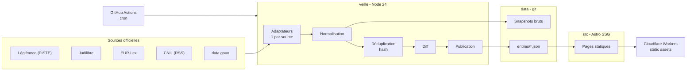

# INSTALL.md - Vitrine

## Vision

Un avocat en droit du numérique qui automatise la veille juridique, et le prouve par trois outils fonctionnels.

Vitrine est un portfolio technique destiné aux recruteurs et aux associés de cabinets (droit du numérique, IP-IT, data). Il ne cherche pas à concurrencer les plateformes de veille existantes : il démontre, par du logiciel qui fonctionne réellement, qu'un avocat peut concevoir et livrer l'automatisation de tâches juridiques récurrentes.

Le différenciateur est double : **la preuve** (un pipeline de veille qui tourne, un MCP sur sources officielles, un plugin de workflows déterministes) et **la traçabilité** (chaque changement de source est daté, hashé et versionné dans git).

## Decisions

| Decision | Choice | Why |
| --- | --- | --- |
| Architecture | Pipeline batch « static-first » | 10 lecteurs, 1 passe/jour : aucun serveur permanent à maintenir. Le cron produit des fichiers, le site les rend. |
| Front-end | Astro (SSG) + Tailwind CSS 4 | Contenu majoritairement statique et SEO minimal : le rendu à la demande est inutile. Zéro intégration framework pour réduire la surface de rupture. |
| Back-end | Scripts TypeScript sur Node 24 LTS, lancés par cron GitHub Actions | Un seul langage pour tout le projet (objectif d'apprentissage), type stripping natif donc aucun build step. Aucune API HTTP à exposer. |
| Database | SQLite local pour le MCP ; snapshots bruts + hash + JSON pour la veille | La veille tient dans git : historique, diff et piste d'audit. Le MCP a besoin d'une recherche vectorielle : `sqlite-vec` dans un seul fichier, sans service, et l'index reste un dérivé non commité. |
| Auth | Aucune | Site public en lecture seule, aucun compte utilisateur, aucune donnée personnelle. |
| Hosting | Cloudflare Workers (static assets) + GitHub Actions | 0 € strict : requêtes statiques gratuites ; en dépôt privé, GitHub Free inclut 12 $/mois de compute Actions (~2 000 min Linux), très au-delà d'une passe/jour. Workers remplace Pages (gelé) et évite le piège du déploiement non déclenché. |

## Stack summary

- **Runtime / langage :** Node 24 LTS, TypeScript exécuté par type stripping natif (pas de `tsx`, pas de bundler pour les scripts).
- **Front-end :** Astro 7 (version exacte épinglée à l'initialisation), Tailwind CSS 4 via `@tailwindcss/vite` (l'intégration `@astrojs/tailwind` est dépréciée), composants `.astro` et JS vanilla uniquement.
- **Recherche :** le MCP RGPD fait une recherche sémantique locale (`sqlite-vec` + Ollama) une fois l'index construit par `npm run corpus:index` ; le site n'en a pas encore, Pagefind reste prévu quand son corpus le justifiera.
- **Back-end :** scripts TypeScript dans `veille/`, un adaptateur par source, aucune dépendance de framework HTTP.
- **Base de données :** aucune pour la veille : `data/raw/` (snapshots adressés par contenu) et `data/entries/` (une entrée par `id`) sont la vérité versionnée. Pour le MCP : `data/corpus/rgpd/` est versionné et `data/corpus/index/index.db` (SQLite + `sqlite-vec`) est un dérivé ignoré par git.
- **Auth :** aucune.
- **Hébergement :** Cloudflare Workers static assets (`*.workers.dev`), déploiement par `wrangler` dans le même job que le cron.
- **CI :** GitHub Actions, cron à `:17` (les crons GitHub sont retardés au début de chaque heure), dépôt **privé** (visibilité modifiable), secrets `PISTE_CLIENT_ID` / `PISTE_CLIENT_SECRET`.
- **Intégrations :** Légifrance (API PISTE, OAuth2 `client_credentials`, tokens 3 600 s), Judilibre, EUR-Lex, CNIL (RSS/HTML), data.gouv.

### Mitigations retenues après audit

1. **Versions figées** (Astro, Tailwind) et Dependabot désactivé les 6 premiers mois : une montée de version est une décision, pas une surprise.
2. **SQLite seulement pour le MCP local** : `node:sqlite` + `sqlite-vec`, un fichier, aucun serveur ; l'index se met à jour par `npm run corpus:index` et n'est pas versionné. L'index est incrémental : une empreinte par unité ne réembarque que les ajouts et modifications, et un second passage sur un corpus inchangé embarque zéro unité. La veille garde JSON + hash.
3. **Pas de `tsx`** : type stripping natif de Node 24.
4. **Découplage contenu / framework** : la sortie est du HTML/JSON statique ; changer de générateur ne fait perdre aucune donnée.
5. **Déploiement dans le même workflow** : un push fait avec `GITHUB_TOKEN` ne déclenche aucun autre workflow.
6. **Domaine** : `*.workers.dev` en 0 € ; un domaine `.fr` (~12 €/an) reste la seule dépense envisageable, à décider plus tard.

## Architecture



Quatre frontières structurent le projet. `veille/sources/` est la seule zone fragile : chaque source est un adaptateur isolé dans son fichier, donc une API qui casse se répare à un seul endroit. `data/` est la vérité : le site ne lit jamais une API, il lit des fichiers commités, ce qui rend le site et le MCP reconstructibles indépendamment. `src/` est jetable par conception : si Astro devient pénible, les données survivent et le site se régénère autrement. `mcp/` est un produit distinct : il lit `data/corpus/`, réutilise seulement `writeRaw` de `veille/write.ts` pour le snapshot brut et le type `FetchLike` de `veille/fetch.ts`, et n'altère ni `veille/` ni `src/`.

## Folder structure

```text
vitrine/
├── .nvmrc                          # 24
├── package.json
├── package-lock.json
├── tsconfig.json
├── astro.config.mjs                # Astro statique + Tailwind
├── .gitignore
├── AGENTS.md
├── CONTRIBUTING.md
├── GUIDE-AIDD.md
│
├── src/                            # FRONT — Astro (SSG)
│   ├── pages/
│   │   ├── index.astro             # la vitrine
│   │   └── veille/
│   │       └── index.astro         # liste des entrées
│   ├── layouts/
│   │   └── Base.astro
│   ├── styles/
│   │   └── global.css              # Tailwind + jetons de thème
│   └── lib/
│       └── entries.ts              # lecture de data/ au build
│
├── veille/                         # BACK — pipeline (Node 24, TS natif, sans build)
│   ├── main.ts                     # une passe complète
│   ├── sources/
│   │   └── cnil.ts                 # adaptateur CNIL
│   ├── normalize.ts
│   ├── write.ts                    # snapshots + entrées, écriture atomique
│   └── types.ts
│
├── mcp/                            # MCP local — corpus RGPD et serveur stdio
│   ├── corpus/                     # CELLAR → data/corpus/rgpd/
│   ├── embed/                      # interface Embedder + adaptateur Ollama
│   ├── index/                      # sqlite-vec : construction et recherche
│   ├── tools.ts                    # get_article, search
│   ├── confidence.ts               # seuils de confiance
│   ├── server.ts                   # transport stdio
│   └── eval/                       # 50 questions, split dev/test et métriques
│
├── data/                           # "BASE" — git = historique
│   ├── raw/<2 hex>/<sha256>.xml    # snapshots bruts adressés par contenu
│   ├── corpus/
│   │   ├── rgpd/                   # manifeste + unites.jsonl, versionnés
│   │   └── index/                  # index.db dérivé, ignoré par git
│   └── entries/
│       ├── <yyyy>/<mm>/            # JSON normalisés, 1 fichier par entrée
│       └── unknown/                # entrées sans date
│
├── tests/
│   ├── fixtures/cnil/              # flux réel figé + flux réduit
│   ├── fixtures/eurlex/            # capture intégrale du RGPD
│   ├── cnil.test.ts
│   ├── write.test.ts
│   ├── entries.test.ts
│   ├── corpus.test.ts
│   ├── index.test.ts
│   ├── mcp.test.ts
│   └── eval.test.ts
│
└── aidd_docs/
    ├── INSTALL.md                  # ce document
    ├── README.md
    ├── GUIDELINES.md
    ├── memory/
    └── tasks/
```

À venir, hors de la tranche actuelle : `.github/workflows/veille.yml` (cron), `wrangler.toml` (Cloudflare), les autres sources, la recherche.

## Install steps

- [ ] **1. Initialiser le dépôt** : `git init`, branche par défaut `main`, dépôt **privé** sur GitHub (passage en public possible plus tard), `CONTRIBUTING.md` (via `@00-repo-init`).
- [ ] **2. Installer Node 24 LTS** et figer la version dans `.nvmrc` ; activer `engines` dans `package.json`.
- [ ] **3. Créer le site Astro** en TypeScript strict, puis installer Tailwind 4 via `@tailwindcss/vite` et **épingler les versions exactes** (pas de `^`).
- [ ] **4. Installer Ollama** et tirer le modèle d'embedding : `ollama serve`, `ollama pull qwen3-embedding:0.6b` ; vérifier avec `npm run mcp:smoke`.
- [ ] **5. Créer le compte Cloudflare**, activer Workers static assets, installer `wrangler` et vérifier un premier déploiement manuel de `dist/`.
- [ ] **6. Ouvrir les accès aux sources** : inscription PISTE (Légifrance), accès Judilibre, EUR-Lex ; enregistrer les identifiants en **secrets GitHub Actions**.
- [ ] **7. Écrire le premier adaptateur** (`veille/sources/cnil.ts`, le plus simple) avec sa fixture et son test, puis brancher `veille.yml` (cron `:17`, déploiement dans le même job).
- [ ] **8. Vérifier la chaîne complète** : une passe locale, une passe planifiée, un commit automatique, un déploiement, et une alerte en cas d'échec.

## Audit summary

| Candidate | Verdict | Notes |
| --- | --- | --- |
| **A. Go + statique** | ⚠️ | Surface de dépendances ≈ zéro (stdlib) et 0 € réaliste, mais aucun client Go maintenu pour PISTE (OAuth à écrire) et pièges Astro/Tailwind/GITHUB_TOKEN. |
| **B. TypeScript + statique** | ⚠️ | Retenu après mitigations : versions figées, SQLite limité au MCP local, Node 24 natif, déploiement dans le même workflow. Risque résiduel : churn Astro (~6 mois). |
| **C. Go + petit serveur** | ❌ | 0 € factuellement impossible : Fly.io sans free tier, Render free à disque éphémère, cron payant. Coût réel 7-10 €/mois et 5-10 h d'ops/mois. |
