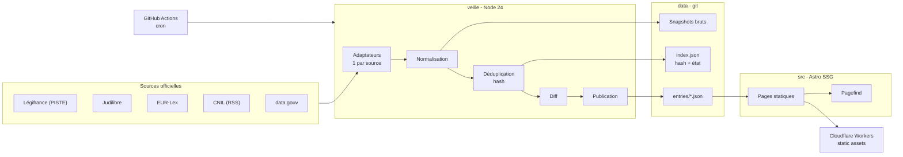

# INSTALL.md - Vitrine

## Vision

Un avocat en droit du numérique qui automatise la veille juridique, et le prouve par trois outils fonctionnels.

Vitrine est un portfolio technique destiné aux recruteurs et aux associés de cabinets (droit du numérique, IP-IT, data). Il ne cherche pas à concurrencer les plateformes de veille existantes : il démontre, par du logiciel qui fonctionne réellement, qu'un avocat peut concevoir et livrer l'automatisation de tâches juridiques récurrentes.

Le différenciateur est double : **la preuve** (un pipeline de veille qui tourne, un MCP sur sources officielles, un plugin de workflows déterministes) et **la traçabilité** (chaque changement de source est daté, hashé et versionné dans git).

## Decisions

| Decision | Choice | Why |
| --- | --- | --- |
| Architecture | Pipeline batch « static-first » | 10 lecteurs, 1 passe/jour : aucun serveur permanent à maintenir. Le cron produit des fichiers, le site les rend. |
| Front-end | Astro (SSG) + Tailwind CSS 4 | Contenu majoritairement statique et SEO minimal : le rendu à la demande est inutile. Zéro intégration framework pour réduire la surface de rupture. |
| Back-end | Scripts TypeScript sur Node 24 LTS, lancés par cron GitHub Actions | Un seul langage pour tout le projet (objectif d'apprentissage), type stripping natif donc aucun build step. Aucune API HTTP à exposer. |
| Database | Aucune : snapshots bruts + hash + JSON commités | À ce volume, une base est du sur-engineering. Git fournit l'historique, le diff et la piste d'audit ; l'index est reconstruit au build. |
| Auth | Aucune | Site public en lecture seule, aucun compte utilisateur, aucune donnée personnelle. |
| Hosting | Cloudflare Workers (static assets) + GitHub Actions | 0 € strict : requêtes statiques gratuites ; en dépôt privé, GitHub Free inclut 12 $/mois de compute Actions (~2 000 min Linux), très au-delà d'une passe/jour. Workers remplace Pages (gelé) et évite le piège du déploiement non déclenché. |

## Stack summary

- **Runtime / langage :** Node 24 LTS, TypeScript exécuté par type stripping natif (pas de `tsx`, pas de bundler pour les scripts).
- **Front-end :** Astro 7 (version exacte épinglée à l'initialisation), Tailwind CSS 4 via `@tailwindcss/vite` (l'intégration `@astrojs/tailwind` est dépréciée), composants `.astro` et JS vanilla uniquement.
- **Recherche :** Pagefind, généré après le build (aucun service de recherche à héberger).
- **Back-end :** scripts TypeScript dans `veille/`, un adaptateur par source, aucune dépendance de framework HTTP.
- **Base de données :** aucune. `data/index.json` porte l'état et les hashes ; `data/raw/` et `data/entries/` sont la vérité versionnée.
- **Auth :** aucune.
- **Hébergement :** Cloudflare Workers static assets (`*.workers.dev`), déploiement par `wrangler` dans le même job que le cron.
- **CI :** GitHub Actions, cron à `:17` (les crons GitHub sont retardés au début de chaque heure), dépôt **privé** (visibilité modifiable), secrets `PISTE_CLIENT_ID` / `PISTE_CLIENT_SECRET`.
- **Intégrations :** Légifrance (API PISTE, OAuth2 `client_credentials`, tokens 3 600 s), Judilibre, EUR-Lex, CNIL (RSS/HTML), data.gouv.

### Mitigations retenues après audit

1. **Versions figées** (Astro, Tailwind) et Dependabot désactivé les 6 premiers mois : une montée de version est une décision, pas une surprise.
2. **Pas de SQLite** : les composants Node les plus instables sont écartés ; JSON + hash suffisent.
3. **Pas de `tsx`** : type stripping natif de Node 24.
4. **Découplage contenu / framework** : la sortie est du HTML/JSON statique ; changer de générateur ne fait perdre aucune donnée.
5. **Déploiement dans le même workflow** : un push fait avec `GITHUB_TOKEN` ne déclenche aucun autre workflow.
6. **Domaine** : `*.workers.dev` en 0 € ; un domaine `.fr` (~12 €/an) reste la seule dépense envisageable, à décider plus tard.

## Architecture



Trois frontières structurent le projet. `veille/sources/` est la seule zone fragile : chaque source est un adaptateur isolé derrière une interface commune, donc une API qui casse se répare dans un seul fichier. `data/` est la vérité : le site ne lit jamais une API, il lit des fichiers commités, ce qui rend le site et le MCP reconstructibles indépendamment. `src/` est jetable par conception : si Astro devient pénible, les données survivent et le site se régénère autrement.

## Folder structure

```text
vitrine/
├── .github/
│   └── workflows/
│       └── veille.yml              # cron :17 → node veille/main.ts → commit → deploy
├── .nvmrc                          # 24
├── package.json
├── tsconfig.json
├── astro.config.mjs
├── wrangler.toml                   # Workers static assets → dist/
├── .gitignore
├── README.md
├── GUIDE-AIDD.md
│
├── src/                            # FRONT — Astro (SSG)
│   ├── pages/
│   │   ├── index.astro
│   │   ├── veille/
│   │   │   ├── index.astro         # liste des entrées
│   │   │   └── [slug].astro        # une entrée = une page
│   │   └── demos/                  # MCP, plugin (plus tard)
│   ├── layouts/
│   ├── components/
│   │   └── ui/                     # design system (boutons, cartes, tags)
│   ├── styles/
│   │   ├── tokens.css              # couleurs, typo, espacements
│   │   └── global.css
│   ├── content/                    # pages éditoriales en Markdown
│   └── lib/                        # lecture de data/ au build
│
├── veille/                         # BACK — pipeline (Node 24, TS natif, sans build)
│   ├── main.ts                     # une passe complète
│   ├── sources/
│   │   ├── source.ts               # interface commune aux adaptateurs
│   │   ├── legifrance.ts
│   │   ├── judilibre.ts
│   │   ├── eurlex.ts
│   │   ├── cnil-rss.ts
│   │   └── data-gouv.ts
│   ├── normalize.ts
│   ├── dedupe.ts
│   ├── diff.ts
│   ├── publish.ts
│   └── types.ts
│
├── data/                           # "BASE" — git = historique
│   ├── raw/<yyyy>/<mm>/            # snapshots bruts + hash
│   ├── entries/<yyyy>/<mm>/        # JSON normalisés, 1 fichier par entrée
│   └── index.json                  # état + hashes
│
├── tests/
│   ├── fixtures/<source>/          # réponses API figées
│   └── <source>.test.ts
│
├── public/
│
└── aidd_docs/
    ├── INSTALL.md                  # ce document
    ├── memory/                     # mémoire projet
    └── tasks/                      # plans et phases
```

## Install steps

- [ ] **1. Initialiser le dépôt** : `git init`, branche par défaut `main`, dépôt **privé** sur GitHub (passage en public possible plus tard), `CONTRIBUTING.md` (via `@00-repo-init`).
- [ ] **2. Installer Node 24 LTS** et figer la version dans `.nvmrc` ; activer `engines` dans `package.json`.
- [ ] **3. Créer le site Astro** en TypeScript strict, puis installer Tailwind 4 via `@tailwindcss/vite` et **épingler les versions exactes** (pas de `^`).
- [ ] **4. Créer le compte Cloudflare**, activer Workers static assets, installer `wrangler` et vérifier un premier déploiement manuel de `dist/`.
- [ ] **5. Ouvrir les accès aux sources** : inscription PISTE (Légifrance), accès Judilibre, EUR-Lex ; enregistrer les identifiants en **secrets GitHub Actions**.
- [ ] **6. Écrire le premier adaptateur** (`veille/sources/cnil-rss.ts`, le plus simple) avec sa fixture et son test, puis brancher `veille.yml` (cron `:17`, déploiement dans le même job).
- [ ] **7. Vérifier la chaîne complète** : une passe locale, une passe planifiée, un commit automatique, un déploiement, et une alerte en cas d'échec.

## Audit summary

| Candidate | Verdict | Notes |
| --- | --- | --- |
| **A. Go + statique** | ⚠️ | Surface de dépendances ≈ zéro (stdlib) et 0 € réaliste, mais aucun client Go maintenu pour PISTE (OAuth à écrire) et pièges Astro/Tailwind/GITHUB_TOKEN. |
| **B. TypeScript + statique** | ⚠️ | Retenu après mitigations : versions figées, SQLite supprimé, Node 24 natif, déploiement dans le même workflow. Risque résiduel : churn Astro (~6 mois). |
| **C. Go + petit serveur** | ❌ | 0 € factuellement impossible : Fly.io sans free tier, Render free à disque éphémère, cron payant. Coût réel 7-10 €/mois et 5-10 h d'ops/mois. |
