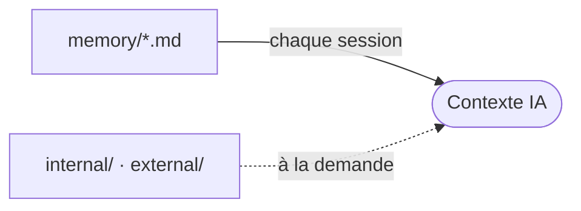

# memory/ - Mémoire projet

Contexte structuré que l'assistant IA lit au début d'une session, pour ne pas redécouvrir le projet à chaque fois.

## Comment ça se charge

Les fichiers à la racine se chargent à chaque session via le bloc de mémoire projet de chaque fichier de contexte IA. `internal/` et `external/` ne se chargent que lorsqu'ils sont pertinents.

## Fichiers

Rafraîchi automatiquement par le hook mémoire. Ne pas éditer à la main.

<!-- files:start -->
- [architecture.md](architecture.md)
- [coding-assertions.md](coding-assertions.md)
- [ecosystem.md](ecosystem.md)
- [project-brief.md](project-brief.md)
- [vcs.md](vcs.md)
<!-- files:end -->

## Maintenance

L'IA écrit et rafraîchit ces fichiers. Pour une édition manuelle :

- Un fichier par préoccupation (architecture, base, vcs, etc.).
- Capturer le macro et le non-dérivable. Pointer vers le code, jamais le recopier.
- État courant uniquement, court. Pas de notes personnelles, pas de TODO.

## Sous-dossiers

- `internal/` : traces du workflow AIDD (profil de capacités, notes d'audit, captures de learn).
- `external/` : références externes importées par le projet (specs, documents de design).
