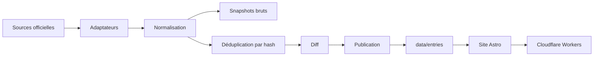

# Architecture

La forme technique macro : la stack, comment les pièces s'articulent, et les décisions derrière. Pointer vers le code, ne pas le recopier.

## Stack

- TypeScript sur Node 24, exécuté par type stripping natif : aucun build step pour le pipeline.
- Astro en rendu statique, Tailwind pour le style. Aucune intégration de framework front ; la recherche viendra plus tard.
- Aucune base de données, aucun serveur permanent : un cron produit des fichiers, le site les rend.

## How it fits together

## Key decisions

- Static-first : un cron GitHub Actions exécutera une passe par jour (workflow encore à créer) ; rien ne tourne en continu.
- Git est la base : snapshots bruts + hash + JSON commités ; l'index se reconstruit au build.
- `src/` est jetable : les données survivent à un changement de générateur.
- Un adaptateur par source, isolé dans `veille/sources/`.
- Le site ne lit aucune API au runtime : il lit `data/`.

## Gotchas

- Un push fait avec `GITHUB_TOKEN` ne déclenche aucun autre workflow : déployer dans le même job.
- Les crons GitHub sont retardés au début de chaque heure : planifier à `:17`.
- Les workflows planifiés se désactivent après 60 jours sans activité du dépôt.
- Les quotas PISTE ne sont pas publics et l'API n'offre qu'une cible de disponibilité de 95 %/jour.
