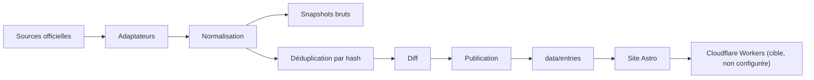

# Architecture

La forme technique macro : la stack, comment les pièces s'articulent, et les décisions derrière. Pointer vers le code, ne pas le recopier.

## Stack

- TypeScript sur Node 24, exécuté par type stripping natif : aucun build step pour le pipeline.
- Astro en rendu statique, Tailwind pour le style. Aucune intégration de framework front ; la recherche viendra plus tard.
- Aucune base de données, aucun serveur permanent : une passe hebdomadaire manuelle produit des fichiers, le site les rend.

## How it fits together

## Key decisions

- Static-first : la passe est manuelle et hebdomadaire ; aucun cron n'est configuré ; le site n'est pas déployé, voir `deployment.md`.
- Git est la base : snapshots bruts + hash + JSON commités ; l'index se reconstruit au build.
- `src/` est jetable : les données survivent à un changement de générateur.
- Un adaptateur par source, isolé dans `veille/sources/` : CNIL, CJUE, ANSSI, CEPD, ARCEP, Commission, Commission DMA, ARCOM, Conseil d'État (CETAT) et Cour de cassation (Judilibre) — dix adaptateurs pour neuf autorités.
- Le site ne lit aucune API au runtime : il lit `data/`.
- Une panne de source n'emporte pas les autres : les écritures réussies restent, la passe échoue avec un message nommant la source.
- Le catalogue `veille/themes.json` est la seule configuration de sélection ; cinq matières actives, lues par le pipeline et le site. Le rattachement est stocké sur chaque entrée ; le site filtre au build, aucune purge.
- `Entry.references` porte les instruments et articles cités : titre officiel pour les arrêts CJUE, section « Textes de référence » de la page liée pour les actualités CNIL, résumé officiel pour le Conseil d'État et visa de la décision pour la Cour de cassation.
- Une source API peut enrichir ses entrées retenues après le rattachement (`ApiResult.enrich`) : la Cour de cassation y lit le visa de la décision, un appel par décision, et n'expose que les instruments des matières de l'entrée. Une entrée déjà écrite n'est pas rappelée ; une erreur ou un budget épuisé diffère l'entrée, relue à la passe suivante ; `[]` ne signifie qu'un visa vide.
- `Entry.themes` porte les matières calculées à l'ingestion : instruments cités d'abord, termes de repli ensuite, défauts de source pour CNIL, CEPD, ANSSI et Commission DMA ; les sources API ne pré-remplissent pas la matière, sauf Judilibre qui conserve la matière de sa requête comme indice pour ne pas perdre une décision que seul son visa rattache.
- Les sources PISTE (Conseil d'État, Cour de cassation) utilisent un jeton OAuth ou un `KeyId`, un plafond de 16 appels par passe et un journal dans `data/usage/`.
- Une page CNIL en échec laisse l'entrée publiée avec `references: []` et un avertissement ; les pages dont les références sont retenues sont conservées en snapshot HTML.
- Une source à flux peut enrichir chaque entrée par sa page (`Source.page`) : l'ARCOM y filtre le DSA et y prend son résumé, la Commission y prend la version française officielle ; une page en panne écarte l'entrée et avertit, sauf si la source déclare la page facultative.
- Les secrets PISTE restent dans `.env` ; `.gitignore`, le hook pre-commit et la CI refusent leur versionnement.

## Gotchas

- Les quotas PISTE ne sont pas publics et l'API n'offre qu'une cible de disponibilité de 95 %/jour.
- Aucun workflow planifié n'existe : une passe oubliée laisse les données en l'état.
