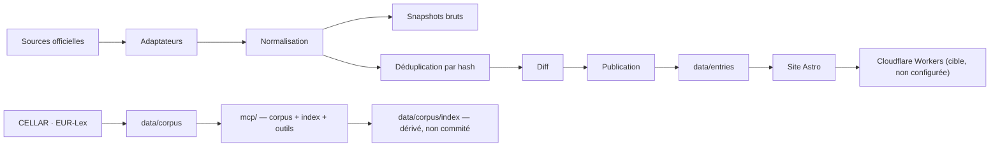

# Architecture

La forme technique macro : la stack, comment les pièces s'articulent, et les décisions derrière. Pointer vers le code, ne pas le recopier.

## Stack

- TypeScript sur Node 24, exécuté par type stripping natif : aucun build step pour le pipeline.
- Astro en rendu statique, Tailwind pour le style. Aucune intégration de framework front ; la recherche viendra plus tard.
- Aucune base de données pour le site ni le pipeline, aucun serveur permanent : une passe hebdomadaire manuelle produit des fichiers, le site les rend. Le MCP local ajoute SQLite + `sqlite-vec` + FTS5 dans `data/corpus/index/`, un dérivé non commité.

## How it fits together

## Key decisions

- Static-first : la passe est manuelle et hebdomadaire ; le corpus a un agent `launchd` optionnel, jamais chargé par la commande ; le site n'est pas déployé, voir `deployment.md`.
- `mcp/` est une quatrième zone, distincte du pipeline et du site : corpus, index, outils, transport stdio. `veille/` et `src/` sont inchangés ; seuls `writeRaw` de `veille/write.ts` et le type `FetchLike` de `veille/fetch.ts` sont réutilisés. Dix-neuf corpus, tous indexés dans le même espace `leoipulsar/harrier-0.6b` : `rgpd` et `aiact` (un acte chacun, CELLAR), `cnil` (3 245 délibérations de trois natures, DINUM + DILA), `cnil_doctrine` (56 guides et référentiels de cnil.fr, 4 459 extraits non modifiés sous CC BY-ND 4.0), `lil` (loi consolidée par PISTE), `textes_fr` (décret 2019-536, Code pénal 226-16 à 226-24, CPCE L34-5, PISTE), `ce` (1 594 décisions du Conseil d'État, toutes dates, archive JADE), `constit` (108 décisions DC et QPC sur les données personnelles, archive CONSTIT de la DILA), `cepd` (lignes directrices, avis art. 64, décisions contraignantes art. 65, recommandations et documents G29 repris, sitemap et PDF), `cc` (403 décisions de la Cour de cassation, toutes dates, Judilibre) et `cjue` (251 décisions depuis 1999, CELLAR SPARQL — matière PDON et notions 4.11.01 et 2.04, complétées par la fiche thématique Curia — et XHTML français puis anglais, repli HTML patrimonial), `eprivacy`, `police`, `eudpr`, `rgpdproc`, `ccs` (décision 2021/914, annexe découpée en clauses), `adequation` (22 décisions d'adéquation, en vigueur et abrogées, une unité par article), et `metadonnees` (1 597 notices du registre des décisions définitives du guichet unique, CEPD). article) et `preparation` (8 propositions et 120 affaires CJUE pendantes au 14 novembre 2026, CELLAR SPARQL et communications du Journal officiel). Chaque manifeste porte un bloc `couverture` émis par sa synchronisation ; le tableau de synthèse vit dans `aidd_docs/tasks/2026_11/2026_11_11_corpus-cassation-cjue/coverage.md`.
- `npm run corpus:build` lit tous les descripteurs `mcp/corpus/*.json` et écrit `data/corpus/<corpus>/` (RGPD, AI Act, ePrivacy, 2016/680, 2018/1725, règlement procédural RGPD, clauses types 2021/914) ; un descripteur à `version` consolidée (`0…`) passe par `parseConsolide`, `ccs` par `parseCcs` (corps par `parseCellar`, annexe par ses titres de clause), les autres par `parseCellar` ; `--document <corpus>` n'en construit qu'un. Une consolidation sans préambule garde les considérants de l'acte d'origine (manifeste : `considerants_source`, `snapshot_considerants`) et prend les articles de la consolidation ; `corpus:sync` n'ajuste `articles_attendus` qu'à la hausse, un rendu tronqué étant refusé et l'entrée laissée `perime`. `npm run adequation:build` construit à part `data/corpus/adequation/` depuis `mcp/corpus/adequation/descripteur.json` : XHTML CELLAR, repli HTML pour les actes anciens, une unité par article, manifeste qui porte `liste_reference` et `consulte_le` ; les décisions invalidées y gardent `statut: ABROGE` et leur motif. `npm run preparation:sync` construit à part `data/corpus/preparation/` : dossiers `PROP_PENDING` de la matière `PDON` ou modifiant un acte du corpus (une proposition par dossier, dernière étape datée ≤ jour de passe), affaires `CN`/`TN` Eurovoc 5181 ou 5595 depuis 2019 sans décision `CJ`/`CO`/`TJ`/`TO` de même juridiction, année et numéro (communications lues en XHTML sous `data/raw/preparation/`, non commité) ; manifeste : requêtes SPARQL, comptes, exclusions motivées, licence et affaires présumées au-delà de trois ans. `npm run cnil:sync` construit `data/corpus/cnil/` depuis deux sources : l'historique DINUM (parquet public, lu colonne par colonne, jamais la colonne d'embeddings `bge-m3`) et les incréments DILA (`TEXTE_CNIL`, découpage local)`npm run cnil-doctrine:sync` lit les pages de référence de cnil.fr (guides, guides AIPD, référentiels, listes AIPD), télécharge les PDF sous `data/raw/cnil-doctrine/` (cache par `sha256`), écarte une mention contraire et écrit `data/corpus/cnil_doctrine/` ; une délibération déjà au corpus `cnil` n'est pas dupliquée, le manifeste la porte dans `couverts_par_cnil`. `npm run lil:sync` lit la version consolidée par PISTE (`/consult/legiPart`). `npm run ce:sync` lit l'archive JADE de la DILA, fonds `publie` et `inedit`, et filtre juridiction et mots-clés, sans borne de date. `npm run constit:sync` lit l'archive CONSTIT de la DILA, ne retient que les natures DC et QPC et filtre par mots-clés ou par « vie privée » associée à une expression de traitement de données ; le filtre lit le texte publié, les unités viennent du `BLOC_TEXTUEL` seul. `npm run cepd:sync` lit le sitemap du CEPD, les pages `_fr` (à défaut `_en`) et leurs PDF, reconnaît les quatre rubriques du site et reclasse les documents G29 repris. `npm run cc:sync` interroge Judilibre, lit chaque décision par `/decision`, la met en cache et reprend au budget près. `npm run cjue:sync` liste les décisions par SPARQL CELLAR et lit leur XHTML en français, puis en anglais quand le français n'est pas servi, et leur HTML patrimonial quand aucun XHTML ne l'est. `npm run cjue:controle` télécharge la fiche thématique Curia « Protection des données à caractère personnel », en garde le PDF sous `data/raw/`, convertit ses numéros d'affaires en CELEX d'arrêt, compare au corpus et écrit `data/corpus/cjue/controle-curia.json` — URL, date de consultation, présents, ajoutés, absents avec raison ; un arrêt absent sans motif durable entre par `celex_complementaires` du descripteur et une synchronisation est relancée, et la commande sort en erreur s'il reste un manquant sans raison. `npm run corpus:index` construit `data/corpus/index/index.db`, jamais commité. `npm run corpus:sync` rafraîchit le corpus depuis la veille : il lit les entrées de `data/entries/` au plus tôt entre `a_jour_au` du rapport précédent et 7 jours avant la passe (une tentative échouée reprend sa fenêtre) et fait correspondre celles qui visent un document — `CNILTEXT…` par l'URL canonique du snapshot HTML de `data/raw/` puis ses liens Légifrance, `CETATEXT…`, identifiant Judilibre, CELEX de l'URL, `document` d'une entrée `legi` et slug d'une entrée `cnil_doctrine` —, ne lance que les sources concernées (`cnil`, `ce`, `cc`, `cjue`, et `lil`, `textes_fr` ou `cnil_doctrine` sur une entrée de veille), réindexe par delta et écrit le rapport `data/corpus/sync.json` (`a_jour_au`, fenêtre, comptes, sort par document, inventaire, sources, index). Un document déjà présent ne relance rien ; une entrée `legi`, `eurlex` ou `cnil_doctrine` dont la `version` manque au corpus rend le document `perime`, ce qui relance sa synchronisation sans le confondre avec un document absent ; un document manquant n'est pas un échec et reste listé tant qu'il est absent ; une source ou l'index en panne n'avance pas `a_jour_au` et l'index est réessayé à la passe suivante. `etat_corpus` lit ce rapport sans réseau ni index, `--planifier` écrit un agent `launchd` de trois jours sans le charger. `a_jour_au` ne couvre que `cnil`, `ce`, `cc` et `cjue`, revérifiés à chaque passe : `cnil_doctrine`, `lil`, `textes_fr` et les actes de l'Union n'attendent que le signal de la veille (`cnil_doctrine`, `legi`, `eurlex`). Une panne de `lil` ou `textes_fr` retient encore la fraîcheur ; une construction d'acte en panne garde sa ligne `perime`, est rejouée à la passe suivante et ne fige pas la fenêtre des autres corpus. Les corpus d'actes (`rgpd`, `aiact`, `eprivacy`, `police`, `eudpr`, `rgpdproc`, `ccs`) ne sont reconstruits que sur une consolidation signalée, avec mise à jour du descripteur (`version`, `date_consolidation`) puis `corpus:build` limité à ce corpus ; `adequation` l'est sur une nouvelle décision signalée, ajoutée au descripteur-liste avec pays, date, URL et statut, une décision abrogée passant en `ABROGE` avec son motif. Le descripteur est rétabli si la construction échoue. `cepd` reste statique. `npm run mcp` ouvre le serveur sur stdio.
- `veille/sources/preparation.ts` est la veille des changements de statut (#57). Elle relit par CELLAR SPARQL, avec les requêtes de `mcp/corpus/preparation/liste.ts` réutilisées en import, le statut des documents suivis — les unités `unites.jsonl` du corpus `preparation` : dossier `PROP_PENDING` adopté (acte `3…` membre du dossier), retiré ou rejeté, affaire `CN`/`TN` fermée par une décision `CJ`/`CO`/`TJ`/`TO` de même numéro, affaires jointes comprises. Une entrée par changement porte l'ancien et le nouveau statut, l'acte adopté ou le CELEX de la décision, la date de l'acte et celle de la détection ; `corpus_vise` nomme le corpus de textes que l'acte adopté modifie (la consolidation viendra par la voie existante `eurlex` → `actes-ue.ts` → `corpus:build`), absent il est hors corpus et n'en crée aucun. `corpus:sync` relance `preparation:sync` sur le document périmé, puis `cjue:sync` tant qu'un arrêt suivi reste à verser — le filtre CJUE d'abord, sinon les `celex_complementaires` du descripteur par `mcp/corpus/cjue/veille.ts` ; un arrêt durablement écarté n'est pas redemandé — et le corpus visé, dont la source dit l'attente de consolidation (aucune version consolidée à appliquer) jusqu'à ce que `eurlex` publie la consolidation. Le drapeau `--source <id>` limite `npm run veille` à une source.
- `npm run veille:textes-fr` est la passe séparée qui alimente ces entrées `legi` : son propre processus, donc son propre compteur PISTE, et **cinq appels au plus** (un jeton, puis la loi 78-17 par `legiPart`, le décret 2019-536 par une recherche `LODA_DATE` sur son numéro, le Code pénal par `/consult/code` sur sa section, le CPCE par `/consult/getArticleWithIdAndNum`). Elle ne compare pas les textes mais les identifiants de version lus dans `data/corpus/lil/` et `data/corpus/textes_fr/` : `LEGIARTI…` en vigueur par article, `LEGITEXT…_JJ-MM-AAAA` pour le décret. Une différence devient une entrée `legi` (titre lisible, URL Légifrance, `document` du texte et `version`) ; aucune différence n'écrit rien. Chaque réponse est conservée sous `data/raw/` adressée par son hash. Une synchronisation qui remplace une version garde l'ancienne dans le manifeste (`versions_remplacees` : identifiant, date de début, date de fin) : la lecture par date vit dans `mcp/corpus/lil/historique.ts` (#46). La passe réutilise les parseurs `mcp/corpus/lil/parse.ts` et `mcp/corpus/textes-fr/parse.ts` : elle lit les mêmes numéros, les mêmes états et les mêmes dates que la synchronisation.
- `corpus` est un champ de premier ordre, distinct de `document` : `document` reste l'acte ou la décision (CELEX, `CNILTEXT…`, `LEGIARTI…`, `CETATEXT…`, slug CEPD), `corpus` la collection (`rgpd`, `aiact`, `cnil`, `lil`, `ce`, `cepd`, `cc`, `cjue`). Unité, table SQLite, `ResultatRecherche`, `SearchOptions`, `SearchDemande` et `search` portent les deux ; `search` filtre par `corpus` et garde `document` pour les références exactes. **Les filtres `corpus`, `document`, `date_min`, `date_max`, `type_sanction`, `montant_min`, `montant_max`, `numero` et `nature` descendent dans la requête `vec0`** et la voie FTS5 filtre par corpus : filtrer après le KNN global ferait remplir la fenêtre de 50 candidats par le corpus majoritaire (29 299 fragments CNIL contre 272 RGPD) et affamerait les autres. `vec_unites` porte donc les colonnes `corpus`, `document`, `nature`, `date_num`, `type_sanction`, `montant`, `numero` et `injonction` ; un index d'avant ces colonnes est migré en recopiant les vecteurs existants, sans ré-embarquer, et un index qui les ignore est refusé avec un message qui nomme `npm run corpus:index`. Les métadonnées CNIL sont lues dans le dispositif par `mcp/corpus/cnil/meta.ts` : type de sanction, montant de la sanction pécuniaire (amende ou liquidation), injonction ; les astreintes quotidiennes ne sont pas des amendes. `nature` filtre les trois natures CNIL et ne s'applique qu'aux unités CNIL.
- Le corpus CNIL a deux origines de fragments, déclarées par unité et dans le manifeste : `dinum` (l'historique publié, dont le `chunk_index` reste la base de citation) et `dila` (incréments, découpage local de 600 à 1 200 caractères dit dans le `chemin`). `etat.json` porte la dernière archive lue et son empreinte ; il n'avance qu'après validation complète. Un document déjà présent n'est remplacé que si l'archive DILA est plus récente que sa date au corpus : une archive plus ancienne ne dégrade pas la numérotation publiée.
- `get_decision` est séparé de `get_article` : il rend une délibération par identifiant ou par numéro, et dit l'absence. **La partie opératoire est le défaut** (`partie: "dispositif"`, 1 705 tokens estimés au pire sur les 249 décisions) ; `partie: "tous"` rend le document entier, jusqu'à 56 032, que les clients tronquent. Les fragments rendus sont entiers — le premier peut commencer avant le « PAR CES MOTIFS » — et la réponse porte `fragments_total`. La borne vient de `debutDispositif` (`mcp/corpus/cnil/meta.ts`), partagée avec l'extraction des métadonnées : dernier « PAR CES MOTIFS », sinon dernière conclusion, sinon dernière formule de sanction, sinon les 2 500 derniers caractères ; les décisions d'avant 2010 sans marqueur peuvent donc commencer dans les motifs, la charge restant faible. Un numéro porté par deux documents rend les deux avec leur identifiant.
- Une décision porte les textes qu'elle cite : `search` recopie sur chaque passage et `get_decision` sur chaque décision une liste `citations` (instrument, `document`, articles, `reference`, `url`, `hors_corpus`), extraite à la lecture par `mcp/corpus/citations.ts` depuis `data/corpus/<corpus>/unites.jsonl`. **L'extraction est au niveau du document, jamais du fragment seul** : un passage rendu garde la base juridique reconnue de sa décision. Le périmètre est fermé — RGPD, 95/46, ePrivacy, 2016/680, 2018/1725, loi 78-17, CPCE et code pénal à partir de 226-16 — et la règle est stricte : l'instrument doit suivre immédiatement le connecteur (`du`, `de la`, `de l'`, `des`, `of`) ou précéder sa liste dans la même proposition ou le même en-tête ; un visa qui ne fait qu'appliquer une loi (« le décret … pris pour l'application de la loi du 6 janvier 1978 ») n'attribue rien, et une anaphore (`du même règlement`) ne se résout que si un seul instrument de cette nature est nommé. Le cache ne garde que les citations par document, jamais le texte, et suit la date du fichier : aucun stockage, aucun changement d'index ni de `data/`, #29 pourra persister une table à partir de la même fonction. Aucun seuil publié ; la précision relevée sur 25 documents relus est dans `aidd_docs/tasks/2026_11/2026_11_13_citations-decisions/mesure.md`.
- `metadonnees` est un corpus de notices, pas de textes : chaque unité ne porte qu'une ligne de métadonnées (intitulé, autorité, date, identifiant, lien officiel) et le champ `metadonnees_seulement`. `mcp/corpus/metadonnees/` lit deux sources — HUDOC pour la CEDH (critère article 8 **et** mots-clés de données personnelles, collections `JUDGMENTS` et `DECISIONS`, versions française et anglaise fusionnées en une décision par requête et par date) et le registre des décisions définitives du guichet unique du CEPD (une entrée par décision) — et `npm run metadonnees:sync` écrit `data/corpus/metadonnees/` après validation. **La source CEDH est arrêtée** : l'interface JSON de HUDOC répond 403 au client du projet alors que les mêmes URL répondent à curl au même moment ; le motif et sa preuve sont au manifeste (`couverture.perimetre.cedh_abandonnee`), le critère et sa lecture restent testés hors ligne, aucun contournement n'est tenté. Le registre n'a pas d'ordre stable entre deux pages et sert parfois la même décision sous deux noms de fichier : le numéro de décision du PDF tranche, et les limites sont dites (`limites`). Au rendu, `mcp/corpus/metadonnees/mention.ts` ajoute à chaque passage `metadonnees_seulement` et `avertissement_contenu` — « métadonnées seulement — contenu non connu du serveur, consulter la source » —, calculés à la lecture : aucun réindex.

- Le statut d'application est une lecture, pas une donnée : `mcp/corpus/statut.ts` traduit `(corpus, statut, nature?)` en un vocabulaire uniforme — `en_vigueur`, `abroge`, `propose`, `pendant`, `rendue`, `adoptee`, `inconnu` — que `mcp/tools.ts` ajoute au rendu sous `statut_application`, sur les passages de `search`, l'article de `get_article` et chaque décision de `get_decision`. **Le statut source n'est jamais réécrit** : statut de publication, type d'acte et statut Légifrance restent lisibles dans `statut`. Les textes (`rgpd`, `aiact`, `eprivacy`, `police`, `eudpr`, `rgpdproc`, `ccs`, `adequation`, `lil`, `textes_fr`) suivent leur statut source (`EN_VIGUEUR` et `VIGUEUR` → `en_vigueur`, `ABROGE` → `abroge`, `PROJET`/`PROPOSE`/`PROPOSITION` → `propose`, `PENDANT` → `pendant`) ; `preparation` ne reconnaît que `PROPOSE` (→ `propose`) et `PENDANT` (→ `pendant`) ; les décisions juridictionnelles (`ce`, `constit`, `cc`, `cjue`) sont toujours `rendue` ; pour `metadonnees`, la nature tranche sans lire de texte — `juridiction` rend `rendue`, `autorite` rend `adoptee`. Pour la CNIL et le CEPD, un statut sans effet (`ABROGE`, `ANNULE`) prime sur la nature — une recommandation abrogée rend `abroge` — et un statut `MODIFIE` rend `inconnu` puisque la version rendue n'est pas celle en vigueur ; ensuite la nature CNIL départage sanction (`rendue`) et doctrine (`adoptee`), et un document CEPD adopté (`finale`, `adoptée`, `adopted`, `endorsed`) est `adoptee` tandis qu'un projet ou une consultation reste `propose`, et la doctrine publiée de `cnil_doctrine` (statut `Publié`) est `adoptee`. Toute autre entrée rend `inconnu`, jamais `en_vigueur` : le serveur n'affirme pas l'applicabilité qu'il n'a pas vérifiée ; le champ dit la force du document, pas l'applicabilité article par article — le corpus ne porte pas les dates échelonnées de l'AI Act, fixées par son article 113. La table vit au rendu, dans `tools.ts`, jamais dans l'index ni dans `data/` (aucun réindex, aucune synchronisation, test hors ligne) ; `propose` porte les documents CEPD en consultation et les propositions de `preparation`, `pendant` les affaires pendantes de `preparation` — une branche dédiée ne rend jamais `en_vigueur` ni `rendue` pour ce corpus.
- La doctrine CNIL est rendue sous sa licence : `mcp/corpus/cnil-doctrine/mention.ts` lit le manifeste au rendu et `tools.ts` ajoute à chaque passage `cnil_doctrine` un `marquage` — « extrait non modifié · CC BY-ND 4.0 · <lien> », titre, « Source : CNIL – https://www.cnil.fr » et date d'extraction `JJ/MM/AAAA`. Le fragment reste mot pour mot celui du PDF ; le serveur ne résume ni ne reformule. Le marquage est un champ frère de `texte`, jamais un préfixe : préfixer modifierait le fragment et casserait la copie mot pour mot, les descriptions d'outil imposant au client de l'afficher avant l'extrait. Un passage sans marquage lève plutôt que de rendre un extrait sans attribution. Les listes AIPD déjà au corpus `cnil` (délibérations 2018-327 et 2019-118) ne sont pas dupliquées.
- La présence d'un instrument cité se lit à la lecture dans les manifestes `data/corpus/<corpus>/manifest.json` (champs `document` et `text_id`), jamais dans une constante : `documentsPresents` normalise les identifiants en majuscules sans espace, `marquerPresence` en dérive `hors_corpus` sur chaque `CitationRendue`, et `avecPresence` n'est que le raccourci qui relit les manifestes. Une citation hors corpus garde son identifiant, ses articles et sa `url`, et ne porte aucun texte ni résumé. `absenceDuDocument` est la phrase unique des trois outils — « <libellé> (<identifiant>) est absent de mon corpus (périmètre : RGPD, AI Act, ePrivacy, directive 2016/680, règlement 2018/1725, règlement procédural RGPD, LIL, textes français d'application, CNIL, Conseil d'État, Conseil constitutionnel, CEPD, Cour de cassation, CJUE). » — et ne s'applique qu'aux huit identifiants du catalogue : un identifiant inconnu garde la réponse d'un article ou d'une décision introuvable, parce que le serveur ne déclare jamais absent ce qu'il ne connaît pas. `get_article` et `get_decision` la substituent à « introuvable » / « Aucune décision pour… » ; `search` refuse **avant** l'embedder et l'index, un document absent n'ayant aucun passage à chercher. Le périmètre cité ne porte aucune date de fraîcheur (`#34` la porte), et les citations entre décisions restent réservées à `#30`. Le relevé du marquage sur les 4 459 citations des cinq corpus de décisions est dans `aidd_docs/tasks/2026_11/2026_11_13_documents-hors-corpus/mesure.md`. Le catalogue d'instruments et d'URL est dupliqué avec `src/lib/references.ts` parce que `mcp/` ne réutilise de `src/` ni de `veille/` que `writeRaw` et `FetchLike`, et que les deux copies ne servent pas la même chose : celle de `mcp/corpus/citations.ts` fait foi pour ce que rendent `search` et `get_decision`, celle du site pour les libellés et les pastilles des entrées ; une URL officielle corrigée se corrige aux deux endroits.
- `npm run veille:delais` mesure le délai publication → détection → entrée au corpus sur les cas du dépôt (`data/corpus/delais.json`, résumé dans `coverage.md`). La correspondance corpus → sources est dérivée du code (`SOURCES_PAR_CORPUS`, inverse de `CORPUS_PAR_SOURCE`, `CORPUS_PAR_DOCUMENT`, `CORPUS_ACTES_UE` et `CORPUS_PAR_CATEGORIE`) ; `CORPUS_SANS_VEILLE` nomme les corpus qu'aucune source ne couvre (`metadonnees`, instantané du registre). `etat_corpus` rend `corpus[].veille` : les sources avec leur `derniere_lecture_reussie`, lue dans `data/veille/etat.json` écrit par `npm run veille` (et par `veille:textes-fr` pour `legi`) à la fin de chaque passe pour les sources lues sans erreur, ou `absente.raison`. Ce fichier décrit une machine, comme `sync.json` : absent, il rend `null` (« jamais lue »), jamais une date devinée. Le temps est en trois dates : `date_acte`, `publishedAt` de la première entrée de veille (seulement pour les sources qui datent leur passe) et premier commit git qui ajoute la version ou l'unité (`git log -S`, à défaut la date d'arrêté du manifeste) ; les cas sans entrée de veille sont publiés à part comme collecte initiale, jamais comptés comme réactivité de la veille.
- Le classement des documents hors corpus se calcule à la synchronisation, jamais à la lecture. `mcp/corpus/hors-corpus.ts` sépare `classerCitations`, pure — compte chaque citation rendue (décision × instrument) par document normalisé, écarte les documents présents, marque `exclu` les identifiants que le catalogue déclare hors périmètre, trie par citations décroissantes puis identifiant, et les autorités par compte puis libellé —, et `classementHorsCorpus`, qui lit `citationsDuCorpus` sur les six corpus de décisions, `documentsPresents` et `documentsExclus` et date le bloc. `syncCorpus` le pose dans `rapport.hors_corpus` à chaque passe, `--dry-run` compris, et l'écrit dans `data/corpus/sync.json` ; `etat_corpus` le rend tel quel et rend `hors_corpus: null` pour un rapport absent ou antérieur au bloc, sans jamais recalculer. Le périmètre d'un instrument se déclare au catalogue `INSTRUMENTS` (`perimetre: "exclu"`, l'absence du champ valant `couvert`) : aucun des neuf n'est exclu aujourd'hui, une exclusion ne se déduit donc jamais d'une date ni d'un manifeste. L'unité comptée est la citation rendue, le dénominateur de la mesure des citations ; le relevé réel (6 documents, 410 citations au 2026-11-13) et ses limites sont dans `aidd_docs/tasks/2026_11/2026_11_13_classement-documents-absents/mesure.md`.
- L'index est incrémental : chaque unité porte une empreinte `sha256` du modèle, de la dimension et du passage contextualisé. La construction lit `ref → rowid, empreinte`, n'embarque que les unités ajoutées ou modifiées, supprime les absentes et laisse les autres vecteurs intacts. Le même delta met à jour `unites`, `vec_unites` et `fts_unites` dans une seule transaction ; les nouveaux `rowid` suivent le maximum existant, jamais la position ; un changement de modèle ou de dimension, ou un index sans table lexicale, reconstruit l'index complet.
- La table FTS5 `fts_unites` (même `rowid`, tokenizer `unicode61 remove_diacritics 2`) porte la voie lexicale. `rechercheHybride` prend jusqu'à 50 candidats denses et jusqu'à 50 lexicaux (davantage si `k` dépasse 50 ; sous filtre document, la voie dense interroge l'index global avant de filtrer et peut en rendre moins), applique la bande article à l'ordre dense, puis fusionne par `1 / (60 + rang)` ; la distance rendue reste la distance dense brute. Mesurée sur `dev` v2, elle gagne une question au top 5 mais perd 26,3 points de top 1 et 0,128 de MRR : elle n'est pas la voie par défaut, `search` reste dense, l'hybride se mesure avec `--recherche hybride` (`aidd_docs/tasks/2026_11/2026_11_05_qualite-v2-aiact/eval-v2.md`).
- L'évaluation est filtrée par corpus : la colonne `corpus` du CSV fait foi, sinon le préfixe des `sources_attendues` (`32016R0679` → `rgpd`, `32024R1689` → `aiact`, `CNILTEXT…` → `cnil`) ; une question qui viserait deux corpus lève, et le jeu est refusé s'il en mélange deux. La mesure passe `search(..., { corpus })`. `dev` et `test` voient ainsi la même tâche malgré huit corpus dans l'index ; les jeux LIL, Conseil d'État et CEPD déclarent leur colonne `corpus`. Une `sources_attendues` sans `#` vise un document entier : le succès est « au moins un fragment de ce document dans le top 5 » ; avec `#`, la comparaison reste exacte. Le split `test` exige `--mesurer-test` ; le marqueur v3 (`questions-v3.test-consomme.json`) porte une entrée par modèle et refuse la seconde mesure du même modèle, tandis qu'un marqueur v2 à plat reste refusé. Le marqueur est une trace de consommation, pas une preuve d'exécution : supprimer le fichier ou copier le CSV sous un autre nom contourne le garde ; c'est délibéré, il n'arrête qu'une seconde exécution accidentelle.
- `search` honore un document nommé dans la question quand `document` est absent. La question est normalisée (casse, diacritiques, ponctuation) avant reconnaissance : « RGPD », « R.G.P.D. », « règlement général sur la protection des données », « règlement général », « règlement (UE) 2016/679 », « 2016/679 » et `32016R0679` désignent `32016R0679` ; « AI Act », « IA Act », « règlement IA » (`IA` seulement comme jeton isolé), « règlement sur l'intelligence artificielle », « règlement européen sur l'intelligence artificielle », « règlement (UE) 2024/1689 », « 2024/1689 » et `32024R1689` désignent `32024R1689`. Deux corpus nommés n'infèrent rien, et `document` fourni reste prioritaire. Le document inféré filtre le court-circuit exact et la recherche sémantique ; un numéro absent de ce document est refusé explicitement, jamais servi depuis l'autre corpus. Sans document nommé, un numéro qui n'existe que dans un seul corpus est rendu `incertain` avec un message qui nomme ce corpus ; un numéro présent dans les deux corpus est rendu avec son ambiguïté `incertain`.
- Le classement d'une recherche ajoute `BANDE_ARTICLE = 0,02` à la similarité d'un article, sans changer la similarité rendue : à pertinence comparable, l'article passe devant le considérant, qui reste rendu et étiqueté. La bande est mesurée sur les questions `dev` dans `aidd_docs/tasks/2026_11/2026_11_04_qualite-mcp/eval.md` ; `0,02` est retenue pour rester minimale.
- L'embedding reste local : Ollama sur `127.0.0.1:11434` avec `leoipulsar/harrier-0.6b`, appelé seulement à l'indexation et à la requête. Le site ne lit aucune API. `qwen3-embedding:4b` a été mesuré dans une racine séparée (`--root`, `--modele`, `--dim`) ; le jeu v3 n'établit pas de gain significatif, le produit ne l'a pas retenu. Harrier a remplacé `qwen3-embedding:0.6b` le 2026-11-11 (#20), après un `test` tenu à l'écart (50/54 contre 42/54).
- Git est la base : snapshots bruts + hash + JSON commités ; l'index se met à jour par delta avec `npm run corpus:index`.
- `src/` est jetable : les données survivent à un changement de générateur.
- Un adaptateur par source, isolé dans `veille/sources/` : CNIL, CJUE, ANSSI, CEPD, ARCEP, Commission, Commission DMA, ARCOM, Conseil d'État (CETAT), Conseil constitutionnel (CONSTIT), Cour de cassation (Judilibre), actes de l'Union (EUR-Lex via CELLAR) et changements de statut de la préparation — quatorze adaptateurs, dix autorités, la Commission et la CNIL comptant deux flux. `veille/sources/legi.ts` sert la passe séparée `veille:textes-fr`, pas `npm run veille` ; `veille/sources/eurlex.ts` y est branché et n'écrit que des différences de consolidation ou des actes nouveaux du périmètre. `veille/sources/constit.ts` y relit l'archive globale CONSTIT seulement quand son nom diffère de celle du manifeste du corpus, applique le filtre et le dédoublonnage de #50, et n'écrit une entrée que pour une décision retenue absente du corpus ; le retard de l'archive est dit à chaque passe, avertissement au-delà de 45 jours. `veille/sources/cepd.ts` fait les deux pour la même source : le flux d'actualités, plus la liste des documents par le sitemap, lue avec la reconnaissance du corpus (`listerDocumentsSitemap`, `slugDe`, `enrichirDocument`) et comparée au manifeste `data/corpus/cepd/manifest.json` (`documents_types`, `documents_versions` — signature : version explicite, sinon `finale`/`projet` —, `documents_lastmod`, `couverture.documents_ecartes`) ; aucun PDF n'est téléchargé, une page seulement pour un document absent ou dont le sitemap a bougé. Le hook `Source.documents` de `veille/main.ts` ajoute ces entrées à celles du flux, qui gardent leur snapshot et leurs champs. `veille/sources/cnil-doctrine.ts` relit les pages de référence de cnil.fr par la reconnaissance du corpus `cnil_doctrine` (`mcp/corpus/cnil-doctrine/liste.ts`, réutilisée en import) et compare au manifeste : un document absent est `nouveau`, un intitulé connu servi par une autre URL de PDF est `modifie`. Elle ne télécharge aucun PDF et ne produit aucun résumé (régime CC BY-ND), seulement le titre, le type et l'URL ; un document couvert par le corpus `cnil` ou écarté par la synchronisation n'écrit rien. `CORPUS_PAR_SOURCE.cnil_doctrine` fait relancer `cnil-doctrine:sync` sur un document manquant, et l'URL du PDF portée en `version` rend `perime` un document réédité sous le même slug.
- Le site ne lit aucune API au runtime : il lit `data/`.
- Une panne de source n'emporte pas les autres : les écritures réussies restent, la passe échoue avec un message nommant la source.
- Le catalogue `veille/themes.json` est la seule configuration de sélection ; cinq matières actives, lues par le pipeline et le site. Le rattachement est stocké sur chaque entrée ; le site filtre au build, aucune purge.
- `Entry.references` porte les instruments et articles cités : titre officiel pour les arrêts CJUE, section « Textes de référence » de la page liée pour les actualités CNIL, texte intégral de la décision pour le Conseil d'État et pour la Cour de cassation.
- Une source API peut enrichir ses entrées retenues après le rattachement (`ApiResult.enrich`) : la Cour de cassation y lit le visa de la décision, le Conseil d'État le texte intégral par `/consult/juri`, un appel par décision, et n'exposent que les instruments des matières de l'entrée. Une entrée déjà écrite n'est pas rappelée ; une erreur ou un budget épuisé diffère l'entrée, relue à la passe suivante ; `[]` ne signifie qu'un texte sans article. Le Conseil d'État passe avant la Cour de cassation dans la passe et lui réserve six appels de recherche (`JUDILIBRE_SEARCH_RESERVE`).
- `Entry.themes` porte les matières calculées à l'ingestion : instruments cités d'abord, termes de repli ensuite, défauts de source pour CNIL, CEPD, ANSSI et Commission DMA ; les sources API ne pré-remplissent pas la matière, sauf Judilibre qui conserve la matière de sa requête comme indice pour ne pas perdre une décision que seul son visa rattache.
- Les sources PISTE (Conseil d'État, Cour de cassation) utilisent un jeton OAuth ou un `KeyId`, un plafond de 16 appels par passe et un journal dans `data/usage/` ; `veille:textes-fr` ouvre son propre processus et son propre plafond de 5 appels ; la collecte du corpus Cour de cassation ouvre un budget dédié (`--max-appels`, 1 500 par défaut) et reprend au cache.
- `npm run lil:historique` range les versions d'articles de la LIL dans `data/corpus/lil/versions.jsonl`, hors de `unites.jsonl` et de l'index, et n'ajoute au manifeste qu'un bloc `historique` (`depuis`, `dates_lues`, `versions`, `consulte_le`). La graine est la réponse `legiPart` courante ; les bornes (`dateDebut`/`dateFin`) découvertes dans chaque réponse datée entrent dans la file jusqu'au point fixe, un appel par date distincte, budget `120` jeton compris (borne `2018-06-01` si la collecte complète le dépasse) et reprise par `dates_lues` et par les bornes déjà rangées. `get_article` avec `date`, réservé à la LIL, lit ce fichier hors ligne : `date_debut <= date` et `date < date_fin` (fin ouverte quand `date_fin` est `null`), refus explicite pour un autre corpus, message « inexistant à la date … » ou « historique non couvert avant … » ; sans date, la version en vigueur du corpus est servie comme avant, alias LIL compris.
- Une page CNIL en échec laisse l'entrée publiée avec `references: []` et un avertissement ; les pages dont les références sont retenues sont conservées en snapshot HTML.
- Une source à flux peut enrichir chaque entrée par sa page (`Source.page`) : l'ARCOM y filtre le DSA et y prend son résumé, la Commission y prend la version française officielle ; une page en panne écarte l'entrée et avertit, sauf si la source déclare la page facultative.
- Les secrets PISTE restent dans `.env` ; `.gitignore`, le hook pre-commit et la CI refusent leur versionnement.

## Gotchas

- Les quotas PISTE ne sont pas publics et l'API n'offre qu'une cible de disponibilité de 95 %/jour.
- Sans Ollama et sans `leoipulsar/harrier-0.6b`, `corpus:index`, `mcp:smoke` et la recherche sémantique échouent ; le message nomme `ollama pull leoipulsar/harrier-0.6b`. La lecture d'un article exact (« article 17 ») reste servie sans index ni modèle.
- Le parquet DINUM de la CNIL (334 Mo) n'est pas commité : sans `npm run cnil:sync`, `data/corpus/cnil/` n'existe pas et l'index ne porte que 565 unités. L'URL Légifrance `cnil/id/<id>` est déclarée dans le manifeste mais non vérifiée : elle répond 403 aux robots. La licence du jeu est `etalab-2.0` sur Hugging Face et `lov2` sur data.gouv ; l'écart est consigné, pas résolu.
- Le serveur MCP journalise sur `stderr` uniquement : `stdout` porte le protocole JSON-RPC.
- Aucun workflow planifié ne collecte les actualités : une passe oubliée laisse `data/entries/` en l'état. Le corpus a son agent `launchd` optionnel, généré par `corpus:sync -- --planifier` et non chargé par défaut ; l'installation est une action de l'utilisateur.
