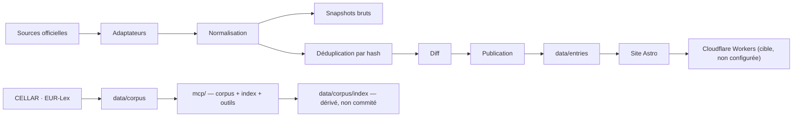

# Architecture

La forme technique macro : la stack, comment les pièces s'articulent, et les décisions derrière. Pointer vers le code, ne pas le recopier.

## Stack

- TypeScript sur Node 24, exécuté par type stripping natif : aucun build step pour le pipeline.
- Astro en rendu statique, Tailwind pour le style. Aucune intégration de framework front ; la recherche viendra plus tard.
- Aucune base de données pour le site ni le pipeline, aucun serveur permanent : une passe hebdomadaire manuelle produit des fichiers, le site les rend. Le MCP local ajoute SQLite + `sqlite-vec` + FTS5 dans `data/corpus/index/`, un dérivé non commité.

## How it fits together

## Key decisions

- Static-first : la passe est manuelle et hebdomadaire ; aucun cron n'est configuré ; le site n'est pas déployé, voir `deployment.md`.
- `mcp/` est une quatrième zone, distincte du pipeline et du site : corpus, index, outils, transport stdio. `veille/` et `src/` sont inchangés ; seuls `writeRaw` de `veille/write.ts` et le type `FetchLike` de `veille/fetch.ts` sont réutilisés. Trois corpus : `rgpd` et `aiact` (un acte chacun) et `cnil` (249 délibérations de sanction), tous indexés dans le même espace `qwen3-embedding:0.6b`.
- `npm run corpus:build` lit tous les descripteurs `mcp/corpus/*.json` et écrit `data/corpus/<corpus>/` (RGPD et AI Act) ; `--document <corpus>` n'en construit qu'un. `npm run cnil:sync` construit `data/corpus/cnil/` depuis deux sources : l'historique DINUM (parquet public, lu colonne par colonne, jamais la colonne d'embeddings `bge-m3`) et les incréments DILA (`TEXTE_CNIL`, découpage local). `npm run corpus:index` construit `data/corpus/index/index.db`, jamais commité. `npm run mcp` ouvre le serveur sur stdio.
- `corpus` est un champ de premier ordre, distinct de `document` : `document` reste l'acte (CELEX ou `CNILTEXT…`), `corpus` la collection (`rgpd`, `aiact`, `cnil`). Unité, table SQLite, `ResultatRecherche`, `SearchOptions`, `SearchDemande` et `search` portent les deux ; `search` filtre par `corpus` et garde `document` pour les références exactes. Un index sans colonne `corpus` est refusé avec un message qui nomme `npm run corpus:index`.
- Le corpus CNIL a deux origines de fragments, déclarées par unité et dans le manifeste : `dinum` (l'historique publié, dont le `chunk_index` reste la base de citation) et `dila` (incréments, découpage local de 600 à 1 200 caractères dit dans le `chemin`). `etat.json` porte la dernière archive lue et son empreinte ; il n'avance qu'après validation complète. Un document déjà présent n'est remplacé que si l'archive DILA est plus récente que sa date au corpus : une archive plus ancienne ne dégrade pas la numérotation publiée.
- `get_decision` est séparé de `get_article` : il rend une délibération entière par identifiant ou par numéro, fragments dans l'ordre du document, et dit l'absence. Un numéro porté par deux documents rend les deux avec leur identifiant.
- L'index est incrémental : chaque unité porte une empreinte `sha256` du modèle, de la dimension et du passage contextualisé. La construction lit `ref → rowid, empreinte`, n'embarque que les unités ajoutées ou modifiées, supprime les absentes et laisse les autres vecteurs intacts. Le même delta met à jour `unites`, `vec_unites` et `fts_unites` dans une seule transaction ; les nouveaux `rowid` suivent le maximum existant, jamais la position ; un changement de modèle ou de dimension, ou un index sans table lexicale, reconstruit l'index complet.
- La table FTS5 `fts_unites` (même `rowid`, tokenizer `unicode61 remove_diacritics 2`) porte la voie lexicale. `rechercheHybride` prend jusqu'à 50 candidats denses et jusqu'à 50 lexicaux (davantage si `k` dépasse 50 ; sous filtre document, la voie dense interroge l'index global avant de filtrer et peut en rendre moins), applique la bande article à l'ordre dense, puis fusionne par `1 / (60 + rang)` ; la distance rendue reste la distance dense brute. Mesurée sur `dev` v2, elle gagne une question au top 5 mais perd 26,3 points de top 1 et 0,128 de MRR : elle n'est pas la voie par défaut, `search` reste dense, l'hybride se mesure avec `--recherche hybride` (`aidd_docs/tasks/2026_11/2026_11_05_qualite-v2-aiact/eval-v2.md`).
- L'évaluation est filtrée par corpus : la colonne `corpus` du CSV fait foi, sinon le préfixe des `sources_attendues` (`32016R0679` → `rgpd`, `32024R1689` → `aiact`, `CNILTEXT…` → `cnil`) ; une question qui viserait deux corpus lève, et le jeu est refusé s'il en mélange deux. La mesure passe `search(..., { corpus })`. `dev` et `test` voient ainsi la même tâche malgré trois corpus dans l'index. Une `sources_attendues` sans `#` vise un document entier : le succès est « au moins un fragment de ce document dans le top 5 » ; avec `#`, la comparaison reste exacte. Le split `test` exige `--mesurer-test` ; le marqueur v3 (`questions-v3.test-consomme.json`) porte une entrée par modèle et refuse la seconde mesure du même modèle, tandis qu'un marqueur v2 à plat reste refusé. Le marqueur est une trace de consommation, pas une preuve d'exécution : supprimer le fichier ou copier le CSV sous un autre nom contourne le garde ; c'est délibéré, il n'arrête qu'une seconde exécution accidentelle.
- `search` honore un document nommé dans la question quand `document` est absent. La question est normalisée (casse, diacritiques, ponctuation) avant reconnaissance : « RGPD », « R.G.P.D. », « règlement général sur la protection des données », « règlement général », « règlement (UE) 2016/679 », « 2016/679 » et `32016R0679` désignent `32016R0679` ; « AI Act », « IA Act », « règlement IA » (`IA` seulement comme jeton isolé), « règlement sur l'intelligence artificielle », « règlement européen sur l'intelligence artificielle », « règlement (UE) 2024/1689 », « 2024/1689 » et `32024R1689` désignent `32024R1689`. Deux corpus nommés n'infèrent rien, et `document` fourni reste prioritaire. Le document inféré filtre le court-circuit exact et la recherche sémantique ; un numéro absent de ce document est refusé explicitement, jamais servi depuis l'autre corpus. Sans document nommé, un numéro qui n'existe que dans un seul corpus est rendu `incertain` avec un message qui nomme ce corpus ; un numéro présent dans les deux corpus est rendu avec son ambiguïté `incertain`.
- Le classement d'une recherche ajoute `BANDE_ARTICLE = 0,02` à la similarité d'un article, sans changer la similarité rendue : à pertinence comparable, l'article passe devant le considérant, qui reste rendu et étiqueté. La bande est mesurée sur les questions `dev` dans `aidd_docs/tasks/2026_11/2026_11_04_qualite-mcp/eval.md` ; `0,02` est retenue pour rester minimale.
- L'embedding reste local : Ollama sur `127.0.0.1:11434` avec `qwen3-embedding:0.6b`, appelé seulement à l'indexation et à la requête. Le site ne lit aucune API. `qwen3-embedding:4b` a été mesuré dans une racine séparée (`--root`, `--modele`, `--dim`) ; le jeu v3 n'établit pas de gain significatif, le produit garde `0.6b`.
- Git est la base : snapshots bruts + hash + JSON commités ; l'index se met à jour par delta avec `npm run corpus:index`.
- `src/` est jetable : les données survivent à un changement de générateur.
- Un adaptateur par source, isolé dans `veille/sources/` : CNIL, CJUE, ANSSI, CEPD, ARCEP, Commission, Commission DMA, ARCOM, Conseil d'État (CETAT) et Cour de cassation (Judilibre) — dix adaptateurs pour neuf autorités.
- Le site ne lit aucune API au runtime : il lit `data/`.
- Une panne de source n'emporte pas les autres : les écritures réussies restent, la passe échoue avec un message nommant la source.
- Le catalogue `veille/themes.json` est la seule configuration de sélection ; cinq matières actives, lues par le pipeline et le site. Le rattachement est stocké sur chaque entrée ; le site filtre au build, aucune purge.
- `Entry.references` porte les instruments et articles cités : titre officiel pour les arrêts CJUE, section « Textes de référence » de la page liée pour les actualités CNIL, texte intégral de la décision pour le Conseil d'État et pour la Cour de cassation.
- Une source API peut enrichir ses entrées retenues après le rattachement (`ApiResult.enrich`) : la Cour de cassation y lit le visa de la décision, le Conseil d'État le texte intégral par `/consult/juri`, un appel par décision, et n'exposent que les instruments des matières de l'entrée. Une entrée déjà écrite n'est pas rappelée ; une erreur ou un budget épuisé diffère l'entrée, relue à la passe suivante ; `[]` ne signifie qu'un texte sans article. Le Conseil d'État passe avant la Cour de cassation dans la passe et lui réserve six appels de recherche (`JUDILIBRE_SEARCH_RESERVE`).
- `Entry.themes` porte les matières calculées à l'ingestion : instruments cités d'abord, termes de repli ensuite, défauts de source pour CNIL, CEPD, ANSSI et Commission DMA ; les sources API ne pré-remplissent pas la matière, sauf Judilibre qui conserve la matière de sa requête comme indice pour ne pas perdre une décision que seul son visa rattache.
- Les sources PISTE (Conseil d'État, Cour de cassation) utilisent un jeton OAuth ou un `KeyId`, un plafond de 16 appels par passe et un journal dans `data/usage/`.
- Une page CNIL en échec laisse l'entrée publiée avec `references: []` et un avertissement ; les pages dont les références sont retenues sont conservées en snapshot HTML.
- Une source à flux peut enrichir chaque entrée par sa page (`Source.page`) : l'ARCOM y filtre le DSA et y prend son résumé, la Commission y prend la version française officielle ; une page en panne écarte l'entrée et avertit, sauf si la source déclare la page facultative.
- Les secrets PISTE restent dans `.env` ; `.gitignore`, le hook pre-commit et la CI refusent leur versionnement.

## Gotchas

- Les quotas PISTE ne sont pas publics et l'API n'offre qu'une cible de disponibilité de 95 %/jour.
- Sans Ollama et sans `qwen3-embedding:0.6b`, `corpus:index`, `mcp:smoke` et la recherche sémantique échouent ; le message nomme `ollama pull qwen3-embedding:0.6b`. La lecture d'un article exact (« article 17 ») reste servie sans index ni modèle.
- Le parquet DINUM de la CNIL (334 Mo) n'est pas commité : sans `npm run cnil:sync`, `data/corpus/cnil/` n'existe pas et l'index ne porte que 565 unités. L'URL Légifrance `cnil/id/<id>` est déclarée dans le manifeste mais non vérifiée : elle répond 403 aux robots. La licence du jeu est `etalab-2.0` sur Hugging Face et `lov2` sur data.gouv ; l'écart est consigné, pas résolu.
- Le serveur MCP journalise sur `stderr` uniquement : `stdout` porte le protocole JSON-RPC.
- Aucun workflow planifié n'existe : une passe oubliée laisse les données en l'état.
