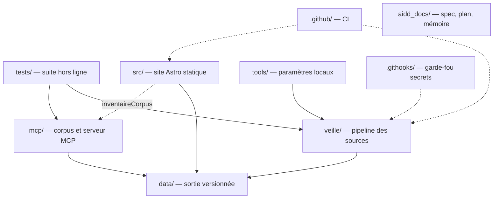

# Codebase Map

La disposition macro : les zones de premier niveau et ce qu'elles portent. Une carte pour naviguer, pas l'arbre complet.

## Areas

- `veille/` : le pipeline. Douze adaptateurs : CNIL, CJUE, ANSSI, CEPD, ARCEP, Commission, Commission DMA, ARCOM, CETAT, Conseil constitutionnel (CONSTIT), Judilibre et actes de l'Union (EUR-Lex via CELLAR) ; catalogue `themes.json` ; rattachement par instruments puis termes ; normalisation, résumés, références, écriture. La page CNIL est lue pour sa section « Textes de référence » (`parseCnilPageReferences`), les instruments sont canonicalisés par `extractCnilReferences` et les pages retenues sont snapshotées en HTML. La page ARCOM filtre le DSA et fournit le résumé ; la page Commission `/fr/` fournit le titre, le résumé et le lien français. Seule zone qui parle aux sources.
- `src/` : le site Astro, rendu statique. `layouts/Base.astro` porte la coquille et les deux polices auto-hébergées (Instrument Serif, Inter), Open Sans 800 n'étant importée que par `components/Collage.astro` pour le bandeau de sanction, `pages/` les trois routes (`/`, `/connecteur`, `/veille`), `styles/global.css` les jetons Tailwind (palette claire et sombre, deux familles de polices, formes et ombre douce), `lib/entries.ts` lit `data/entries/` au build, valide `themes` et filtre les matières actives, `lib/references.ts` résout l'URL officielle d'un instrument (Légifrance ou CELEX) sans réseau et abrège son libellé d'affichage (`RGPD`, `LIL`, `CPCE`, `ePrivacy`, `C. conso`, `AI Act`, `DSA`, `DMA`, `DORA`, `NIS2`, `CRA`, `Data Act`), le libellé complet restant dans `title`, `lib/sources.ts` porte les libellés des douze adaptateurs, `lib/familles.ts` (`familleDeSource`) la seule correspondance source ou corpus → famille (textes, autorités françaises, Union européenne, juridictions françaises, autre) → pastille et aplat de couleur, `src/lib/corpus.ts` (`sourcesCorpus`) libelle et ordonne les collections du connecteur (textes, autorités, juridictions) avec leurs documents et `unites`, et calcule `etagesFacade` (hauteur d'une colonne de la façade, `ceil(log10(unités))` bornée à [1, 5]), à partir d'`inventaireCorpus` de `mcp/corpus/sync-rapport.ts`, seule dépendance du site à `mcp/`, en lecture de fichiers. `/connecteur` en tire la façade du corpus. `src/lib/collage.ts` sélectionne sans I/O les cartes du collage de l'accueil (dernière entrée par source, sanction CNIL seulement si le titre la nomme, montant en euros extrait du titre, formation et numéro du Conseil d'État, chambre et pourvoi de la cassation) et lit au build l'article 32 du RGPD et la première proposition du corpus `preparation`, fichier absent rendant `null` ; `components/Collage.astro` le rend en quatre colonnes décalées. `components/Verification.astro` rend la rangée « Chaque affirmation se vérifie » de l'accueil : trois cartes et deux fenêtres popover remplies au build depuis `src/demo/reponse-cookies.md` et `src/demo/source-san-2023-008.md`. `src/lib/demo.ts` (`lireDemo`) lit la démo capturée `src/demo/demo.json` (question, date, modèle, réponses sans / avec, sources `https`), rend `null` quand le fichier manque et lève en nommant le champ fautif ; `components/` porte `Demo.astro`, ses variantes compacte et complète, `Legende.astro`, les quatre familles nommées en pastilles et libellés, `Facade.astro`, la façade du corpus (une colonne par collection, étages calculés au build), `Collage.astro`, le collage des sources de l'accueil, et `PublicationRangee.astro`, la rangée de publication partagée par l'accueil (variante compacte) et la liste de la veille (variante complète). `components/EssaiRecherche.astro` porte l'encart « Essayer la recherche par mots » du connecteur, seul script client du site, et `src/lib/essai-recherche.ts` en tient la logique pure et testée (URL, lecture des statuts 200/400/429/503, filtrage des liens, corpus → libellé et famille, dates). Les pages ne parlent à aucune API au build ; seul cet encart interroge l'API locale depuis le navigateur. Jetable : les données lui survivent.
- `mcp/` : les dix-neuf corpus RGPD, AI Act, ePrivacy, directive 2016/680, règlement 2018/1725, règlement procédural RGPD, CNIL, doctrine CNIL, LIL, textes français d'application, textes en préparation et affaires pendantes, Conseil d'État, Conseil constitutionnel, CEPD, Cour de cassation, CJUE, clauses contractuelles types, décisions d'adéquation et notices de métadonnées (guichet unique), et le serveur MCP, séparés du pipeline et du site. `corpus/` lit les descripteurs `mcp/corpus/*.json`, récupère le XHTML CELLAR, le parse avec `parseCellar` (RGPD 272 unités, AI Act 299) et écrit `data/corpus/<corpus>/` ; `--document` n'en construit qu'un. `corpus/cnil/` porte la voie DINUM + DILA : `historique.ts` lit les parquet DINUM colonne par colonne (jamais les embeddings `bge-m3`), `parse.ts` lit `TEXTE_CNIL` et découpe localement, `increments.ts` rejoue les archives DILA après `etat.json`, `sync.ts` orchestre `--historique|--increments|--tout|--dry-run|--nature` et n'écrit qu'après validation (3 245 documents, 29 299 fragments) ; `meta.ts` lit le dispositif de chaque décision et en tire `type_sanction`, `montant` et `injonction`, et expose `debutDispositif`, la borne partagée avec `get_decision`. `corpus/cnil-doctrine/` construit la doctrine de cnil.fr : `liste.ts` lit les pages de référence et leurs pages de résultats, `parse.ts` découpe les PDF en fragments mot pour mot et écarte une mention contraire, `sync.ts` télécharge et met en cache les PDF, extrait une fiche IA sans PDF de la zone principale de sa page (74 documents, 5 070 fragments, 2 listes AIPD laissées au corpus `cnil`), `mention.ts` porte le marquage CC BY-ND lu au rendu ; les fiches pratiques IA forment le type `fiche_ia`. `corpus/statut.ts` traduit `(corpus, statut, nature?)` en statut d'application uniforme (`en_vigueur`, `abroge`, `propose`, `pendant`, `rendue`, `adoptee`, `inconnu`), lu au rendu par `tools.ts` sans réindex ni écriture dans `data/`. `corpus/lil/` lit PISTE `/consult/legiPart` et écrit 133 articles ; `corpus/textes-fr/` lit le décret 2019-536, la section 226-16 à 226-24 du Code pénal et l'article L34-5 du CPCE (183 articles, cache brut par date) ; `corpus/articles.ts` compare les numéros d'article (préfixe, tirets, plages) ; `corpus/ce/` lit l'archive JADE en flux (`publie` + `inedit`) et filtre juridiction et mots-clés, toutes dates (1 594 décisions, 20 774 fragments) ; `corpus/cepd/` lit le sitemap CEPD, les pages `_fr` et les PDF (36 lignes directrices, 5 443 fragments) ; `corpus/cc/` interroge Judilibre, met chaque décision en cache et filtre visa puis occurrences, toutes dates (403 décisions, 8 194 fragments) ; `corpus/cjue/` liste par SPARQL CELLAR (matière PDON + notions 4.11.01 et 2.04 + CELEX complémentaires, sans borne de date) et découpe le XHTML comme le HTML patrimonial des arrêts anciens, français puis anglais, en en-tête, points et dispositif (248 décisions, 23 188 fragments) ; `corpus/preparation/` interroge CELLAR SPARQL pour les propositions en cours et les affaires pendantes, lit les communications du Journal officiel en XHTML et écrit une unité par proposition ou affaire (8 et 120 au 14 novembre 2026), hors de `corpus:sync`. Chaque synchronisation écrit le bloc `couverture` de son manifeste. `corpus/veille.ts` fait la correspondance entrée → document (URL canonique des snapshots HTML puis liens `CNILTEXT…`, `CETATEXT…`, `CONSTEXT…` porté par l'entrée, identifiant Judilibre, CELEX de l'URL), et dérive des mêmes tables les sources de veille de chaque corpus (`SOURCES_PAR_CORPUS`, corpus sans veille déclaré dans `CORPUS_SANS_VEILLE`) ; `corpus/lectures.ts` lit et écrit la dernière lecture réussie de chaque source (`data/veille/etat.json`, non versionné) ; `corpus/delais.ts` mesure le délai publication → veille → corpus et écrit `data/corpus/delais.json` (résumé dans `coverage.md`) ; `corpus/sync.ts` orchestré par `npm run corpus:sync` classe la fenêtre, déclenche `cnil`/`ce`/`constit`/`cc`/`cjue` et réindexe, `corpus/sync-rapport.ts` lit et écrit `data/corpus/sync.json`, `corpus/hors-corpus.ts` classe les documents cités absents du corpus (`classerCitations` pure, `classementHorsCorpus` qui lit le corpus, les manifestes et le catalogue et date le bloc écrit par la passe), `corpus/sync-planificateur.ts` génère le plist launchd de trois jours. `index/` construit et interroge `data/corpus/index/index.db` (SQLite + `sqlite-vec` + FTS5) : `build.ts` porte l'empreinte, le calcul du delta (`calculerDelta`), son application transactionnelle aux trois tables (`unites`, `vec_unites`, `fts_unites`) et la migration des métadonnées sans ré-embarquer ; `search.ts` pousse les filtres de corpus, document, nature, date, type, montant et numéro dans la requête `vec0` (la voie FTS5 filtre par corpus) : filtrer après le KNN laisserait un corpus majoritaire affamer les autres, garde `rangerPassages` et `rechercheHybride` (non retenue par défaut) ; `embed/` isole Ollama derrière l'interface `Embedder` ; `corpus/citations.ts` extrait à la lecture les instruments et articles que cite une décision (`extraireCitations`, `citationsDesUnites`, `citationsDuCorpus`, `urlOfficielle`) avec un cache par fichier qui ne garde que les citations, et y ajoute la présence des documents (`documentsPresents` lit `document`/`text_id`/`textes[].text_id` des manifestes, `articlesCouverts` et `citationAuCorpus` font la présence par article d'un texte couvert en partie, `marquerPresence` et `avecPresence` marquent `hors_corpus`, `absenceDuDocument` rend la phrase de refus partagée, `instrumentParIdentifiant` compare un identifiant reçu) ; `corpus/citants.ts` porte `decisions_citant`, la lecture inverse des citations : les décisions qui citent un article, comptées par autorité et paginées, avec un article absent du corpus distingué d'un article jamais cité ; `corpus/citations-decisions.ts` extrait à la lecture les références de décisions (affaire de l'Union, ECLI, délibération CNIL, requête du Conseil d'État, pourvoi), les date, les résout vers le corpus par clé, date et numéros joints, et n'expose que les familles dont la précision mesurée a une borne basse de Wilson ≥ 90 % (`MESURES`, `famillesExposees`) ; il porte `decisions_citees` et l'outil `decisions_citant_decision` ; `tools.ts` porte `get_article`, `get_decision`, `search` et `etat_corpus`, `confidence.ts` les trois niveaux et la marge, `server.ts` le transport stdio, et `demo.ts` la démonstration qui s'y connecte par stdio et appelle trois des six outils sur cinq questions ; `eval/` porte les jeux v1/v2/v3, le jeu CNIL de 20 questions (succès au document, sans split), le jeu CNIL v2 de 50 questions documentaires (25 `dev` / 25 `test`, seuils du produit, aucune question ne nomme l'identifiant, le numéro `SAN-…` ou un article), le jeu CNIL doctrine de 10 questions, le jeu LIL de 10 questions, le jeu Conseil d'État de 12 questions et le jeu CEPD de 10 questions, la sortie `--json`, les seuils figés `--seuils`, le marqueur v3 par modèle, la comparaison appariée `compare.ts`, le filtrage par corpus et le pilote de filtres `filtres.ts` (12 cas, top 5 7/12 sans filtre, 11/12 avec), l'échantillonneur `citations-decisions.ts` (citations entre décisions d'une famille, pas régulier, extrait et cibles, support de la relecture de #30) et l'échantillonneur `citations.ts` (n documents par corpus, citations marquées, passages et compte hors corpus par instrument sur tout le corpus). Seuls `writeRaw` de `veille/write.ts` et le type `FetchLike` de `veille/fetch.ts` sont réutilisés.
- `tests/` : la suite `node:test` et les fixtures des douze adaptateurs, des deux corpus CELLAR, de la CNIL (XML, lignes parquet injectées, tar fabriqué), de la LIL (`legi-part.json`), du Conseil d'État (archive JADE réduite), du Conseil constitutionnel (archive CONSTIT réduite) et du CEPD (liste HTML, sitemap, PDF et texte extrait), hors ligne.
- `data/` : la sortie du pipeline et les dix-neuf corpus, versionnés par git. Snapshots bruts adressés par leur contenu, entrées JSON par `id`, journal d'appels PISTE, `corpus/{rgpd,aiact,eprivacy,police,eudpr,rgpdproc,cnil,cnil_doctrine,lil,textes_fr,preparation,ce,constit,cepd,cc,cjue,metadonnees}/` (manifestes et unités) ; le rapport `corpus/sync.json` est écrit par `corpus:sync` et n'est pas suivi par git ; `corpus/index/` est dérivé et ignoré, et les sources brutes sous `data/raw/{cnil,cnil-doctrine,lil,textes_fr,ce,constit,cepd,cc,cjue,preparation,metadonnees}/` aussi.
- `tools/` : l'outil local de paramètres (`parametres.html`), non déployé ; il écrit `veille/themes.json`.
- `.github/` : la CI — contrôle des secrets PISTE, typecheck, tests et build ; aucun déploiement.
- `.githooks/` : le hook `pre-commit` qui refuse `.env` et les valeurs PISTE non vides.
- `aidd_docs/` : le contrat (`spec.md`), les plans et la mémoire projet.

## Entry points

- `veille/main.ts` : une passe complète sur les douze adaptateurs, lancée par `npm run veille`.
- `veille/themes.json` : le catalogue des cinq matières et de leur état, écrit par l’outil local.
- `veille/backfill.ts` : recalcule `themes` sur les entrées existantes, lancé par `npm run backfill`.
- `src/pages/index.astro`, `src/pages/connecteur.astro` (route `/connecteur`) et `src/pages/veille/index.astro` : les trois pages, générées par `npm run build`.
- `mcp/corpus/build.ts` : `npm run corpus:build` (tous les descripteurs) et `--document <corpus>` (un seul), la capture CELLAR vers `data/corpus/<corpus>/`.
- `mcp/index/build.ts` : `npm run corpus:index`, l'index `sqlite-vec` + FTS5 incrémental depuis Ollama.
- `mcp/corpus/sync.ts` : `npm run corpus:sync` (entrées récentes → sources → index → `data/corpus/sync.json`), `--depuis`, `--date`, `--root`, `--dry-run`, `--json`, `--planifier` et `--dossier`.
- `mcp/server.ts` : `npm run mcp`, le serveur MCP stdio (`get_article`, `get_decision`, `search`, `etat_corpus`).
- `mcp/corpus/cnil/sync.ts` : `npm run cnil:sync -- --tout` (historique DINUM puis incréments DILA), `--increments --dry-run` pour compter sans écrire.
- `mcp/corpus/lil/sync.ts` : `npm run lil:sync -- --date AAAA-MM-JJ` (PISTE `/consult/legiPart`), `--dry-run` pour compter sans écrire.
- `mcp/corpus/textes-fr/sync.ts` : `npm run textes-fr:sync -- --date AAAA-MM-JJ` (PISTE, 4 appels), `--dry-run` pour compter sans écrire le corpus.
- `mcp/corpus/ce/sync.ts` : `npm run ce:sync` (archive JADE globale, `publie` + `inedit`, toutes dates), `--archive`, `--dry-run`.
- `mcp/corpus/cepd/sync.ts` : `npm run cepd:sync` (sitemap CEPD, pages `_fr` et PDF), `--limite`, `--depuis`, `--dry-run`.
- `mcp/corpus/cc/sync.ts` : `npm run cc:sync` (Judilibre, toutes dates, budget `--max-appels`, reprise au cache), `--dry-run`.
- `mcp/corpus/cjue/sync.ts` : `npm run cjue:sync` (SPARQL CELLAR, XHTML puis HTML patrimonial, français puis anglais), `--limite`, `--dry-run`.
- `mcp/eval/run.ts` : `npm run mcp:eval -- --questions <csv> [--split dev|test|all] [--mesurer-test] [--recherche dense|hybride] [--json] [--seuils bas,haut,marge] [--root <racine>] [--modele <nom>] [--dim <n>]`, les métriques datées, hors CI.
- `mcp/eval/compare.ts` : `node mcp/eval/compare.ts <base.json> <candidat.json>`, l'alignement par question, le McNemar exact et le verdict figé.
- `mcp/eval/citations.ts` : `node mcp/eval/citations.ts <corpus> [--taille <n>]` relit les citations d'un échantillon de décisions, `--classement` imprime le classement réel des documents cités absents du corpus (statut, citations, autorités), sans écrire ni indexer.
- `tools/parametres.html` : l'outil local de sélection des matières.
- `npm test` : la suite de tests ; `npm run typecheck` vérifie les types.
