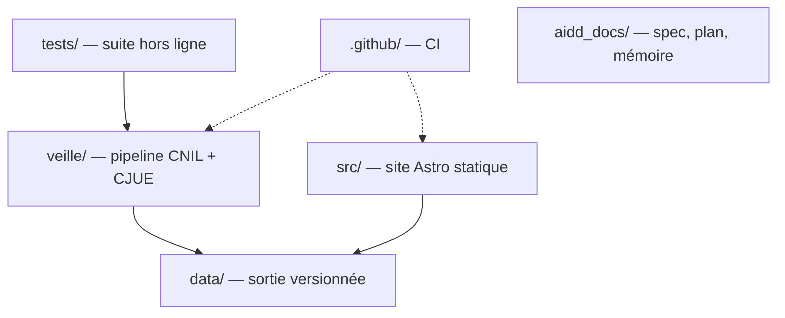

# Codebase Map

La disposition macro : les zones de premier niveau et ce qu'elles portent. Une carte pour naviguer, pas l'arbre complet.

## Areas

- `veille/` : le pipeline. Adaptateurs CNIL et CJUE, normalisation des URL, résumés, références, catalogue de tags, écriture des entrées. Seule zone qui parle aux sources.
- `src/` : le site Astro, rendu statique. `layouts/Base.astro` porte la coquille, `pages/` les deux routes, `styles/global.css` les jetons Tailwind, `lib/entries.ts` lit `data/entries/` au build et filtre les résumés redondants, `lib/sources.ts` porte les libellés CNIL/CJUE. Les pages ne parlent à aucune API. Jetable : les données lui survivent.
- `tests/` : la suite `node:test` et les fixtures CNIL/CJUE, hors ligne.
- `data/` : la sortie du pipeline, versionnée par git. Snapshots bruts adressés par leur contenu, entrées JSON par `id`.
- `.github/` : la CI, seul automatisme ; aucun déploiement.
- `aidd_docs/` : le contrat (`spec.md`), les plans et la mémoire projet.

## Entry points

- `veille/main.ts` : une passe complète sur les deux sources, lancée par `npm run veille`.
- `veille/tags.json` : le catalogue des tags actifs, écrit plus tard par l’outil local.
- `src/pages/index.astro` et `src/pages/veille/index.astro` : les deux pages, générées par `npm run build`.
- `npm test` : la suite de tests ; `npm run typecheck` vérifie les types.
