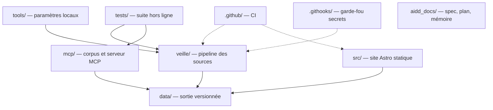

# Codebase Map

La disposition macro : les zones de premier niveau et ce qu'elles portent. Une carte pour naviguer, pas l'arbre complet.

## Areas

- `veille/` : le pipeline. Dix adaptateurs : CNIL, CJUE, ANSSI, CEPD, ARCEP, Commission, Commission DMA, ARCOM, CETAT et Judilibre ; catalogue `themes.json` ; rattachement par instruments puis termes ; normalisation, résumés, références, écriture. La page CNIL est lue pour sa section « Textes de référence » (`parseCnilPageReferences`), les instruments sont canonicalisés par `extractCnilReferences` et les pages retenues sont snapshotées en HTML. La page ARCOM filtre le DSA et fournit le résumé ; la page Commission `/fr/` fournit le titre, le résumé et le lien français. Seule zone qui parle aux sources.
- `src/` : le site Astro, rendu statique. `layouts/Base.astro` porte la coquille, `pages/` les deux routes, `styles/global.css` les jetons Tailwind, `lib/entries.ts` lit `data/entries/` au build, valide `themes` et filtre les matières actives, `lib/references.ts` résout l'URL officielle d'un instrument (Légifrance ou CELEX) sans réseau et abrège son libellé d'affichage (`RGPD`, `LIL`, `CPCE`, `ePrivacy`, `C. conso`, `AI Act`, `DSA`, `DMA`, `DORA`, `NIS2`, `CRA`, `Data Act`), le libellé complet restant dans `title`, `lib/sources.ts` porte les libellés des dix adaptateurs. Les pages ne parlent à aucune API. Jetable : les données lui survivent.
- `mcp/` : les six corpus RGPD, AI Act, CNIL, LIL, Conseil d'État et CEPD, et le serveur MCP, séparés du pipeline et du site. `corpus/` lit les descripteurs `mcp/corpus/*.json`, récupère le XHTML CELLAR, le parse avec `parseCellar` (RGPD 272 unités, AI Act 293) et écrit `data/corpus/<corpus>/` ; `--document` n'en construit qu'un. `corpus/cnil/` porte la voie DINUM + DILA : `historique.ts` lit les parquet DINUM colonne par colonne (jamais les embeddings `bge-m3`), `parse.ts` lit `TEXTE_CNIL` et découpe localement, `increments.ts` rejoue les archives DILA après `etat.json`, `sync.ts` orchestre `--historique|--increments|--tout|--dry-run|--nature` et n'écrit qu'après validation (3 245 documents, 29 299 fragments) ; `meta.ts` lit le dispositif de chaque décision et en tire `type_sanction`, `montant` et `injonction`, et expose `debutDispositif`, la borne partagée avec `get_decision`. `corpus/lil/` lit PISTE `/consult/legiPart` et écrit 133 articles ; `corpus/ce/` lit l'archive JADE en flux (`publie` + `inedit`) et filtre juridiction, date et mots-clés (1 312 décisions, 17 703 fragments) ; `corpus/cepd/` lit le sitemap CEPD, les pages `_fr` et les PDF (36 lignes directrices, 5 443 fragments). Chaque synchronisation écrit le bloc `couverture` de son manifeste. `index/` construit et interroge `data/corpus/index/index.db` (SQLite + `sqlite-vec` + FTS5) : `build.ts` porte l'empreinte, le calcul du delta (`calculerDelta`), son application transactionnelle aux trois tables (`unites`, `vec_unites`, `fts_unites`) et la migration des métadonnées sans ré-embarquer ; `search.ts` pousse les filtres de corpus, document, nature, date, type, montant et numéro dans la requête `vec0` (la voie FTS5 filtre par corpus) : filtrer après le KNN laisserait un corpus majoritaire affamer les autres, garde `rangerPassages` et `rechercheHybride` (non retenue par défaut) ; `embed/` isole Ollama derrière l'interface `Embedder` ; `tools.ts` porte `get_article`, `get_decision` et `search`, `confidence.ts` les trois niveaux et la marge, `server.ts` le transport stdio, et `demo.ts` la démonstration qui s'y connecte par stdio et appelle les trois outils sur cinq questions ; `eval/` porte les jeux v1/v2/v3, le jeu CNIL de 20 questions (succès au document, sans split), le jeu CNIL v2 de 50 questions documentaires (25 `dev` / 25 `test`, seuils du produit, aucune question ne nomme l'identifiant, le numéro `SAN-…` ou un article), le jeu CNIL doctrine de 10 questions, le jeu LIL de 10 questions, le jeu Conseil d'État de 12 questions et le jeu CEPD de 10 questions, la sortie `--json`, les seuils figés `--seuils`, le marqueur v3 par modèle, la comparaison appariée `compare.ts`, le filtrage par corpus et le pilote de filtres `filtres.ts` (12 cas, top 5 7/12 sans filtre, 11/12 avec). Seuls `writeRaw` de `veille/write.ts` et le type `FetchLike` de `veille/fetch.ts` sont réutilisés.
- `tests/` : la suite `node:test` et les fixtures des dix adaptateurs, des deux corpus CELLAR, de la CNIL (XML, lignes parquet injectées, tar fabriqué), de la LIL (`legi-part.json`), du Conseil d'État (archive JADE réduite) et du CEPD (liste HTML, sitemap, PDF et texte extrait), hors ligne.
- `data/` : la sortie du pipeline et les six corpus, versionnés par git. Snapshots bruts adressés par leur contenu, entrées JSON par `id`, journal d'appels PISTE, `corpus/{rgpd,aiact,cnil,lil,ce,cepd}/` (manifestes et unités) ; `corpus/index/` est dérivé et ignoré, et les sources brutes sous `data/raw/cnil/`, `data/raw/lil/`, `data/raw/ce/` et `data/raw/cepd/` aussi.
- `tools/` : l'outil local de paramètres (`parametres.html`), non déployé ; il écrit `veille/themes.json`.
- `.github/` : la CI — contrôle des secrets PISTE, typecheck, tests et build ; aucun déploiement.
- `.githooks/` : le hook `pre-commit` qui refuse `.env` et les valeurs PISTE non vides.
- `aidd_docs/` : le contrat (`spec.md`), les plans et la mémoire projet.

## Entry points

- `veille/main.ts` : une passe complète sur les dix adaptateurs, lancée par `npm run veille`.
- `veille/themes.json` : le catalogue des cinq matières et de leur état, écrit par l’outil local.
- `veille/backfill.ts` : recalcule `themes` sur les entrées existantes, lancé par `npm run backfill`.
- `src/pages/index.astro` et `src/pages/veille/index.astro` : les deux pages, générées par `npm run build`.
- `mcp/corpus/build.ts` : `npm run corpus:build` (tous les descripteurs) et `--document <corpus>` (un seul), la capture CELLAR vers `data/corpus/<corpus>/`.
- `mcp/index/build.ts` : `npm run corpus:index`, l'index `sqlite-vec` + FTS5 incrémental depuis Ollama.
- `mcp/server.ts` : `npm run mcp`, le serveur MCP stdio (`get_article`, `get_decision`, `search`).
- `mcp/corpus/cnil/sync.ts` : `npm run cnil:sync -- --tout` (historique DINUM puis incréments DILA), `--increments --dry-run` pour compter sans écrire.
- `mcp/corpus/lil/sync.ts` : `npm run lil:sync -- --date AAAA-MM-JJ` (PISTE `/consult/legiPart`), `--dry-run` pour compter sans écrire.
- `mcp/corpus/ce/sync.ts` : `npm run ce:sync` (archive JADE globale, `publie` + `inedit`), `--archive`, `--date-min`, `--dry-run`.
- `mcp/corpus/cepd/sync.ts` : `npm run cepd:sync` (sitemap CEPD, pages `_fr` et PDF), `--limite`, `--depuis`, `--dry-run`.
- `mcp/eval/run.ts` : `npm run mcp:eval -- --questions <csv> [--split dev|test|all] [--mesurer-test] [--recherche dense|hybride] [--json] [--seuils bas,haut,marge] [--root <racine>] [--modele <nom>] [--dim <n>]`, les métriques datées, hors CI.
- `mcp/eval/compare.ts` : `node mcp/eval/compare.ts <base.json> <candidat.json>`, l'alignement par question, le McNemar exact et le verdict figé.
- `tools/parametres.html` : l'outil local de sélection des matières.
- `npm test` : la suite de tests ; `npm run typecheck` vérifie les types.
