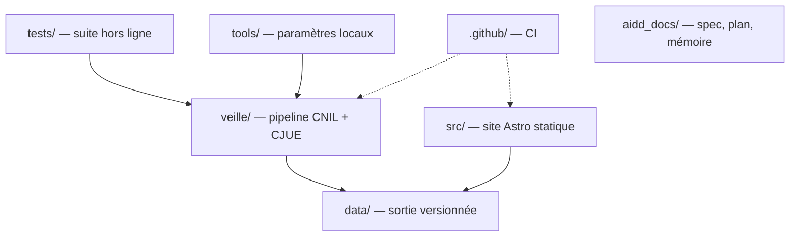

# Codebase Map

La disposition macro : les zones de premier niveau et ce qu'elles portent. Une carte pour naviguer, pas l'arbre complet.

## Areas

- `veille/` : le pipeline. Adaptateurs CNIL, CJUE, ANSSI, CEPD, ARCEP, Commission, CETAT et Judilibre ; catalogue `themes.json` ; rattachement par instruments puis termes ; normalisation, résumés, références, écriture. La page CNIL est lue pour sa section « Textes de référence » (`parseCnilPageReferences`), les instruments sont canonicalisés par `extractCnilReferences` et les pages retenues sont snapshotées en HTML. Seule zone qui parle aux sources.
- `src/` : le site Astro, rendu statique. `layouts/Base.astro` porte la coquille, `pages/` les deux routes, `styles/global.css` les jetons Tailwind, `lib/entries.ts` lit `data/entries/` au build, valide `themes` et filtre les matières actives, `lib/sources.ts` porte les libellés des huit sources. Les pages ne parlent à aucune API. Jetable : les données lui survivent.
- `tests/` : la suite `node:test` et les fixtures des huit sources, hors ligne.
- `data/` : la sortie du pipeline, versionnée par git. Snapshots bruts adressés par leur contenu, entrées JSON par `id`, journal d'appels PISTE.
- `tools/` : l'outil local de paramètres (`parametres.html`), non déployé ; il écrit `veille/themes.json`.
- `.github/` : la CI, seul automatisme ; aucun déploiement.
- `aidd_docs/` : le contrat (`spec.md`), les plans et la mémoire projet.

## Entry points

- `veille/main.ts` : une passe complète sur les huit sources, lancée par `npm run veille`.
- `veille/themes.json` : le catalogue des quatre matières et de leur état, écrit par l’outil local.
- `veille/backfill.ts` : recalcule `themes` sur les entrées existantes, lancé par `npm run backfill`.
- `src/pages/index.astro` et `src/pages/veille/index.astro` : les deux pages, générées par `npm run build`.
- `tools/parametres.html` : l'outil local de sélection des matières.
- `npm test` : la suite de tests ; `npm run typecheck` vérifie les types.
