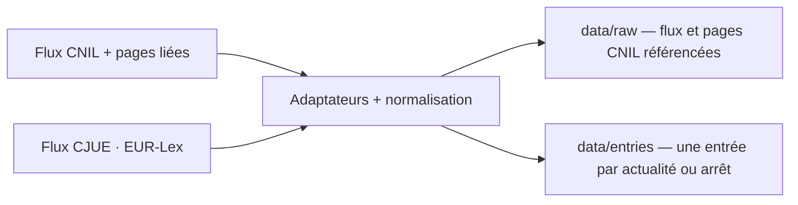

# Data

Le versant données : sources, pipeline et modèles.

## Sources

- CNIL, flux RSS officiel et pages liées pour la section « Textes de référence ».
- CJUE, jurisprudence via le flux public EUR-Lex `rssId=163` ; pas de compte ni de PISTE.
- ANSSI / CERT-FR, flux « actualité » uniquement ; les alertes et avis techniques sont exclus.
- CEPD, flux d'actualités.
- ARCEP, flux « avis et décisions » ; identité portée par la query.
- Commission européenne, flux numérique francophone ; événements et consultations exclus. La page `/fr/` officielle fournit le titre, le résumé et le lien français.
- Commission européenne, flux DMA dédié ; toutes les publications sont retenues, tables rondes et fiches comprises. Le flux n'a pas de version française : les titres restent dans leur langue d'origine.
- ARCOM, flux presse ; les doublons anglais sont écartés et la page article décide du DSA, car le flux n'a pas de description.
- Conseil d'État via l'API Légifrance (fonds CETAT), fenêtre de 90 jours.
- Cour de cassation via Judilibre, fenêtre de 30 jours.
- Pas de Légifrance JORF, pas de JURI : la veille ne couvre pas la législation française, seulement les actualités et la jurisprudence.

## Pipeline

## Summaries

- Chaque entrée porte un résumé extrait de la description de la source, nettoyé puis tronqué à 200 caractères ellipse comprise (`veille/summary.ts`) ; `null` quand la description manque.
- Nettoyage : entités décodées deux fois, balises retirées, espaces normalisés. La source n'est jamais réécrite.
- À l'affichage, un résumé qui répète une suite de 40 caractères ou plus du titre est masqué (`isRedundantSummary`) ; l'entrée reste affichée.

## References

- Chaque entrée porte `officialTitle`, le titre officiel complet, source du filtre et des références CJUE ; le `title` est le titre d'affichage.
- Chaque entrée porte `references: string[]`, les instruments et articles cités : titre officiel pour les arrêts CJUE, section « Textes de référence » de la page liée pour les actualités CNIL, résumé officiel pour le Conseil d'État et la Cour de cassation.
- L'extraction est déterministe (`veille/references.ts`) ; elle ne réécrit pas la source. Un instrument sans article est ignoré, comme pour la CJUE.
- Une page CNIL inaccessible laisse l'entrée publiée avec `references: []` et un avertissement ; la passe ne bloque pas.
- Le catalogue de matières (`veille/themes.json`) porte les instruments, les termes de rattachement et, pour la jurisprudence, les requêtes PISTE ; `Entry.themes` stocke le résultat à l'ingestion.
- Le site filtre au build sur les matières actives : désactiver une matière masque sans supprimer ; le snapshot brut reste la preuve.

## Matières

- `veille/themes.json` : cinq matières — données personnelles, IA, cybersécurité, données non personnelles, plateformes — avec instruments, termes, requêtes, sources et état.
- Défauts de source : CNIL et CEPD → données personnelles ; ANSSI → cybersécurité ; Commission DMA → plateformes. ARCEP, Commission, ARCOM et CJUE ne publient que ce qui correspond à un instrument ou un terme.
- Les sources API ne pré-remplissent pas la matière : elles rapportent titre, résumé et références, puis le rattachement central décide. Judilibre cherche la phrase exacte (guillemets, opérateur `and`, champ texte) et prend l'extrait officiel comme résumé.
- Une matière peut porter plusieurs `queries` : Plateformes interroge 2022/2065 et 2022/1925 ; les autres matières gardent leur premier terme.
- Fenêtres de collecte : CETAT 90 jours, Judilibre 30 jours ; les autres sources suivent leur flux.
- `data/usage/<date>.json` journalise les appels PISTE ; le plafond est de 16 appels par passe, et une passe à cinq matières en consomme 13.
- La page article ARCOM n'est pas snapshotée : elle sert de filtre et de résumé ; le flux brut reste la preuve conservée.

## Models

- Aucun modèle, aucune inférence : le pipeline est déterministe.

## Reproducibility

- Git : chaque snapshot brut est adressé par son `sha256`, chaque entrée par un `id` stable.
- Les entrées ne changent pas quand le contenu est inchangé ; une page CNIL modifiée peut changer `references`.
- Une page CNIL dont les références sont retenues est conservée en `.html` à sa première extraction ou quand ses références changent ; les autres pages ne sont pas archivées.
- Une page dont les références extraites n'ont pas changé ne réécrit pas de snapshot : les jetons volatils de la page (Drupal) ne créent pas de nouveau fichier à chaque passe.
- Le snapshot brut CJUE peut varier avec l'horodatage et l'ordre des items du flux : chaque passe ajoute alors un fichier `data/raw/` (~96 Ko), sans changer `data/entries/`.
- Aucune donnée personnelle : uniquement des textes publics.
- Un flux CJUE en panne laisse les entrées CNIL en place ; une page CNIL en panne laisse l'entrée avec `references: []` et un avertissement.
