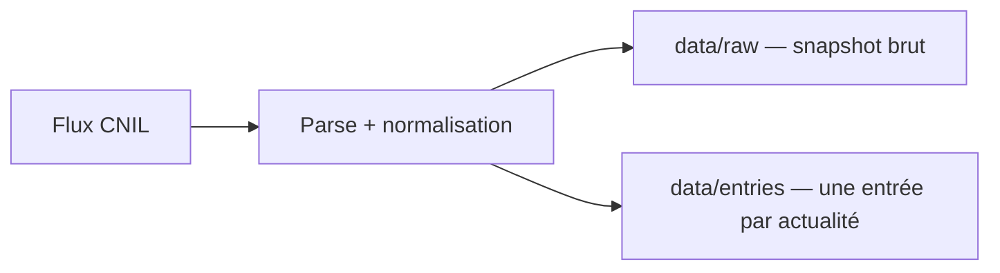

# Data

Le versant données : sources, pipeline et modèles.

## Sources

- CNIL, flux RSS officiel : 10 actualités, mises à jour par la CNIL.
- Prévues, non branchées : Légifrance (PISTE), Judilibre, EUR-Lex, data.gouv.

## Pipeline

## Models

- Aucun modèle, aucune inférence : le pipeline est déterministe.

## Reproducibility

- Git : chaque snapshot brut est adressé par son `sha256`, chaque entrée par un `id` stable.
- Une passe sur un flux inchangé ne produit aucun diff.
- Aucune donnée personnelle : uniquement des textes publics.
