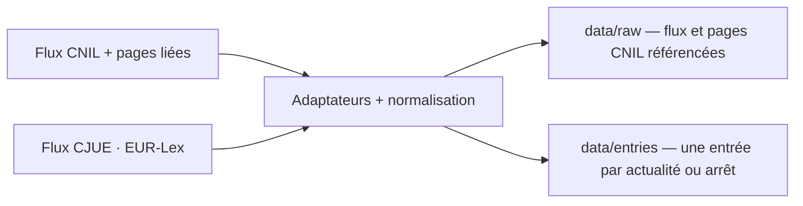

# Data

Le versant données : sources, pipeline et modèles.

## Sources

- CNIL, flux RSS officiel.
- CJUE, jurisprudence via le flux public EUR-Lex `rssId=163` ; pas de compte ni de PISTE.
- Prévues, non branchées : Légifrance (PISTE), Judilibre, data.gouv.

## Pipeline

## Summaries

- Chaque entrée porte un résumé extrait de la description de la source, nettoyé puis tronqué à 200 caractères ellipse comprise (`veille/summary.ts`) ; `null` quand la description manque.
- Nettoyage : entités décodées deux fois, balises retirées, espaces normalisés. La source n'est jamais réécrite.
- À l'affichage, un résumé qui répète une suite de 40 caractères ou plus du titre est masqué (`isRedundantSummary`) ; l'entrée reste affichée.

## References

- Chaque entrée porte `officialTitle`, le titre officiel complet, source du filtre et des références CJUE ; le `title` est le titre d'affichage.
- Chaque entrée porte `references: string[]`, les instruments et articles cités : titre officiel pour les arrêts CJUE, section « Textes de référence » de la page liée pour les actualités CNIL.
- L'extraction est déterministe (`veille/references.ts`) ; elle ne réécrit pas la source. Un instrument sans article est ignoré, comme pour la CJUE.
- Une page CNIL inaccessible laisse l'entrée publiée avec `references: []` et un avertissement ; la passe ne bloque pas.
- Le catalogue de tags (`veille/tags.json`) filtre les arrêts CJUE ; les tags actifs décident de la publication, pas de la donnée brute.

## Models

- Aucun modèle, aucune inférence : le pipeline est déterministe.

## Reproducibility

- Git : chaque snapshot brut est adressé par son `sha256`, chaque entrée par un `id` stable.
- Les entrées ne changent pas quand le contenu est inchangé ; une page CNIL modifiée peut changer `references`.
- Une page CNIL dont les références sont retenues est conservée en `.html` à sa première extraction ou quand ses références changent ; les autres pages ne sont pas archivées.
- Une page dont les références extraites n'ont pas changé ne réécrit pas de snapshot : les jetons volatils de la page (Drupal) ne créent pas de nouveau fichier à chaque passe.
- Le snapshot brut CJUE peut varier avec l'horodatage et l'ordre des items du flux : chaque passe ajoute alors un fichier `data/raw/` (~96 Ko), sans changer `data/entries/`.
- Aucune donnée personnelle : uniquement des textes publics.
- Un flux CJUE en panne laisse les entrées CNIL en place ; une page CNIL en panne laisse l'entrée avec `references: []` et un avertissement.
