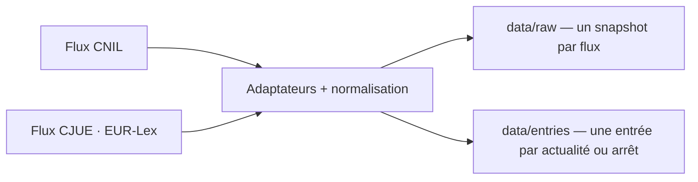

# Data

Le versant données : sources, pipeline et modèles.

## Sources

- CNIL, flux RSS officiel.
- CJUE, jurisprudence via le flux public EUR-Lex `rssId=163` ; pas de compte ni de PISTE.
- Prévues, non branchées : Légifrance (PISTE), Judilibre, data.gouv.

## Pipeline

## Summaries

- Chaque entrée porte un résumé extrait de la description de la source, nettoyé puis tronqué à 200 caractères ellipse comprise (`veille/summary.ts`) ; `null` quand la description manque.
- Nettoyage : entités décodées deux fois, balises retirées, espaces normalisés. La source n'est jamais réécrite.
- À l'affichage, un résumé qui répète une suite de 40 caractères ou plus du titre est masqué (`isRedundantSummary`) ; l'entrée reste affichée.

## References

- Chaque entrée porte `references: string[]`, les instruments et articles principaux cités par le titre officiel ; les entrées CNIL portent `[]`.
- L'extraction est déterministe (`veille/references.ts`) ; elle ne réécrit pas la source.
- Le catalogue de tags (`veille/tags.json`) filtre les arrêts CJUE ; les tags actifs décident de la publication, pas de la donnée brute.

## Models

- Aucun modèle, aucune inférence : le pipeline est déterministe.

## Reproducibility

- Git : chaque snapshot brut est adressé par son `sha256`, chaque entrée par un `id` stable.
- Une passe sur un flux inchangé ne produit aucun diff.
- Aucune donnée personnelle : uniquement des textes publics.
- Un flux CJUE en panne laisse les entrées CNIL en place ; la passe signale la source.
