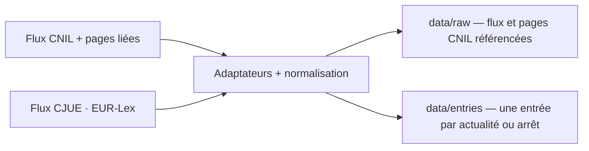

# Data

Le versant données : sources, pipeline et modèles.

## Sources

- CNIL, flux RSS officiel et pages liées pour la section « Textes de référence ».
- CJUE, jurisprudence via le flux public EUR-Lex `rssId=163` ; pas de compte ni de PISTE.
- ANSSI / CERT-FR, flux « actualité » uniquement ; les alertes et avis techniques sont exclus.
- CEPD, flux d'actualités.
- ARCEP, flux « avis et décisions » ; identité portée par la query.
- Commission européenne, flux numérique francophone ; événements et consultations exclus. La page `/fr/` officielle fournit le titre, le résumé et le lien français.
- Commission européenne, flux DMA dédié ; toutes les publications sont retenues, tables rondes et fiches comprises. Le flux n'a pas de version française : les titres restent dans leur langue d'origine.
- ARCOM, flux presse ; les doublons anglais sont écartés et la page article décide du DSA, car le flux n'a pas de description.
- Conseil d'État via l'API Légifrance (fonds CETAT), fenêtre de 90 jours ; le texte intégral de chaque décision nouvelle est lu par `/consult/juri` pour ses articles appliqués.
- Cour de cassation via Judilibre, fenêtre de 30 jours ; le visa de la décision fournit les références, la recherche ne les porte pas.
- Pas de Légifrance JORF, pas de JURI : la veille ne couvre pas la législation française, seulement les actualités et la jurisprudence.

## Pipeline

## Summaries

- Chaque entrée porte un résumé extrait de la description de la source, nettoyé puis tronqué à 200 caractères ellipse comprise (`veille/summary.ts`) ; `null` quand la description manque.
- Nettoyage : entités décodées deux fois, balises retirées, espaces normalisés. La source n'est jamais réécrite.
- À l'affichage, un résumé qui répète une suite de 40 caractères ou plus du titre est masqué (`isRedundantSummary`) ; l'entrée reste affichée.

## References

- Chaque entrée porte `officialTitle`, le titre officiel complet, source du filtre et des références CJUE ; le `title` est le titre d'affichage.
- Chaque entrée porte `references: string[]`, les instruments et articles cités : titre officiel pour les arrêts CJUE, section « Textes de référence » de la page liée pour les actualités CNIL, texte intégral de la décision pour le Conseil d'État et visa de la décision pour la Cour de cassation.
- Le visa Judilibre est lu par décision (`/decision`), après le rattachement, un appel par entrée nouvelle ; il remplace l'extraction depuis le titre et le résumé. La matière de la requête est conservée sur chaque résultat : une décision trouvée par une matière survit au rattachement même si son résumé la tait. L'extraction reconnaît la LIL, le CPCE, ePrivacy, le Code de la consommation et les actes européens génériques (RGPD, AI Act, DSA, DMA, DORA, NIS2, CRA, Data Act). Seuls les instruments des matières rattachées sont retenus : un code du travail ou un code de justice administrative cité au visa n'apparaît pas. Un visa vide laisse `[]` ; un visa non lu diffère l'entrée, relue à la passe suivante. Une décision dont le visa ne rend aucune référence est conservée mais masquée au site.
- Le Conseil d'État n'a pas de visa structuré : `visas` est vide, même sur une décision publiée au Recueil. Ses articles se lisent dans le texte intégral par `/consult/juri`, après le rattachement, un appel par décision nouvelle. Seules les formules d'application (« aux termes », « il résulte des dispositions (combinées) », « en vertu », « en application », « sur le fondement »), les phrases de considérant (« L'article 15 du RGPD garantit ») et leur anaphore (« du même règlement/loi/code/directive », qui ouvre la phrase) déclenchent la lecture ; « les dispositions de l'article » ne déclenche rien, c'est aussi la tournure des griefs. La LIL est nommée par sa date et son objet, ramenée à son libellé canonique. Couverture réelle des neuf décisions collectées : cinq portent des articles (501268, 509210, 509589, 511155, 513996), 520279 perd `Règlement (UE) 2016/679 · art. 5`, qui venait d'un grief.
- L'extraction est déterministe (`veille/references.ts`) ; elle ne réécrit pas la source. Un instrument sans article est ignoré, comme pour la CJUE.
- Une page CNIL inaccessible laisse l'entrée publiée avec `references: []` et un avertissement ; la passe ne bloque pas.
- Le catalogue de matières (`veille/themes.json`) porte les instruments, les termes de rattachement et, pour la jurisprudence, les requêtes PISTE ; `Entry.themes` stocke le résultat à l'ingestion.
- Le site filtre au build sur les matières actives : désactiver une matière masque sans supprimer ; le snapshot brut reste la preuve.

## Matières

- `veille/themes.json` : cinq matières — données personnelles, IA, cybersécurité, données non personnelles, plateformes — avec instruments, termes, requêtes, sources et état.
- Défauts de source : CNIL et CEPD → données personnelles ; ANSSI → cybersécurité ; Commission DMA → plateformes. ARCEP, Commission, ARCOM et CJUE ne publient que ce qui correspond à un instrument ou un terme.
- Les sources API ne pré-remplissent pas la matière, sauf Judilibre qui conserve la matière de sa requête comme indice ; le rattachement central complète. Judilibre cherche la phrase exacte (guillemets, opérateur `and`, champ texte), prend l'extrait officiel comme résumé, puis lit le visa de chaque décision retenue.
- L'URL d'une référence se déduit de son instrument au build (`src/lib/references.ts`) : Légifrance pour la LIL, le CPCE et le Code de la consommation, EUR-Lex par CELEX pour le RGPD, les directives et les règlements. Aucun appel réseau ; un instrument inconnu reste un texte.
- Une matière peut porter plusieurs `queries` : Plateformes interroge 2022/2065 et 2022/1925 ; les autres matières gardent leur premier terme.
- Fenêtres de collecte : CETAT 90 jours, Judilibre 30 jours ; les autres sources suivent leur flux.
- `data/usage/<date>.json` journalise les appels PISTE ; le plafond est de 16 appels par passe. Une passe à cinq matières en consomme 14 : six recherches CETAT, un jeton, six recherches Judilibre et un visa. Chaque décision nouvelle ajoute un appel, jusqu'au plafond ; au-delà, l'entrée est différée et relue à la passe suivante, avec un avertissement. Le Conseil d'État passe avant la Cour de cassation : il réserve six appels aux recherches Judilibre et diffère sa lecture quand il ne reste que ceux-là.
- Les pages d'enrichissement (ARCOM, Commission) ne sont pas snapshotées : elles servent de filtre, de résumé ou de version française ; le flux brut reste la preuve conservée.

## Models

- Aucun modèle, aucune inférence : le pipeline est déterministe.

## Reproducibility

- Git : chaque snapshot brut est adressé par son `sha256`, chaque entrée par un `id` stable.
- Les entrées ne changent pas quand le contenu est inchangé ; une page CNIL modifiée peut changer `references`.
- Une page CNIL dont les références sont retenues est conservée en `.html` à sa première extraction ou quand ses références changent ; les autres pages ne sont pas archivées.
- Une page dont les références extraites n'ont pas changé ne réécrit pas de snapshot : les jetons volatils de la page (Drupal) ne créent pas de nouveau fichier à chaque passe.
- Le snapshot brut CJUE peut varier avec l'horodatage et l'ordre des items du flux : chaque passe ajoute alors un fichier `data/raw/` (~96 Ko), sans changer `data/entries/`.
- Aucune donnée personnelle : uniquement des textes publics.
- Un flux CJUE en panne laisse les entrées CNIL en place ; une page CNIL en panne laisse l'entrée avec `references: []` et un avertissement.
