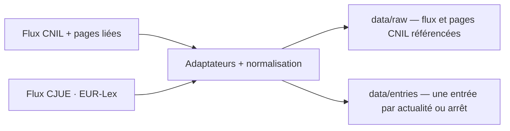

# Data

Le versant données : sources, pipeline et modèles.

## Sources

- CNIL, flux RSS officiel et pages liées pour la section « Textes de référence ».
- CJUE, jurisprudence via le flux public EUR-Lex `rssId=163` ; pas de compte ni de PISTE.
- ANSSI / CERT-FR, flux « actualité » uniquement ; les alertes et avis techniques sont exclus.
- CEPD, flux d'actualités et liste des documents du sitemap (lignes directrices, avis art. 64, décisions art. 65, recommandations, G29 repris).
- ARCEP, flux « avis et décisions » ; identité portée par la query.
- Commission européenne, flux numérique francophone ; événements et consultations exclus. La page `/fr/` officielle fournit le titre, le résumé et le lien français.
- Commission européenne, flux DMA dédié ; toutes les publications sont retenues, tables rondes et fiches comprises. Le flux n'a pas de version française : les titres restent dans leur langue d'origine.
- ARCOM, flux presse ; les doublons anglais sont écartés et la page article décide du DSA, car le flux n'a pas de description.
- Conseil d'État via l'API Légifrance (fonds CETAT), fenêtre de 90 jours ; le texte intégral de chaque décision nouvelle est lu par `/consult/juri` pour ses articles appliqués.
- Cour de cassation via Judilibre, fenêtre de 30 jours ; le visa de la décision fournit les références, la recherche ne les porte pas.
- `npm run veille:textes-fr` est une passe séparée pour la législation : elle ne lit pas de flux, elle compare les identifiants de version des quatre textes suivis (loi 78-17, décret 2019-536, Code pénal 226-16 à 226-24, CPCE L34-5) à ceux du corpus. `npm run veille` reste sans Légifrance JORF et sans JURI.
- Actes de l'Union, par SPARQL CELLAR dans `npm run veille` (source `eurlex`) : dernière consolidation de chaque acte du corpus, décisions d'adéquation et clauses types prises sur le fondement du RGPD ou de 2016/680, actes modifiant le RGPD, ePrivacy, 2016/680 ou 2018/1725. Aucun scraping d'EUR-Lex.
- Conseil constitutionnel, par l'archive DILA CONSTIT dans `npm run veille` (source `constit`) : la liste `OPENDATA/CONSTIT/` donne la dernière archive `Freemium_constit_global_*.tar.gz`, qui n'est pas retéléchargée quand son nom est celui du manifeste de `data/corpus/constit/` (aucun incrément CONSTIT n'est publié). Une nouvelle archive est lue en flux et filtrée par le descripteur du corpus ; chaque décision retenue absente du corpus devient une entrée (`document` = `CONSTEXT…`, `numero`, `nature`, date). Le retard de l'archive — dernière décision toutes natures face à la date de la passe — est dit à chaque passe et averti au-delà de 45 jours.

## Pipeline

## Corpus

- Dix-huit corpus versionnés, chacun avec un manifeste, un bloc `couverture` et `unites.jsonl` (une ligne par unité : `ref`, `document`, `corpus`, `niveau`, `numero`, `chemin`, `texte`, `date_acte`, `date_debut`, `date_fin`, `statut`, `url`, et `origine`/`nature` pour la CNIL et le Conseil constitutionnel ; la CNIL ajoute `type_sanction`, `montant` et `injonction`). `document` est l'acte ou la décision (CELEX, `CNILTEXT…`, `LEGIARTI…`, `CETATEXT…`, `CONSTEXT…`, slug CEPD, identifiant Judilibre) ; `corpus` la collection (`rgpd`, `aiact`, `eprivacy`, `police`, `eudpr`, `rgpdproc`, `ccs`, `adequation`, `cnil`, `cnil_doctrine`, `lil`, `textes_fr`, `preparation`, `ce`, `constit`, `cepd`, `cc`, `cjue`). Le tableau à jour est `aidd_docs/tasks/2026_11/2026_11_11_corpus-cassation-cjue/coverage.md` ; les comptes viennent des manifestes, jamais d'une recopie.
- `data/corpus/rgpd/` : CELEX `32016R0679`, 272 unités (99 articles `art_N`, 173 considérants `rct_N`), date d'acte 2016-04-27, début 2018-05-25.
- `data/corpus/aiact/` : CELEX `32024R1689`, version consolidée `02024R1689-20260727` du 2026-07-27, 299 unités (119 articles de la consolidation, 180 considérants de l'acte d'origine `32024R1689`), date d'acte 2024-06-13, publication 2024-07-12, début 2024-08-01. Le manifeste porte `considerants_source: "32024R1689"` et son `snapshot_considerants`, distinct du `snapshot` des articles : les actes modificatifs ne touchent pas les considérants. La capture CELLAR consolidée ne porte aucun préambule ; ses articles vont jusqu'à 119. La capture CELLAR de l'acte d'origine porte 13 chapitres (`cpt_I` à `cpt_XIII`) et 113 articles ; seuls ses considérants sont comptés.
- Actes de l'Union qui encadrent le RGPD (#41, vérifiés dans CELLAR le 2026-11-14) : le descripteur porte `version` (CELEX récupéré) et `date_consolidation`, recopiés au manifeste ; `document` reste le CELEX de l'acte. La version française consolidée la plus récente est rendue ; à défaut, l'acte d'origine, jamais modifié.
  - `data/corpus/eprivacy/` : `32002L0058`, version consolidée `02002L0058-20091219` (modifiée par 2006/24 et 2009/136), 72 unités (23 articles dont `14 bis` et `15 bis`, 49 considérants) ; l'original n'a pas de XHTML français.
  - `data/corpus/police/` : `32016L0680`, version consolidée `02016L0680-20160504` (corrigendum FR intégré), 172 unités (65 articles, 107 considérants de l'acte d'origine `32016L0680` ; la consolidation n'a pas de préambule, d'où `considerants_source` au manifeste).
  - `data/corpus/eudpr/` : `32018R1725`, acte d'origine (aucune modification, aucune consolidation française), 190 unités (101 articles, 89 considérants), `date_consolidation: null`.
  - `data/corpus/rgpdproc/` : règlement procédural RGPD `32025R2518` (dossier 2023/0202/COD adopté), acte d'origine, 105 unités (37 articles, 68 considérants), entrée en vigueur 2026-01-01, `date_debut` 2027-04-02 (date d'application, art. 37).
  - Convention de `date_debut` : date d'application quand l'acte en fixe une seule (RGPD 2018-05-25, 2018/1725 2018-12-11, 2025/2518 2027-04-02), sinon entrée en vigueur (directives, AI Act à application échelonnée) ; `statut: en_vigueur` dit l'entrée en vigueur, un `date_debut` futur dit que l'acte ne s'applique pas encore.
  - L'art. 15, § 1 bis, d'ePrivacy vient de la directive 2006/24, invalidée par la CJUE (C-293/12, 2014) ; la consolidation officielle le garde et le corpus le rend tel quel.
  - Une version consolidée n'a pas d'ancres ELI : `parseConsolide` (`mcp/corpus/parse.ts`) découpe sur `title-article-norm`, retire les renvois ▼/►/◄, et les unités pointent l'URL EUR-Lex de la version sans fragment ; la ref d'un article inséré est `art_15bis`, son `numero` `15 bis`.
- `date_debut` suit la sémantique de l'acte : date d'application pour le RGPD (2018-05-25), date d'entrée en vigueur pour l'AI Act (2024-08-01), dont l'application générale est fixée au 2026-08-02.
- Provenance : CELLAR, `https://publications.europa.eu/resource/celex/<celex>`, rendu XHTML en `fra` avec `Accept: application/xhtml+xml` ; réutilisation autorisée par la décision 2011/833/UE (CC BY 4.0). Le parseur `parseCellar(xhtml, descripteur)` lit les comptes attendus dans `mcp/corpus/<corpus>.json` et lève en nommant le document quand ils ne correspondent pas.
- Le snapshot brut du XHTML vit dans `data/raw/` ; le manifeste le nomme par son `sha256`.
- `data/corpus/index/index.db` est dérivé : SQLite + `sqlite-vec` + FTS5, table `unites` (avec `empreinte`), table virtuelle `vec_unites` en cosinus et table virtuelle `fts_unites` (même `rowid`, `chemin` + `texte`). Non commité, mis à jour par `npm run corpus:index`.
- L'index est incrémental : l'empreinte `sha256` du modèle, de la dimension et du passage contextualisé décide du delta. Seules les unités ajoutées ou modifiées sont embarquées ; les unités supprimées perdent leur ligne, leur vecteur et leur ligne FTS ; les unités inchangées gardent des vecteurs identiques octet pour octet. Les `rowid` nouveaux suivent le maximum existant ; changer de modèle ou de dimension, ou trouver un index sans `fts_unites`, force une reconstruction complète.
- Ajouter un corpus, c'est déposer un descripteur `mcp/corpus/<corpus>.json` ; `npm run corpus:build` le construit et `lireUnites` l'indexe sans code par corpus. La colonne `corpus` filtre les résultats ; `document` reste exact.
- `data/corpus/sync.json` est le rapport de `npm run corpus:sync`, écrit par la commande, jamais à la main et non suivi par git (comme l'index, il décrit l'état d'une machine) : `a_jour_au` (dernière passe sans source ni index en panne, `null` avant la première), `derniere_tentative`, fenêtre `depuis`, `entrees_lues`, `comptes` (`presents`, `manquants`, `ecartes`, `non_mappes`, `perimes`), `documents` (une ligne par entrée et par document, avec son statut et son motif), inventaire `corpus`, `sources`, `index` et `hors_corpus` (classement daté des documents cités absents, écrit à chaque passe — voir `mcp/corpus/hors-corpus.ts`). `a_jour_au` est la borne de la fenêtre suivante avec un recouvrement de sept jours, pas l'horodatage de la dernière tentative : après un échec il reste ancien et la passe suivante reprend la fenêtre échouée. Un document manquant n'est pas un échec et reste listé tant qu'il n'entre pas au corpus ; un CELEX listé dans `couverture.documents_ecartes` est `ecarte` et ne relance pas la CJUE. Une entrée `legi`, `eurlex` ou `cepd` dont la `version` n'est pas celle du corpus rend le document `perime` et relance sa source (`lil`, `textes_fr`, l'acte ou `cepd`) ; une entrée `cepd` marquée `consultation` est imprimée avec `[consultation]` ; `a_jour_au` ne couvre que `cnil`, `ce`, `cc` et `cjue`.

## Corpus CNIL

- `data/corpus/cnil/` : 3 245 documents et 29 299 fragments, filtrés sur les trois natures `Sanction`, `Avis` et `Recommandation/Lignes directrices` ; comptes `Sanction` 249 / 6 342, `Avis` 2 896 / 21 914, `Recommandation` 100 / 1 043. `niveau` = `fragment`, `ref` = `<doc_id>#f<chunk_index>` pour l'historique DINUM (index publié), `<id>#f<n>` numéroté par nous pour les incréments DILA. Sur les 249 sanctions, `type_sanction` compte 134 amendes, 95 avertissements, 12 liquidations, 6 rappels et 2 interruptions, et 35 décisions prononcent une injonction ; chaque fragment de sanction porte `montant` (sanction pécuniaire en euros, amende ou liquidation, `null` si absent ou masqué ; une seule amende masquée) et `injonction`, extraits du dispositif par `mcp/corpus/cnil/meta.ts`. Les avis et recommandations ne portent aucune métadonnée de sanction. `couverture.exclusions` compte les lignes DINUM écartées par `nature_delib` : 35 167 lignes sur 11 valeurs, dont `(vide)` 298 ; `couverture.lignes_lues` vaut 64 466, soit 29 299 retenues + 35 167 exclues. Une ligne écartée n'entre jamais dans `par_nature`.
- Sources : `https://huggingface.co/datasets/AgentPublic/cnil` (deux parquet, lus avec `hyparquet` 1.32.0 + `hyparquet-compressors` 1.1.3, colonnes `doc_id`, `chunk_index`, `text`, `number`, `date`, `title`, `status`, `nature_delib` ; la colonne `embeddings_bge-m3` n'est jamais lue) et `https://echanges.dila.gouv.fr/OPENDATA/CNIL/` (archives `CNIL_YYYYMMDD-HHMMSS.tar.gz`, 146 au 2026-11-05, XML `TEXTE_CNIL`). Le snapshot DINUM est daté 2026-10-30 (dernière modification Hugging Face), révision `bbc4bf7ef4a0148359f6e3ef38734edb08ac2f06` ; les deux fichiers sont adressés par leur `sha256` dans `manifest.json`.
- Licence : `etalab-2.0` sur Hugging Face, `lov2` sur data.gouv ; l'écart est consigné dans le manifeste, pas résolu. URL de texte `https://www.legifrance.gouv.fr/cnil/id/<id>` déclarée et marquée `url_texte_verifiee: false` (403 aux robots, non vérifiée).
- Découpage : `dinum` conserve le `chunk_index` publié ; `dila` découpe localement les paragraphes en fragments de 600 à 1 200 caractères (un paragraphe plus long reste seul), sans perdre de texte ; le `chemin` porte `Découpage local`.
- `etat.json` porte `derniere_archive`, son `sha256`, la date de lecture et le nombre d'archives lues. `npm run cnil:sync` liste les archives, ne lit que les nouvelles, et n'écrit qu'après validation de tout le corpus. Un document déjà présent n'est remplacé que si l'archive est plus récente que sa `date_acte`.
- Le parquet (334 Mo) reste sous `data/raw/cnil/`, ignoré par git ; seul `data/raw/` des captures CELLAR est commité.

## Corpus doctrine CNIL

- `data/corpus/cnil_doctrine/` : 56 documents et 4 459 fragments — 30 guides et 26 référentiels ; aucune liste AIPD ingérée, les deux listes étant des délibérations déjà au corpus `cnil`. Les fragments sont des tranches mot pour mot du PDF (paragraphes regroupés de 600 à 1 200 caractères), `ref` = `<slug>#f<n>`, `niveau` = `fragment`, `numero` = slug, `statut` = `Publié`, `chemin` = `Doctrine CNIL > Guides|Référentiels > <titre>`.
- Liste de référence au manifeste : `fr/mediatheque?field_scald_collection_tid=29` (26 guides), `fr/guides-aipd` (4 PDF), `fr/autres-referentiels` (26 PDF), `fr/listes-des-traitements-pour-lesquels-une-aipd-est-requise-ou-non` (2 pages). `consulte_le` vaut le jour de la passe ; `liste_reference[]` porte type, URL, date et compte. Les résultats sont parcourus par `?page=N` jusqu'à épuisement.
- Licence : CC BY-ND 4.0 pour les textes de cnil.fr ; chaque document porte `licence`, `licence_url` et `source` au manifeste, et chaque passage rendu porte `marquage` (mention, titre, source, date d'extraction). Les deux listes AIPD restent en Licence Ouverte : la requise est la délibération 2018-327 (`CNILTEXT000037560659`), la non requise la 2019-118 (`CNILTEXT000039249797`), portées au manifeste dans `couverts_par_cnil` et non dupliquées. Un document co-édité avec un tiers garde le crédit du site et son lien ; aucune mention de licence distincte n'est portée par les documents retenus (`couverture.licence_note`).
- Détection et exclusions : une mention contraire explicite (`tous droits réservés`, `reproduction interdite`, `all rights reserved`, `sous réserve de droits d'auteur`) écarte le document avec son motif (`documents_ecartes`). Aucun des 58 PDF ne la porte au 2026-11-14. Une page qui cite plusieurs délibérations garde celle dont l'intitulé rejoint le titre du document (au moins 3 jetons communs).
- `date_acte` : date déclarée dans l'en-tête (« Adopté le … », « Publié le … »), sinon date d'extraction avec `date_source: "extraction"` (47 sur 56). Les PDF et leur cache vivent sous `data/raw/cnil-doctrine/`, adressés par leur `sha256` ; le cache vaut sept jours (`validite_jours`), `--refresh` le force, et les pages de référence sont relues à chaque passe pour que la liste ne se fige pas.
- Requêtes polies : un appel à la fois, 1 s d'attente lue au descripteur (`delai_ms`), `User-Agent` générique, reprise sur 429 et 503. Les pages de référence et de document ne sont jamais servies par le cache ; seuls les PDF le sont, sept jours. Le corpus n'est écrit qu'après validation de tous les fragments.

## Veille de la doctrine CNIL

- `veille/sources/cnil_doctrine`, branchée dans `npm run veille` : la source relit les pages de référence déclarées au descripteur avec la reconnaissance du corpus (`mcp/corpus/cnil-doctrine/liste.ts`, `parcourirReference` et `extraireDocuments`), dans le même ordre et avec le même dédoublonnage par URL, puis compare au manifeste `data/corpus/cnil_doctrine/manifest.json`. Aucun PDF n'est téléchargé.
- Une entrée par document absent du manifeste (`motif: "nouveau"`) ou dont l'intitulé et le type existent mais dont l'URL du PDF a changé (`motif: "modifie"`). L'intitulé est comparé sans casse, diacritiques ni ponctuation ; l'URL sans `www`, fragment ni requête. Entrée : `document` (le slug du corpus, calculé par la même règle), `type`, `motif`, `version` (URL du PDF), titre seul — `summary: null`, aucune reformulation sous CC BY-ND. `publishedAt` est la date de la passe, les pages de référence ne datant pas leurs documents.
- Aucune entrée pour un document listé au `couverts_par_cnil` du manifeste (listes AIPD portées par les délibérations 2018-327 et 2019-118) ni pour un document de `documents_ecartes`. Un manifeste absent rend tous les documents listés nouveaux.
- Raccord : `CORPUS_PAR_SOURCE.cnil_doctrine = "cnil_doctrine"`, `documentsDeLEntree` rend le slug, `indexerVersionsCorpus` lit l'URL de chaque document du manifeste ; un document manquant relance `cnil-doctrine:sync`, et un document présent avec une autre URL de PDF est `perime` et le relance aussi. Passe réelle du 2026-11-14 : 58 documents listés, 0 nouveau, 0 modifié, 56 inchangés, 2 couverts par le corpus `cnil`.
- Limite déclarée : une réédition servie sous la même URL de PDF n'est pas détectable par la veille, qui ne lit pas les PDF, et `cnil_doctrine` n'est relancé que sur un signal : elle n'entre au corpus qu'à la prochaine exécution de `cnil-doctrine:sync`, déclenchée par un autre signal ou à la main. Un intitulé qui change en même temps que le fichier apparaît comme nouveau.

## Corpus LIL

- `data/corpus/lil/` : la loi n° 78-17 dans sa version consolidée, 1 document et 133 articles en vigueur ; 54 articles abrogés sont écartés et 50 sections parcourues. `ref` = `LEGIARTI…`, `niveau` = `article`, `document` = `LEGITEXT000006068624`.
- Source : PISTE — Légifrance `/consult/legiPart` avec `{ textId, date }` ; `npm run lil:sync -- --date AAAA-MM-JJ` lit la version à cette date, laisse un snapshot `legi-part-<date>.json` sous `data/raw/lil/` (non commité) et écrit `data/corpus/lil/`. Le manifeste porte `text_id`, `version`, `date_consultation`, `date_debut_version`, `articles_en_vigueur`, `articles_abroges_ecartes`, `versions_remplacees` et `snapshot_sha256`.
- Licence : Licence Ouverte 2.0 (Etalab). Le texte est copié, jamais reformulé ; les balises HTML de `content` sont ramenées à leur texte visible.
- `data/corpus/lil/versions.jsonl` garde les versions passées d'articles, hors de `unites.jsonl` et de l'index : une ligne par version (`numero`, `identifiant` `LEGIARTI…`, `date_debut`, `date_fin` ou `null`, `texte`, `url`), dédupliquée par `identifiant` et triée par numéro puis date de début. Le bloc `historique` du manifeste porte `depuis`, `dates_lues`, `versions` et `consulte_le` ; `npm run lil:historique` le collecte, un appel `legiPart` par date de version distincte et budget de 120 appels jeton compris (borne `2018-06-01` si la collecte complète le dépasse, reprise par `dates_lues`). La graine est la réponse courante ; les `dateDebut`/`dateFin` vues dans chaque réponse datée entrent ensuite dans la file jusqu'au point fixe, et une reprise repart aussi des bornes de `versions.jsonl`. Les interruptions restantes sont des abrogations, pas des trous de collecte : aucune borne de version n'est laissée non interrogée.

## Corpus textes français d'application

- `data/corpus/textes_fr/` : trois textes, 183 articles en vigueur au 2026-11-14 ; 2 abrogés écartés et comptés. Décret n° 2019-536 en entier (`LEGITEXT000038567662`, version `_07-09-2025`, 166 articles, 1 abrogé) ; Code pénal articles 226-16 à 226-24 (`LEGITEXT000006070719`, section `LEGISCTA000006165313`, 16 articles, `226-16-1-A` abrogé) ; CPCE article L34-5 (`LEGITEXT000006070987`, `LEGIARTI000042155961`). `document` = identifiant du texte, `ref` = `LEGIARTI…`, `numero` tel que la DILA l'écrit (`226-16`, `L34-5`).
- Source : PISTE — Légifrance, un appel par texte : `/consult/legiPart` (décret), `/consult/code` avec `sctCid` (1 appel pour la section, ~3 Mo), `/consult/getArticleWithIdAndNum` (CPCE ; rend la dernière version, une version différée non `VIGUEUR` fait refuser la capture). `npm run textes-fr:sync -- --date AAAA-MM-JJ` : 4 appels avec le jeton, dans son propre processus. Chaque réponse est gardée sous `data/raw/textes_fr/<date>/<cle>.json` (non commité) avant validation : une relance à la même date ne coûte aucun appel. Comptes attendus par texte dans `mcp/corpus/textes-fr/descripteur.json`.
- Le manifeste porte `textes[]` (`text_id`, `version`, `perimetre`, `articles_couverts`, comptes, `snapshot_sha256`, `versions_remplacees`). `articles_couverts` (`null` pour un texte entier) fait la présence par article : une citation de CPCE L34-1 ou de Code pénal 226-1 reste `hors_corpus` et reste au classement hors corpus ; `get_article` sur un article non couvert dit « hors du corpus : seuls les articles … y figurent ».
- `versions_remplacees` garde l'historique : à chaque synchronisation, la version courante du manifeste précédent y entre (`identifiant`, `date_debut`, `date_fin` = veille du début de la version qui la remplace). Rejouer la même version ne change rien. Le snapshot de l'ancienne version reste sous `data/raw/textes_fr/<date>/`.
- Un article dont la DILA ouvre la date de début (an 2999 : articles 156 à 158 du décret) a `date_acte` = date du texte (`date_texte` du descripteur) et `date_debut` vide, jamais la date de la version consolidée.
- `get_article` et la référence exacte de `search` lisent le numéro avec son préfixe de code, ses tirets et son suffixe : `L. 34-5` = `L34-5`, `26-1` ≠ `26`, `226-16-1-A` ≠ `226-16-1`, `9 bis` ≠ `9`, `n° 17` = `17` (avant #44, `20-1` de la LIL pouvait répondre pour `20`). Avec `corpus` de décisions (`cnil`, `ce`, `cc`, `cjue`, `cepd`), une question qui cite un article part en recherche sémantique.

## Veille des textes français

- `npm run veille:textes-fr` est une passe séparée de `npm run veille`, dans son propre processus : cinq appels PISTE au plus, un jeton puis un par texte. Routes : loi 78-17 par `/consult/legiPart` daté, décret 2019-536 par `/search` fond `LODA_DATE` `NUM` exact `2019-536`, Code pénal par `/consult/code` sur la section `LEGISCTA000006165313`, CPCE par `/consult/getArticleWithIdAndNum` `{id: LEGITEXT000006070987, num: "L34-5"}`. Le plafond de 16 de la veille n'est pas partagé.
- La détection compare des identifiants de version, jamais des textes : `LEGIARTI…` en vigueur par article dans `data/corpus/lil/` et `data/corpus/textes_fr/`, `LEGITEXT…_JJ-MM-AAAA` pour le décret. Chaque différence écrit une entrée de source `legi` dans `data/entries/` : `document` (le `LEGITEXT…` du texte), `version`, titre lisible (« Code pénal, art. 226-17 : nouvelle version en vigueur au … »), URL Légifrance ; une version inchangée n'écrit rien. `publishedAt` est la date de la passe (la détection), pour que la version entre dans la fenêtre de `corpus:sync` même si sa date d'effet est ancienne ; la date d'effet reste dans le titre.
- Les réponses brutes sont conservées sous `data/raw/`, adressées par leur hash : l'ancienne version garde sa preuve. `corpus:sync` lit ces entrées, marque le document `perime` tant que la version manque et relance `lil` ou `textes_fr` ; une panne laisse `a_jour_au` inchangé.
- Limite déclarée : un changement du nombre d'articles en vigueur fait refuser la capture par `lil:sync` ou `textes-fr:sync` (comptes attendus du descripteur) ; l'opérateur met à jour le descripteur. La lecture d'une version à une date passée est #46.

## Veille des actes de l'Union

- Source `eurlex` de `npm run veille`, trois requêtes SPARQL groupées sur `https://publications.europa.eu/webapi/rdf/sparql` : dernières consolidations (`VALUES`, préfixe CELEX `0…`), décisions prises sur le fondement du RGPD (`32016R0679`) ou de 2016/680 (`32016L0680`) depuis le 2026-11-14, actes modifiant le RGPD, ePrivacy, 2016/680 ou 2018/1725 (`resource_legal_amends_resource_legal`).
- Consolidation : une entrée quand la dernière version (`02024R1689-20260727`) diffère de la `version` du descripteur, ou quand un acte non consolidé reçoit une consolidation postérieure à sa publication — la consolidation du jour de publication n'est pas une nouveauté. L'acte d'origine n'entre pas au corpus par cette voie.
- Nouveaux actes : une entrée par décision absente des descripteurs et dont le titre constate l'adéquation ou adopte des clauses contractuelles types ; un titre qui « modifie » une décision existante est signalé hors périmètre. Une décision que la nouvelle abroge (relation `resource_legal_repeals_resource_legal`) porte son CELEX dans `abroge`.
- Entrée : `document` = CELEX visé (acte de base, ou décision), `version` = consolidation quand elle existe, `categorie` (`consolidation`, `adequation`, `clauses_types`, `modification`), titre lisible, URL EUR-Lex, date de l'acte. `publishedAt` est la date de la passe (la détection), comme pour `legi`, pour que l'entrée entre dans la fenêtre de `corpus:sync`.
- `corpus:sync` met à jour `version` et `date_consolidation` du descripteur de l'acte puis relance `corpus:build --document <corpus>` ; une décision d'adéquation est ajoutée à `adequation/descripteur.json` (clé, pays, date, URL, statut `en_vigueur`, nombre d'articles compté sur la capture) puis `adequation:build` est relancé. Le descripteur est rétabli si la construction échoue, et l'entrée reste `perime` : elle est rejouée à la passe suivante sans figer `a_jour_au` ni la fenêtre des autres corpus. Une nouvelle décision d'adéquation entre donc au corpus. Règle de compte : `articles_attendus` n'est ajusté qu'à la hausse, quand la consolidation sert plus d'articles que le descripteur (un acte modificatif a inséré des articles) ; un rendu qui en sert moins est tenu pour tronqué, refusé sans toucher au descripteur, et l'entrée reste `perime`. `considerants_attendus` reste celui de l'acte d'origine, validé sur sa capture. Une consolidation sans préambule (cas de l'AI Act `02024R1689-20260727` : 119 articles, 0 considérant) garde les considérants de l'acte d'origine et prend les articles de la consolidation.
- Limite déclarée : des clauses types neuves sont détectées et publiées dans la veille, mais restent `non_mappe` ; le corpus `ccs` ne porte qu'un acte, et leur ajout demande un descripteur dédié.

## Corpus clauses contractuelles types

- `data/corpus/ccs/` : décision d'exécution (UE) 2021/914 (CELEX `32021D0914`), 82 unités = 4 articles, 26 considérants et 52 clauses de l'annexe. `niveau` vaut `clause` pour l'annexe ; `numero` porte la clause (`8.1`), la ref ajoute le module quand la clause est déclinée (`#clause_8.1_m2`), et `chemin` dit « Clause 8.1, module 2 ». Une clause sans variante de module reste une seule unité ; la clause 15 se lit en `15.1` et `15.2`.
- Source : CELLAR (`https://publications.europa.eu/resource/celex/32021D0914`), XHTML français ; `npm run corpus:build -- --document ccs` écrit `data/corpus/ccs/`. Le parseur dédié `mcp/corpus/ccs/parse.ts` découpe le corps par `parseCellar`, puis l'annexe `anx_1` sur ses titres `oj-ti-grseq-1` (`Clause N`, `N.M`, `MODULE N`). `clauses_attendues` fait foi : une capture incomplète lève avant écriture.
- `date_acte` 2021-06-04, publication 2021-06-07, entrée en vigueur 2021-06-27 ; URL EUR-Lex sans fragment.

## Corpus décisions d'adéquation

- `data/corpus/adequation/` : 22 décisions et 120 unités, une par article ; 20 décisions en vigueur et 2 invalidées (Safe Harbour `32000D0520`, Privacy Shield `32016D1250`). Le manifeste porte `liste_reference` (page Commission « Adequacy decisions »), `consulte_le` et `decisions[]` (`celex`, `pays`, `date_acte`, `date_fin`, `url`, `statut`, `motif`, `articles`, `snapshot`). `statut` vaut `en_vigueur` ou `ABROGE` ; `statut.ts` rend alors `abroge`, jamais `en_vigueur`.
- Source : CELLAR par CELEX, XHTML français quand il existe, HTML pour les actes antérieurs à 2004 qui n'ont pas de datastream XHTML. `npm run adequation:build` lit `mcp/corpus/adequation/descripteur.json`, valide tous les articles avant la première écriture, conserve les captures sous `data/raw/` et écrit manifeste et `unites.jsonl` ; `--dry-run` compte sans écrire.
- Liste établie à la main depuis la page Commission consultée le 2026-11-14 : Andorre, Argentine, Brésil (2026/179), Canada, îles Féroé, Guernesey, Israël, île de Man, Japon, Jersey, Nouvelle-Zélande, Corée (2022/254), Suisse, Royaume-Uni (RGPD 2021/1772 et LED 2021/1773, renouvelées par 2025/2574 et 2025/2571), États-Unis (cadre 2023/1795), Uruguay et Organisation européenne des brevets (2025/1382), avec Safe Harbour et Privacy Shield comme abrogées.

## Corpus Conseil d'État

- `data/corpus/ce/` : 1 594 décisions et 20 774 fragments, du 1982-03-12 au 2026-10-27, toutes dates, sur les données personnelles. Fonds `publie` : 282 décisions / 4 430 fragments ; fonds `inedit` : 1 312 / 16 344 ; 62 doublons d'identifiant entre les deux fonds. `ref` = `<CETATEXT…>#f<n>`, `niveau` = `fragment`, URL `https://www.legifrance.gouv.fr/ceta/id/<id>`. `statut` dit la publication au recueil, jamais la solution seule : « Publié au recueil » ou « Inédit au recueil », suivi de la solution quand elle existe (« Inédit au recueil · Satisfaction partielle »).
- Source : archive globale JADE de la DILA, `https://echanges.dila.gouv.fr/OPENDATA/JADE/`, fichier `Freemium_jade_global_*.tar.gz` (1,32 Go, 8 novembre 2026). `npm run ce:sync` la télécharge sous `data/raw/ce/` (non commité), la lit en flux (`Readable.fromWeb` → `createGunzip` → tar incrémental) et écrit `data/corpus/ce/`. Les deux fonds `jade/global/publie` et `jade/global/inedit` sont lus.
- Filtres déclarés : `JURIDICTION` normalisée exactement « Conseil d'État » (les cours administratives d'appel et tribunaux administratifs sont écartés et comptés), aucun filtre de date, au moins un mot-clé du descripteur. Sur 573 525 entrées lues, 174 265 décisions du Conseil d'État toutes dates avant mots-clés ; exclusions : autre juridiction 399 198, sans mot-clé 167 044, texte vide 5 627, date invalide 0. Le manifeste porte `couverture.fonds`, `couverture.exclusions` et `ecartes`.
- Licence : Licence Ouverte 2.0 (Etalab). `etat.json` porte l'archive, son `sha256`, la date de lecture et une empreinte du filtre ; une même archive et un même filtre ne sont pas relus.

## Corpus Conseil constitutionnel

- `data/corpus/constit/` : 108 décisions et 5 775 fragments, du 1982-12-14 au 2026-08-14 (décision la plus récente du corpus), sur les données personnelles. `ref` = `<CONSTEXT…>#f<n>`, `niveau` = `fragment`, `nature` = `DC` ou `QPC`, `numero` = `<numéro> <nature>` (`2018-765 DC`), URL `https://www.conseil-constitutionnel.fr/decision/…` reprise de `URL_CC` en https. `statut` = « Décision DC · Non conformité partielle » : la nature puis la solution de la source.
- Source : archive DILA `https://echanges.dila.gouv.fr/OPENDATA/CONSTIT/`, fichier `Freemium_constit_global_*.tar.gz` (13 Mo, XML Légifrance `TEXTE_JURI_CONSTIT`), lue en flux. `npm run constit:sync` la télécharge sous `data/raw/constit/` (non commité), écrit `data/corpus/constit/` et n'écrit qu'après validation. Aucun incrément CONSTIT n'est publié au 2026-11-14 : l'archive est complète à chaque passe, et le manifeste porte `couverture.retard_archive` (`derniere_decision` 2026-10-16, `jours_au` 29).
- Natures retenues : `DC` et `QPC`. Les autres (contentieux électoral `AN` 4 171, `SEN` 306, `L` 338, `ORGA` 169, etc.) sont écartées avec leur compte (`natures_ecartees`, 5 378 documents) et leur motif au manifeste.
- Filtre : mots-clés du descripteur CE (`données personnelles`, `informatique et libertés`, `protection des données`, `RGPD`, `CNIL`…) ou « vie privée » associée à une expression de traitement de données (`données de connexion`, `traitement(s) automatisé(s)`, `traitement(s) de données`, `fichier automatisé`). Il lit le texte publié entier (décision, saisines, observations) ; les unités sont découpées dans le `BLOC_TEXTUEL` seul, les saisines et observations restant hors périmètre. Sur 2 045 décisions DC/QPC, 1 933 sont écartées `sans_mot_cle`, 0 `texte_vide` et 0 `date_invalide` ; 108 sont retenues (77 DC, 31 QPC), après 4 doublons de numéro + nature résolus au profit de l'identifiant le plus récent. Le compte reproduit la cible du spike #37 (108 décisions au stock du 2026-11-08).
- Licence : Licence Ouverte 2.0 (Etalab), fiche DILA `DILA_CONSTIT_Presentation_20170824.pdf` ; data.gouv déclare `fr-lo` et une fréquence trimestrielle, écart consigné, non résolu. Le lien Légifrance `cons/id/<id>` reste déclaré en repli, non vérifié (403 aux robots).
- `etat.json` porte l'archive, son `sha256`, la date de lecture et une empreinte du filtre : une même archive et un même filtre ne sont pas relus.
- La veille (#51) ne dispose d'aucun incrément : `veille/sources/constit.ts` compare la dernière archive listée au champ `archive` du manifeste, ne la retélécharge pas si elles coïncident, et sinon émet une entrée par décision retenue absente des `document` de `unites.jsonl`. `publishedAt` est la date de la passe, la date de la décision restant dans `date_acte` et le titre : l'archive a ≈ 4 semaines de retard et une entrée datée de la décision sortirait de la fenêtre de `corpus:sync`. `CORPUS_PAR_SOURCE.constit = "constit"` fait relancer `constit:sync` sur un document manquant, qui fait alors entrer la décision au corpus. Limite déclarée : si `npm run constit:sync` lit une nouvelle archive avant `npm run veille`, le manifeste la porte déjà et la passe n'en signale ni les décisions ni le retard ; aucun chemin automatique ne lance `constit:sync` sans entrée de veille préalable, le cas reste donc manuel.
- Requête : `mcp/embed/embedder.ts` porte une instruction propre au corpus (`constit`), de la même forme que celles du RGPD, de l'AI Act et de la CNIL. Aucune mesure sur un jeu `dev` : le corpus suit les seuils de repli `0,69 / 0,74 / 0,01`, sans promesse chiffrée.

## Corpus CEPD

- `data/corpus/cepd/` : 328 documents et 20 287 fragments, période 2018-04-11 → 2026-11-10. `ref` = `<slug>#f<n>`, `niveau` = `fragment`, `chemin` = `CEPD > <type> > <titre>`. Les cinq types sont `lignes_directrices` (43 documents, 6 914 fragments), `avis_art64` (263, 7 770), `decision_art65` (12, 4 571), `recommandation` (9, 841) et `g29_repris` (1, 191, WP260 Transparence). URL de la page du document.
- Source : sitemap du CEPD (`https://www.edpb.europa.eu/sitemap.xml`, pages `?page=1` à `?page=5`), rubriques réelles `guideline`, `opinion-of-the-board-art-64`, `edpb-binding-decisions` et `recommendation`. Les URL `_fr` et `_en` sont regroupées par document : la page française gagne quand elle existe, l'anglaise sert de repli ; le PDF français est préféré, puis l'anglais, et les PDF de consultation sont écartés. Un document G29 est reconnu à son numéro WP, à son titre « Article 29 Working Party » ou à la phrase d'endossement de la page. Le Wayback Machine ne sert que de repli si le sitemap est injoignable. `npm run cepd:sync -- --dry-run|--limite <n>|--depuis <date>` écrit les PDF sous `data/raw/cepd/` (non commité), attend 300 ms entre deux documents et écrit le corpus après extraction `unpdf` ; une page ou un PDF en échec écarte le document avec son motif sans aborter la passe, et un PDF déjà téléchargé est réutilisé.
- Qualité : un PDF sans texte, de moins de 2 000 caractères ou dont la part de lettres est inférieure à 50 % est refusé en nommant son URL. Sur 341 documents listés, 328 sont retenus ; 22 entrées sont écartées avec leur type et leur motif (dont deux pages courtes, doublons de WP242 et WP260) : 7 sans PDF, 3 versions obsolètes (doublons anglais d'un même numéro), 2 où la page ne sert que l'annexe, 1 PDF sans rapport avec le document (WP242) et 9 documents de la liste d'endossement du G29 (8 hébergés sur `ec.europa.eu`, WP263 porté par un document EDPB hors des rubriques). Les 10 sans texte sont comptés à part. Sept documents sont des versions de consultation (`statut: projet`, `statut_application: propose`) ; la page porte « Public consultation ongoing/closed » sans « Final version » ni « Version 2.0 ». Langues des textes retenus : 154 `fr`, 174 `en`, 0 `autre` ; seul le marqueur terminal du nom de PDF compte, et un PDF sans marqueur suit la langue de sa page. Le manifeste porte `documents_langues`, `documents_types`, `documents_versions` et `documents_lastmod` document par document, `types_retenus`, `comptes_par_type` (`{documents, fragments}`), `couverture.via: "sitemap"`, `sitemap_pages`, `langues_pdf`, `documents_sans_texte_ecartes`, `versions_ecartees` et `documents_ecartes` (`{url, slug, type, raison, source}`).
- Liste d'endossement du G29 : `g29` porte la source (`https://www.edpb.europa.eu/endorsed-wp29-guidelines_en`), la date de lecture, une ligne par document (`titre`, `url`, `wp`, `numero`, `hebergement`, `statut`, `document` et `type` s'il est retenu, `successeur` quand le WP est représenté par son successeur EDPB, `raison` sinon) et les comptes : 16 listés, 6 retenus, dont WP260 transparence et cinq WP (259 consentement, 250 violation, 244 autorité chef de file, 264 formulaire BCR et 256 tableau BCR) représentés par leur successeur EDPB (`successeurs: 5`), 10 écartés. Les documents hébergés sur `ec.europa.eu` ne sont pas téléchargés : la notice de copyright du CEPD couvre les documents publiés sur son site, pas l'archive de la Commission.
- Licence : régime ouvert de la notice de copyright du CEPD — réutilisation commerciale et non commerciale autorisée, source citée, sens non dénaturé, mentions d'auteur et de source conservées. Chaque fragment porte sa source et son URL ; le serveur ne produit aucun résumé.

## Veille des documents CEPD

- `npm run veille` (source `cepd`, #53) fait deux choses dans le même adaptateur : le flux d'actualités, inchangé, puis la liste des documents par le sitemap, lue avec les fonctions du corpus (`listerDocumentsSitemap`, `slugDe`, `enrichirDocument`) et non dupliquée. Aucun PDF n'est téléchargé : la liste coûte l'index et cinq pages de sitemap, plus une page par document à vérifier, avec le `delai_entre_requetes_ms` du descripteur et le user-agent générique du corpus.
- Comparaison au manifeste : `documents_types` dit les documents déjà au corpus, `documents_versions` (signature de version : la version du titre ou du PDF — `2.0`, `rev01` —, sinon l'état publié `finale` ou `projet`) tranche la nouveauté, `documents_lastmod` (le `<lastmod>` du sitemap) évite de relire une page inchangée. Un slug de `couverture.documents_ecartes` n'est jamais signalé : les 13 des 22 documents écartés qui figurent encore au sitemap ne reviennent pas à chaque passe. Un manifeste antérieur à ces deux cartes n'est pas comparé : la passe le dit (`manifeste sans versions (relancer cepd:sync)`) et ne devine rien ; un manifeste absent ou illisible fait échouer la passe en nommant le chemin.
- Entrée : `document` = slug, `type` (les cinq types du corpus), titre et `<meta name="description">` de la page (aucun résumé inventé), `url`, `date_acte`, `version` = la signature comparée (`2.0`, sinon `finale`/`projet`), `consultation: true` quand le statut du corpus (`statutApplication("cepd", …)`) rend `propose` — bannière de consultation de la page ou titre de projet. `publishedAt` est la date de la passe, comme pour `legi`, `eurlex` et `constit`, pour entrer dans la fenêtre de `corpus:sync` ; l'`id` hache le document et sa signature.
- Raccord : `CORPUS_PAR_SOURCE.cepd = "cepd"` et `documentsDeLEntree` rendent le slug ; un document manquant relance `cepd:sync`, une signature différente du corpus le rend `perime` et le relance aussi. `documentsEcartes(rootDir, "cepd")` lit `couverture.documents_ecartes` : un écart pour motif durable (version obsolète, annexe seule, PDF sans rapport, page non listée, hébergement hors site) est `ecarte` dans le rapport et ne relance rien ; un écart transitoire (page illisible, PDF absent, date ou extraction en échec) laisse le document `manquant`, donc rejoué tant que son entrée de veille reste dans la fenêtre de `corpus:sync` ; une synchronisation complète le reprend ensuite. Limite déclarée : une nouvelle version qui ne change ni le slug, ni le marqueur de version du titre, ni l'état publié (`finale`/`projet`) n'est pas distinguée de la précédente ; le corpus garde alors la version qu'il a lue.

## Corpus Cour de cassation

- `data/corpus/cc/` : 403 décisions et 8 194 fragments, du 1986-07-21 au 2026-11-10, sans borne de date. `ref` = `<id Judilibre>#visa` ou `<id>#f<n>`, `niveau` = `fragment`, `document` = identifiant Judilibre, URL `https://www.courdecassation.fr/decision/<id>`. Le visa, quand Judilibre le porte, est le premier fragment ; le texte suit, regroupé en fragments de 600 à 1 200 caractères par `decouperParagraphes`, un paragraphe plus long restant entier. `statut` porte la publication au Bulletin et la solution (« Publié au Bulletin · Cassation »).
- Source : PISTE — Judilibre `/search` puis `/decision`, `field=text`, `operator=and`, phrases du descripteur (`données personnelles`, `RGPD`, `CNIL`, `vidéosurveillance`, etc.), sans borne de date. `npm run cc:sync` met chaque décision en cache sous `data/raw/cc/decisions/` (non commité), marque les 404 dans `introuvables.json` et reprend au budget : `--max-appels` (1 500 par défaut) borne les appels de la passe, le corpus n'est écrit qu'avec les décisions lues, et le cache évite toute relecture.
- Filtre de pertinence : retenue si le visa cite un instrument de protection des données, ou si le texte porte au moins `occurrences_min` (2) expressions centrales. Mesure du 2026-11-14 : 1 348 décisions lues, 403 retenues, 945 écartées `hors_sujet`, 705 doublons de recherche ; les 4 entrées Judilibre de `data/entries/` sont incluses. 51 décisions retenues sont antérieures à 2014 : aucune date n'est écartée pour son ancienneté, `exclusions.avant_borne` n'existe plus.
- Licence : Licence Ouverte 2.0 (Etalab) et CGU Judilibre.

## Corpus CJUE

- `data/corpus/cjue/` : 251 décisions et 23 460 fragments, du 1999-10-14 au 2026-11-05, sans borne de date. `ref` = `<CELEX>#h<n>` (en-tête), `<CELEX>#pointN` (motivation) ou `<CELEX>#dispositif`, `niveau` = `fragment`, `document` = CELEX, URL EUR-Lex dans la langue du texte (`/FR/` ou `/EN/`). `statut` = « Arrêt de la Cour », « Arrêt du Tribunal », « Ordonnance de la Cour » ou « Ordonnance du Tribunal ».
- Source : CELLAR, SPARQL `https://publications.europa.eu/webapi/rdf/sparql`. La liste réunit la matière `PDON` (`resource_legal_is_about_subject-matter`) et deux notions fines (`case-law_is_about_concept_new_case-law`) : `fd_578/4.11.01` (« Protection des données à caractère personnel ») et `fd_578/2.04` (« Protection des données à caractère personnel par les institutions de l'Union »), aux CELEX `6…`, sans filtre de date ; un CELEX est ajouté explicitement, `62018CJ0746` (Prokuratuur). Types retenus : `CJ`, `TJ`, `CO`, `TO` ; conclusions d'avocat général (`CC`) et autres types écartés et comptés. `npm run cjue:sync` lit ensuite le XHTML `rel=…` en français (`Accept-Language: fra`) puis en anglais (`eng`), et, quand aucune forme XHTML n'est servie, le HTML patrimonial des arrêts anciens dans le même ordre de langues ; il garde la première représentation servie, met le texte en cache sous `data/raw/cjue/` (`.xhtml` ou `.html`) et marque les 404 de toutes les formes et langues en `xhtml_absent` pour ne pas les redemander ; une panne (5xx, réseau) n'écrit aucun marqueur et la décision est redemandée à la passe suivante. Un motif `version_francaise_absente`, écrit avant le 13 novembre 2026, reste lu ; il ne porte pas les formes demandées et il est donc rejoué une fois, puis réécrit en `xhtml_absent` avec les formes. `--limite` écrit un corpus partiel : réservez-le à `--root` hors du corpus commité ; `--dry-run` compte sans écrire.
- Deux rendus : le XHTML moderne (`sum-title-1`, `index`, ancres `count`/`pointN`) et le HTML patrimonial (`<dt>N</dt>`, ancre `<A NAME="pointN">` ou numéro en tête de paragraphe, paragraphes centrés exclus), détecté par l'absence de `xmlns` XHTML. 72 des 86 décisions sans XHTML ont été récupérées ainsi ; six (`62004CJ0475`, `62002TJ0320`, `62003TJ0259`, `62004TJ0161`, `62009TJ0082`, `62010TJ0190`) ne sont servies que sous forme de résumé, sans motifs. Le HTML patrimonial porte la date des conclusions avant celle de l'arrêt : `sync.ts` retient la date CELLAR pour lui, l'en-tête du XHTML pour le rendu moderne. Un marqueur `xhtml_absent` porte les formes demandées : un marqueur écrit avant le repli HTML n'a pas ce champ, il est donc rejoué une fois ; il est effacé dès qu'une capture est en cache.
- Langue : un seul rendu par décision, dans la première langue servie ; la provenance est déduite du contenu par `langueCapture` (« On those grounds » ou une date écrite à l'anglaise), jamais d'un fichier annexe, et `chemin` porte « (texte anglais) » hors français. Couverture du 2026-11-14 : `couverture.langues` = 250 `fra`, 1 `eng`, `couverture.documents_langues` = `{62002TJ0320: eng}`. Le repli reste actif dans les deux rendus.
- Couverture du 2026-11-14 : 361 CELEX listés et 4 complémentaires (`documents_lus` 365), 251 retenus (170 arrêts de la Cour, 52 du Tribunal, 14 ordonnances de la Cour, 15 du Tribunal), 95 conclusions d'avocat général, 5 autres types, 14 sans aucune représentation textuelle dans CELLAR (404 en XHTML et en HTML, toutes langues). 40 décisions sont antérieures à 2014 ; les 45 que l'ancienne borne comptait à part y sont, sauf 5 (`62002TJ0179`, `62007TJ0392`, `62009TJ0241`, `62010TJ0308`, `62011TJ0214`), servies par une notice RDF sans texte. Une entrée CJUE de la veille est incluse d'office quand son URL porte un CELEX.
- Contrôle du 2026-11-14 par la fiche thématique Curia « Protection des données à caractère personnel » (PDF de juillet 2024, `data/raw/9c/9c11ab31….pdf`) : 51 numéros d'affaires pour 43 arrêts, 43 présents, aucun absent. Trois arrêts que le classement CELLAR ne donnait pas sont entrés par `celex_complementaires` et une synchronisation : C-461/10 (Bonnier Audio, `62010CJ0461`), C-37/20 et C-601/20 (`62020CJ0037`), C-339/20 et C-397/20 (`62020CJ0339`) ; Prokuratuur (`62018CJ0746`) était déjà complémentaire. Une affaire jointe porte le CELEX de son premier numéro, vérifié par SPARQL quand le CELEX déduit n'existe pas. `npm run cjue:controle` écrit `data/corpus/cjue/controle-curia.json` et son résumé dans `coverage.md` ; il sort en erreur si un arrêt manque sans raison durable.
- Limite déclarée : le classement CELLAR est incomplet ; l'union `PDON` + notions `4.11.01` et `2.04` récupère La Quadrature du Net (C-511/18) et le contentieux du Contrôleur européen (EDPS) contre les institutions ; Prokuratuur (C-746/18) et trois arrêts de la fiche Curia (C-461/10, C-37/20 et C-601/20, C-339/20 et C-397/20) sont ajoutés par une liste explicite portée au manifeste. 14 décisions de la sélection n'ont aucun texte téléchargeable, ce n'est pas un défaut de langue. Les notions restent larges : six décisions de `4.11.01` ne traitent les données personnelles que dans une partie de leur raisonnement.
- Licence : réutilisation autorisée par la décision 2011/833/UE (CC BY 4.0).

## Corpus préparation

- `data/corpus/preparation/` : 8 propositions et 120 affaires pendantes, 128 unités au 2026-11-14 (dont 35 affaires présumées pendantes). Une unité par proposition (`ref` `<CELEX>#proposition`, `niveau` `proposition`, `document` = CELEX, `numero` = référence de procédure `2025/0360/COD`, `statut` `PROPOSE`, `derniere_etape` et la même mention dans `texte`, URL EUR-Lex) et une par affaire (`ref` `<CELEX>#affaire`, `niveau` `affaire`, `numero` `C-703/25 P`, `statut` `PENDANT`, `decision_attaquee` quand elle est lisible, `pendant_presume` au-delà de trois ans, URL Curia). Le `texte` d'une proposition est son titre et son objet (matière CELLAR et actes du corpus visés), jamais le texte intégral ; celui d'une affaire est la communication du Journal officiel (parties, conclusions, moyens).
- Source unique : CELLAR SPARQL. Propositions : acte de type `PC` rattaché à un dossier `PROP_PENDING` (par `act_preparatory_initiates_dossier` ou `dossier_contains_work`), de matière `PDON` ou modifiant un acte du corpus ; une seule proposition par dossier, le corrigendum `R(01)` cédant au CELEX de base. Dernière étape : événement `event_legal_part_of_dossier` de date maximale **≤ jour de passe**, les étapes planifiées étant datées après la passe et donc écartées. Affaires : communications `CN`/`TN` Eurovoc 5181 ou 5595 depuis 2019, écartées si une décision `CJ`/`CO` (Cour) ou `TJ`/`TO` (Tribunal) de même année et même numéro CELEX existe. La lettre de juridiction fait partie de la clé : `C-1/19` et `T-1/19` sont deux affaires ; une affaire jointe est fermée par le CELEX de l'arrêt principal, que `case-law_joins_case_court` relie à ses autres numéros.
- Communications lues en XHTML français (`Accept: application/xhtml+xml`) sous `data/raw/preparation/` (non commité), deux rendus (`oj-doc-ti` moderne, `doc-ti` patrimonial), pied `ELI:`/`ISSN` retiré. Un 404 écarte l'affaire (`capture_absente`) ; une panne réseau ou 5xx arrête la passe avant écriture. Un appel à la fois, 500 ms d'attente, reprise sur 429/503.
- Manifeste : `couverture.requetes` (textes SPARQL exacts), `consulte_le`, `comptes` (`propositions`, `affaires`, `affaires_presumees`), `presomption_annees`, `exclusions` et `documents_ecartes` motivés, `presumees`, `periode`, `mention` et licence. `npm run preparation:sync` est séparé de `npm run corpus:sync` : le corpus est un instantané daté, jamais revérifié par la passe générale.
- `statutApplication` ne rend pour `preparation` que `propose` (source `PROPOSE`) et `pendant` (source `PENDANT`), `inconnu` sinon : jamais `en_vigueur` ni `rendue`. Aucun outil ne rend un texte proposé applicable (`get_article` ne trouve aucun article, `get_decision` aucune sanction).

## Summaries

- Chaque entrée porte un résumé extrait de la description de la source, nettoyé puis tronqué à 200 caractères ellipse comprise (`veille/summary.ts`) ; `null` quand la description manque.
- Nettoyage : entités décodées deux fois, balises retirées, espaces normalisés. La source n'est jamais réécrite.
- À l'affichage, un résumé qui répète une suite de 40 caractères ou plus du titre est masqué (`isRedundantSummary`) ; l'entrée reste affichée.

## References

- Chaque entrée porte `officialTitle`, le titre officiel complet, source du filtre et des références CJUE ; le `title` est le titre d'affichage.
- Chaque entrée porte `references: string[]`, les instruments et articles cités : titre officiel pour les arrêts CJUE, section « Textes de référence » de la page liée pour les actualités CNIL, texte intégral de la décision pour le Conseil d'État et visa de la décision pour la Cour de cassation.
- Le visa Judilibre est lu par décision (`/decision`), après le rattachement, un appel par entrée nouvelle ; il remplace l'extraction depuis le titre et le résumé. La matière de la requête est conservée sur chaque résultat : une décision trouvée par une matière survit au rattachement même si son résumé la tait. L'extraction reconnaît la LIL, le CPCE, ePrivacy, le Code de la consommation et les actes européens génériques (RGPD, AI Act, DSA, DMA, DORA, NIS2, CRA, Data Act). Seuls les instruments des matières rattachées sont retenus : un code du travail ou un code de justice administrative cité au visa n'apparaît pas. Un visa vide laisse `[]` ; un visa non lu diffère l'entrée, relue à la passe suivante. Une décision dont le visa ne rend aucune référence est conservée mais masquée au site.
- Le Conseil d'État n'a pas de visa structuré : `visas` est vide, même sur une décision publiée au Recueil. Ses articles se lisent dans le texte intégral par `/consult/juri`, après le rattachement, un appel par décision nouvelle. Seuls les motifs (après « Considérant ce qui suit ») sont lus : les visas et les moyens des parties, où une formule peut n'être qu'un grief, sont écartés. Dans les motifs, seules les formules d'application (« aux termes », « il résulte des dispositions (combinées) », « en vertu », « en application », « sur le fondement »), les phrases de considérant (« L'article 15 du RGPD garantit ») et leur anaphore (« du même règlement/loi/code/directive », qui ouvre la phrase) déclenchent la lecture ; une formule directement introduite par un grief est ignorée — les verbes `soutient`, `reproche`, `conteste`, `se plaint` et leurs pluriels, « est soutenu que », « selon <partie> » (requérant, requérante, société, partie, ministre, administration, CNIL, défendeur, demandeur, lui, elle, eux, elles), « moyen/grief tiré de ce que » —, « Selon la Cour de justice » restant une formule appliquée, « il résulte de l'instruction » ne déclenche rien, et « les dispositions de l'article » ne déclenche rien hors formule. Sans le repère « Considérant ce qui suit », rien n'est extrait. L'ordre des pastilles suit la première rencontre dans les motifs ; il n'est pas contractuel. La LIL et la directive ePrivacy sont nommées par leur date, ramenées à leur libellé canonique (la directive du 12 juillet 2002 devient 2002/58/CE). Couverture réelle des neuf décisions collectées : cinq portent des articles (501268, 509210, 509589, 511155, 513996), 520279 perd `Règlement (UE) 2016/679 · art. 5`, qui venait d'un grief.
- L'extraction est déterministe (`veille/references.ts`) ; elle ne réécrit pas la source. Un instrument sans article est ignoré, comme pour la CJUE.
- Une page CNIL inaccessible laisse l'entrée publiée avec `references: []` et un avertissement ; la passe ne bloque pas.
- Le catalogue de matières (`veille/themes.json`) porte les instruments, les termes de rattachement et, pour la jurisprudence, les requêtes PISTE ; `Entry.themes` stocke le résultat à l'ingestion.
- Le site filtre au build sur les matières actives : désactiver une matière masque sans supprimer ; le snapshot brut reste la preuve.

## Matières

- `veille/themes.json` : cinq matières — données personnelles, IA, cybersécurité, données non personnelles, plateformes — avec instruments, termes, requêtes, sources et état.
- Défauts de source : CNIL et CEPD → données personnelles ; ANSSI → cybersécurité ; Commission DMA → plateformes. ARCEP, Commission, ARCOM et CJUE ne publient que ce qui correspond à un instrument ou un terme.
- Les sources API ne pré-remplissent pas la matière, sauf Judilibre qui conserve la matière de sa requête comme indice ; le rattachement central complète. Judilibre cherche la phrase exacte (guillemets, opérateur `and`, champ texte), prend l'extrait officiel comme résumé, puis lit le visa de chaque décision retenue.
- L'URL d'une référence se déduit de son instrument au build (`src/lib/references.ts`) : Légifrance pour la LIL, le CPCE et le Code de la consommation, EUR-Lex par CELEX pour le RGPD, les directives et les règlements. Aucun appel réseau ; un instrument inconnu reste un texte.
- Une matière peut porter plusieurs `queries` : Plateformes interroge 2022/2065 et 2022/1925 ; les autres matières gardent leur premier terme.
- Fenêtres de collecte : CETAT 90 jours, Judilibre 30 jours ; les autres sources suivent leur flux.
- `data/usage/<date>.json` journalise les appels PISTE ; le plafond est de 16 appels par passe. Une passe fusionne ses appels avec ceux du même jour déjà journalisés, puis vide son journal mémoire : un fichier absent ou illisible repart de zéro sans faire échouer la passe. Une passe à cinq matières consomme 13 appels de recherche et de jeton : six recherches CETAT, un jeton, six recherches Judilibre. Les trois appels restants se partagent entre les lectures de décisions ; le Conseil d'État passe avant la Cour de cassation, réserve six appels aux recherches Judilibre et diffère sa lecture dès que le plancher est atteint. Une passe à froid peut donc ne lire que deux textes CETAT et une décision Judilibre ; le reste est relu aux passes suivantes, avec un avertissement.
- Les pages d'enrichissement (ARCOM, Commission) ne sont pas snapshotées : elles servent de filtre, de résumé ou de version française ; le flux brut reste la preuve conservée.

## Models

- Le pipeline de veille est déterministe : aucun modèle, aucune inférence.
- Le MCP local embarque uniquement à l'indexation et à la requête : `leoipulsar/harrier-0.6b` (Q8_0, 1 024 dimensions), servi par Ollama sur `127.0.0.1:11434`, jamais un service cloud. Le produit a basculé de `qwen3-embedding:0.6b` à Harrier le 2026-11-11 (#20) ; l'index de 53 143 unités a été reconstruit. Les vecteurs sont normalisés dans le code ; la similarité vaut `1 - distance`. L'instruction de requête dépend du document ou du corpus (celle du RGPD reste celle de la v1, l'AI Act, la CNIL et le Conseil constitutionnel ont la leur) ; les passages indexés n'en portent jamais. Le triplet de repli (`bas 0,69`, `haut 0,74`, `marge 0,01`) reste celui calibré sur les 35 questions `dev` du jeu v1, jamais sur les 15 `test` ; il n'a pas été recalibré pour Harrier et s'applique hors CNIL sans promesse chiffrée ; la bande article (`0,02`) est mesurée sur `dev` et retenue pour rester minimale (`aidd_docs/tasks/2026_11/2026_11_04_qualite-mcp/eval.md`). Le jeu v2 de 60 questions calibre `0,680 / 0,730 / 0,010` sur `dev` en voie dense, mais ces valeurs ne sont pas écrites dans le produit : l'hybride, qui aurait exigé une recalibration, n'est pas retenu (`aidd_docs/tasks/2026_11/2026_11_05_qualite-v2-aiact/eval-v2.md`). L'expérience `qwen3-embedding:4b` (2560 dimensions), mesurée alors à 5 min 40 s pour 565 unités contre 49 s (6,9×), est documentée hors produit : sur les 30 questions `dev` v2, il répare `art_56` au rang 1, fait reculer `art_35` du rang 1 au rang 3, garde le même top 1 (15/19) et augmente `incertain` (4 contre 2). Le jeu v3 de 80 questions a tranché la question sur un split `test` tenu à l'écart : seuils de l'évaluation calibrés sur `dev` à `0,640 / 0,690 / 0,010` pour `0.6b` et `0,720 / 0,770 / 0,010` pour `4b`, tandis que le produit tourne toujours avec `0,69 / 0,74 / 0,01`, donc les chiffres v3 ne sont pas ceux du produit (recalculé avec les seuils produit, le top 5 rendu de `0.6b` tombe à 28/34). Sur les 34 questions sémantiques du `test`, `0.6b` rend la référence au top 5 pour 29 questions sur 34 (30 brutes) et `4b` pour 31 (31 brutes), et au rang 1 rendu pour 25 contre 25 (26 contre 25 bruts). Les paires discordantes rendues valent `b = 2`, `c = 2`, `b + c = 4` (`b = 2`, `c = 3`, `b + c = 5` au brut), sous le plancher de six : le verdict est **non établi** ; `0.6b` est resté le modèle du produit jusqu'au basculement Harrier du 2026-11-11. L'index `4b` a coûté 754,48 s contre 48,74 s pour `0.6b` (15,5×) dans la mesure v3, mais une mesure v2 du même index donnait 340 s contre 49 s (6,9×) : l'écart de 2,2× entre les deux mesures rend le coût imprécis. Une passe `dev` de 40 questions a coûté 15,88 s contre 1,88 s. Le détail daté est dans `aidd_docs/tasks/2026_11/2026_11_05_mesure-v3-modeles/eval-v3.md` ; le marqueur `mcp/eval/questions-v3.test-consomme.json` porte une entrée par modèle.
- L'étage de rerank a été mesuré puis refusé (2026-11-10), sur le jeu CNIL étendu rééquilibré (60 questions `dev` : 20 avis, 7 recommandations, 27 sanctions, 6 pièges), sous les seuils du témoin et en vue brute : `Qwen3-Reranker-0.6B` (`b = 8`, `c = 9`, `p = 1,0`, top 5 +6, top 1 −1, MRR +0,0182) rend `conserver` ; `bge-reranker-v2-m3` (`b = 13`, `c = 6`, `p = 0,1671`, top 5 +6, top 1 +7, MRR +0,1173) rend `non_etabli`, faute de signification. Sur les 10 questions de la doctrine CNIL, bge passe de 3/10 à 4/10 et ne laisse aucune réponse confiante fausse (2 justes, 0 fausse, contre 3 et 5 pour le témoin) ; Qwen3 reste à 3/10. Aucun n'entre dans `mcp/server.ts` : le produit ne porte ni `RERANK_URL` ni repli dense. Coût mesuré sur une machine macOS arm64, un client séquentiel : 9 332,0 ms (Qwen3) et 3 594,7 ms (bge) par question contre ≈73 ms en dense. Rapports : `aidd_docs/tasks/2026_11/2026_11_10_reranker-avant-embedder/eval-rerank.md` et `decision.md`.
- Un embedder de même taille a été mesuré le 2026-11-10 : `mradermacher/harrier-oss-v1-0.6b-GGUF`, 1024 dimensions, servi par Unsloth Studio sur `127.0.0.1:8888/v1/embeddings`, dans une racine séparée (`~/.cache/vitrine-harrier/root`, corpus CNIL copié, index propre de 29 299 unités). Sur les 54 questions conceptuelles `dev` du jeu rééquilibré et en vue brute, il rend 44/54 au top 5 contre 39/54, 38/54 au rang 1 contre 29/54, MRR 0,7404 contre 0,6250, soit `b = 16`, `c = 7`, `p = 0,0931` et le verdict `non_etabli`, à une paire discordante du seuil. Le gain est concentré sur les sanctions (+5 au top 5, +7 au rang 1), nul sur les avis, négatif sur les recommandations ; sur la doctrine il fait 2/10 contre 3/10 et supprime les erreurs confiantes en refusant de conclure (0 réponse confiante contre 8). Aucun piège confiant. Contrôle hors CNIL sur un second index (RGPD, AI Act, LIL ; 698 unités) : +1 question RGPD, +2 rangs 1 AI Act, −1 question LIL, aucun verdict contre. La bascule exigeait la reconstruction de l'index complet (53 143 unités, ≈1 h 06), la recalibration des seuils et une mesure unique du split `test` ; le ticket #20 l'a faite le 2026-11-11 avec le paquet Ollama `leoipulsar/harrier-0.6b`, dont les vecteurs sont équivalents au modèle mesuré (rangs et niveaux identiques sur `dev`, écart de similarité ≤ 7,0 × 10⁻⁵). Le service renvoie le nom de modèle demandé et sert le modèle chargé : le contrôle du champ `model` ne détecte pas une substitution de même dimension, seule la dimension attrape le repli à 384. Rapports : `harrier.md` et `mesures/noncnil/`.

## Seuils de confiance

- Le niveau se choisit sur le **corpus demandé**, jamais sur un document nommé : `SEUILS_PAR_CORPUS` (`mcp/confidence.ts`) porte une ligne CNIL `0,73 / 0,73 / 0,01`, tout le reste suit le repli `0,69 / 0,74 / 0,01`. `bas` refuse (`aucun_resultat_fiable`) ; `haut` et `marge` certifient (`confiant`).
- « Confiant » est **statistique, jamais par réponse** : le taux porte sur les seules réponses étiquetées, et la justesse s'apprécie au **document** dans le top 5 brut — ni au fragment exact, ni au rang 1. Aucun signal par passage ne prouve que le premier résultat est le bon article ; une réponse confiante peut rester fausse.
- Promesse mesurée, corpus CNIL (`questions-cnil-etendu.csv`, 54 questions sémantiques `dev`, `leoipulsar/harrier-0.6b` 1024 d, index de 53 143 unités) : **28 confiantes, 2 fausses (7,1 %), borne haute à 95 % 22,6 %, couverture 51,9 %**. Le split `test` déjà stocké la resserre à **0 erreur sur 34 confiantes (borne 10,2 %, couverture 63,0 %)**. Aucun réglage mesuré sur `dev` ne descend sous 19,4 % ; 10 % demanderait au moins 35 confiantes sans erreur. Cible non atteinte en `dev`, écart de 12,6 points.
- Sous-ensemble doctrinal (`questions-cnil-doctrine.csv`, corpus `cnil`) mesuré **à part** et **hors promesse** : 3 confiantes, 3 fausses, borne 100,0 % sous Harrier. Il déclare le même corpus, donc la table s'y applique, mais ses 10 questions ne fixent pas le plafond commun.
- Aucune promesse chiffrée sur les autres corpus : RGPD, Conseil d'État, LIL, CEPD, AI Act, Cour de cassation et CJUE suivent le repli, avec 19, 12, 10, 10, 3, 10 et 10 questions sémantiques — trop peu pour fixer une borne. Une recherche **sans `corpus`** ou qui **ne nomme qu'un document** suit aussi le repli et sort de la promesse : l'instruction de requête et le bassin de candidats y changent.
- Le plancher de refus CNIL passe de 0,67 (table qwen3) à 0,73 sous Harrier : la plus faible similarité d'une bonne réponse vaut 0,7304, et 0,74 en tairait une. À `bas = haut = 0,73`, aucun refus ne porte sur une réponse qui aurait été confiante.
- La table est liée au couple **(modèle, corpus)** : un changement d'embedder, d'index ou de mode de recherche déplace l'échelle de similarité et exige une recalibration ; la mécanique reste. Contrat et règle de choix : `aidd_docs/tasks/2026_11/2026_11_10_promesse-confiance/promesse.md` ; mesures Harrier : `aidd_docs/tasks/2026_11/2026_11_11_bascule-harrier/mesures/` (`calibration.md`, `test-harrier-promesse.md`, `autres-corpus.md`).

## Évaluations dev

- Mesures du 2026-11-09, hors split `test` : RGPD v2 18/19 sémantique au top 5 (MRR 0,860) ; AI Act 2/3 (0,278) ; CNIL v2 14/25 (0,406) ; **CNIL doctrine 3/10 (MRR 0,225, top 1 20,0 %, 8 confiant dont 3 corrects et 5 faux ; 2 incertain faux ; aux seuils globaux d'alors, 0,69 / 0,74 / 0,01, 9 confiant dont 6 faux)** ; **LIL 10/10 (MRR 0,750)** ; Conseil d'État 8/12 (0,486) ; CEPD 10/10 (1,000).
- Mesures du 2026-11-11 sur l'index à huit corpus (74 891 unités, `leoipulsar/harrier-0.6b`) : Cour de cassation 6/10 au top 5 (MRR 0,470, top 1 40,0 %, 5 `confiant`, 5 `incertain` à la table produit) ; CJUE 8/10 au top 5 (MRR 0,750, top 1 70,0 %, 1 `confiant`, 9 `incertain`). Détail dans `aidd_docs/tasks/2026_11/2026_11_11_corpus-cassation-cjue/eval.md`.
- Index au 2026-11-14 : **83 994 unités** après l'ouverture de la CJUE aux arrêts antérieurs à 2014 (248 décisions, 23 188 fragments), en deux deltas : 6 934 ajoutées et 676 retirées, puis 16 ajoutées, 4 modifiées et 2 retirées après la correction des paragraphes centrés. Les 10 questions CJUE `dev` rejouées rendent les mêmes rangs qu'avant (8/10 au top 5, MRR 0,750, top 1 70,0 %). La calibration `dev` du harnais donne 1 et 9 ; elle ne décrit pas ce que le produit rend.
- Après le contrôle Curia (#49), l'index porte **88 685 unités**, tous corpus confondus, dont la CJUE à 251 décisions et 23 460 fragments ; la mise à jour s'est faite par delta incrémental, sans reconstruction complète.
- Le harnais mesure un corpus, pas le filtre `nature` : le 3/10 de CNIL doctrine est corpus-level et ne prouve rien sur `search.nature`.
- Le `test` CNIL v2 à 16/25 date du 2026-11-06 et du corpus de sanctions seules ; son marqueur est consommé, il n'est pas rejouable et ne décrit pas le corpus élargi. L'évidence courante est le `dev` 14/25.
- Mesures du 2026-11-10 sur le jeu CNIL étendu rééquilibré, split `dev` (60 questions : 54 conceptuelles, 6 pièges), index de 53 143 unités : témoin dense `qwen3-embedding:0.6b` 39/54 au top 5 (MRR 0,6250, top 1 29/54) ; +`Qwen3-Reranker-0.6B` 45/54 (0,6432, 28/54) ; +`bge-reranker-v2-m3` 45/54 (0,7423, 36/54) ; Harrier 44/54 (0,7404, 38/54). Aucun candidat adopté, voir Models. Avec le repli (0,69 / 0,74 / 0,01) au lieu de la calibration `dev` : 24 réponses confiantes dont 5 fausses (4 sanctions sur 9, 1 recommandation sur 3), 26 incertaines dont 8 fausses, 4 refusées dont 2 dont le bon document était dans le top 5 brut ; le classement brut ne change pas, mais la vue rendue tombe à 37/54 au top 5 et 27/54 au rang 1.
- Harrier sur le même jeu et le même jour, en racine séparée : 44/54 au top 5 (MRR 0,7404, top 1 38/54) contre 39/54 (0,6250, 29/54) pour `qwen3-embedding:0.6b` ; `b = 16`, `c = 7`, `p = 0,0931`, verdict `non_etabli`, non basculé dans le produit.
- Le split `test` du jeu CNIL étendu a été dépensé une fois, le 2026-11-10, pour deux modèles pré-déclarés : `qwen3-embedding:0.6b` (règle livrée) et Harrier. Harrier rend 50/54 au top 5 et 41/54 au rang 1 contre 42/54 et 32/54 (`b = 10`, `c = 1`, `p = 0,0117`) : `adopter`. La promesse de confiance de `qwen3` tient hors échantillon (1 erreur sur 26 confiantes, 3,8 %, borne 18,9 %). L'adoption de Harrier a été faite dans le lot suivant (#20) : index complet, service Ollama, table recalibrée sur `dev` et promesse constatée sur ce `test` stocké. Rapport : `aidd_docs/tasks/2026_11/2026_11_10_promesse-confiance/mesures/confirmation.md`.
- Instruction de requête CNIL mise à l'épreuve le même jour, sur le jeu rééquilibré : `INSTRUCTION_CNIL`, qui nomme la sanction, donne 39/54 ; la variante du harnais qui ne nomme que le corpus en donne 41/54 (MRR 0,6503 contre 0,6250, top 1 31/54 contre 29/54), avec `b = 2`, `c = 0` : deux paires discordantes, `non_etabli`, le produit garde son instruction.

## Reproducibility

- Git : chaque snapshot brut est adressé par son `sha256`, chaque entrée par un `id` stable.
- Les entrées ne changent pas quand le contenu est inchangé ; une page CNIL modifiée peut changer `references`.
- Une page CNIL dont les références sont retenues est conservée en `.html` à sa première extraction ou quand ses références changent ; les autres pages ne sont pas archivées.
- Une page dont les références extraites n'ont pas changé ne réécrit pas de snapshot : les jetons volatils de la page (Drupal) ne créent pas de nouveau fichier à chaque passe.
- Le snapshot brut CJUE peut varier avec l'horodatage et l'ordre des items du flux : chaque passe ajoute alors un fichier `data/raw/` (~96 Ko), sans changer `data/entries/`.
- Aucune donnée personnelle : uniquement des textes publics.
- Un flux CJUE en panne laisse les entrées CNIL en place ; une page CNIL en panne laisse l'entrée avec `references: []` et un avertissement.
