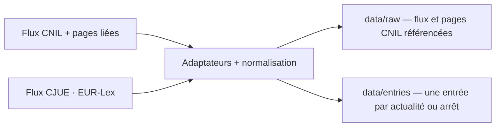

# Data

Le versant données : sources, pipeline et modèles.

## Sources

- CNIL, flux RSS officiel et pages liées pour la section « Textes de référence ».
- CJUE, jurisprudence via le flux public EUR-Lex `rssId=163` ; pas de compte ni de PISTE.
- ANSSI / CERT-FR, flux « actualité » uniquement ; les alertes et avis techniques sont exclus.
- CEPD, flux d'actualités.
- ARCEP, flux « avis et décisions » ; identité portée par la query.
- Commission européenne, flux numérique francophone ; événements et consultations exclus. La page `/fr/` officielle fournit le titre, le résumé et le lien français.
- Commission européenne, flux DMA dédié ; toutes les publications sont retenues, tables rondes et fiches comprises. Le flux n'a pas de version française : les titres restent dans leur langue d'origine.
- ARCOM, flux presse ; les doublons anglais sont écartés et la page article décide du DSA, car le flux n'a pas de description.
- Conseil d'État via l'API Légifrance (fonds CETAT), fenêtre de 90 jours ; le texte intégral de chaque décision nouvelle est lu par `/consult/juri` pour ses articles appliqués.
- Cour de cassation via Judilibre, fenêtre de 30 jours ; le visa de la décision fournit les références, la recherche ne les porte pas.
- Pas de Légifrance JORF, pas de JURI : la veille ne couvre pas la législation française, seulement les actualités et la jurisprudence.

## Pipeline

## Corpus

- Six corpus versionnés, chacun avec un manifeste, un bloc `couverture` et `unites.jsonl` (une ligne par unité : `ref`, `document`, `corpus`, `niveau`, `numero`, `chemin`, `texte`, `date_acte`, `date_debut`, `date_fin`, `statut`, `url`, et `origine`/`nature` pour la CNIL ; la CNIL ajoute `type_sanction`, `montant` et `injonction`). `document` est l'acte ou la décision (CELEX, `CNILTEXT…`, `LEGIARTI…`, `CETATEXT…`, slug CEPD) ; `corpus` la collection (`rgpd`, `aiact`, `cnil`, `lil`, `ce`, `cepd`). Le tableau à jour est `aidd_docs/tasks/2026_11/2026_11_09_mcp-donnees-personnelles/coverage.md` ; les comptes viennent des manifestes, jamais d'une recopie.
- `data/corpus/rgpd/` : CELEX `32016R0679`, 272 unités (99 articles `art_N`, 173 considérants `rct_N`), date d'acte 2016-04-27, début 2018-05-25.
- `data/corpus/aiact/` : CELEX `32024R1689`, 293 unités (113 articles, 180 considérants), date d'acte 2024-06-13, publication 2024-07-12, début 2024-08-01. La capture CELLAR porte 13 chapitres (`cpt_I` à `cpt_XIII`) ; seuls les comptes d'articles et de considérants sont validés.
- `date_debut` suit la sémantique de l'acte : date d'application pour le RGPD (2018-05-25), date d'entrée en vigueur pour l'AI Act (2024-08-01), dont l'application générale est fixée au 2026-08-02.
- Provenance : CELLAR, `https://publications.europa.eu/resource/celex/<celex>`, rendu XHTML en `fra` avec `Accept: application/xhtml+xml` ; réutilisation autorisée par la décision 2011/833/UE (CC BY 4.0). Le parseur `parseCellar(xhtml, descripteur)` lit les comptes attendus dans `mcp/corpus/<corpus>.json` et lève en nommant le document quand ils ne correspondent pas.
- Le snapshot brut du XHTML vit dans `data/raw/` ; le manifeste le nomme par son `sha256`.
- `data/corpus/index/index.db` est dérivé : SQLite + `sqlite-vec` + FTS5, table `unites` (avec `empreinte`), table virtuelle `vec_unites` en cosinus et table virtuelle `fts_unites` (même `rowid`, `chemin` + `texte`). Non commité, mis à jour par `npm run corpus:index`.
- L'index est incrémental : l'empreinte `sha256` du modèle, de la dimension et du passage contextualisé décide du delta. Seules les unités ajoutées ou modifiées sont embarquées ; les unités supprimées perdent leur ligne, leur vecteur et leur ligne FTS ; les unités inchangées gardent des vecteurs identiques octet pour octet. Les `rowid` nouveaux suivent le maximum existant ; changer de modèle ou de dimension, ou trouver un index sans `fts_unites`, force une reconstruction complète.
- Ajouter un corpus, c'est déposer un descripteur `mcp/corpus/<corpus>.json` ; `npm run corpus:build` le construit et `lireUnites` l'indexe sans code par corpus. La colonne `corpus` filtre les résultats ; `document` reste exact.

## Corpus CNIL

- `data/corpus/cnil/` : 3 245 documents et 29 299 fragments, filtrés sur les trois natures `Sanction`, `Avis` et `Recommandation/Lignes directrices` ; comptes `Sanction` 249 / 6 342, `Avis` 2 896 / 21 914, `Recommandation` 100 / 1 043. `niveau` = `fragment`, `ref` = `<doc_id>#f<chunk_index>` pour l'historique DINUM (index publié), `<id>#f<n>` numéroté par nous pour les incréments DILA. Sur les 249 sanctions, `type_sanction` compte 134 amendes, 95 avertissements, 12 liquidations, 6 rappels et 2 interruptions, et 35 décisions prononcent une injonction ; chaque fragment de sanction porte `montant` (sanction pécuniaire en euros, amende ou liquidation, `null` si absent ou masqué ; une seule amende masquée) et `injonction`, extraits du dispositif par `mcp/corpus/cnil/meta.ts`. Les avis et recommandations ne portent aucune métadonnée de sanction. `couverture.exclusions` compte les lignes DINUM écartées par `nature_delib` : 35 167 lignes sur 11 valeurs, dont `(vide)` 298 ; `couverture.lignes_lues` vaut 64 466, soit 29 299 retenues + 35 167 exclues. Une ligne écartée n'entre jamais dans `par_nature`.
- Sources : `https://huggingface.co/datasets/AgentPublic/cnil` (deux parquet, lus avec `hyparquet` 1.32.0 + `hyparquet-compressors` 1.1.3, colonnes `doc_id`, `chunk_index`, `text`, `number`, `date`, `title`, `status`, `nature_delib` ; la colonne `embeddings_bge-m3` n'est jamais lue) et `https://echanges.dila.gouv.fr/OPENDATA/CNIL/` (archives `CNIL_YYYYMMDD-HHMMSS.tar.gz`, 146 au 2026-11-05, XML `TEXTE_CNIL`). Le snapshot DINUM est daté 2026-10-30 (dernière modification Hugging Face), révision `bbc4bf7ef4a0148359f6e3ef38734edb08ac2f06` ; les deux fichiers sont adressés par leur `sha256` dans `manifest.json`.
- Licence : `etalab-2.0` sur Hugging Face, `lov2` sur data.gouv ; l'écart est consigné dans le manifeste, pas résolu. URL de texte `https://www.legifrance.gouv.fr/cnil/id/<id>` déclarée et marquée `url_texte_verifiee: false` (403 aux robots, non vérifiée).
- Découpage : `dinum` conserve le `chunk_index` publié ; `dila` découpe localement les paragraphes en fragments de 600 à 1 200 caractères (un paragraphe plus long reste seul), sans perdre de texte ; le `chemin` porte `Découpage local`.
- `etat.json` porte `derniere_archive`, son `sha256`, la date de lecture et le nombre d'archives lues. `npm run cnil:sync` liste les archives, ne lit que les nouvelles, et n'écrit qu'après validation de tout le corpus. Un document déjà présent n'est remplacé que si l'archive est plus récente que sa `date_acte`.
- Le parquet (334 Mo) reste sous `data/raw/cnil/`, ignoré par git ; seul `data/raw/` des captures CELLAR est commité.

## Corpus LIL

- `data/corpus/lil/` : la loi n° 78-17 dans sa version consolidée, 1 document et 133 articles en vigueur ; 54 articles abrogés sont écartés et 50 sections parcourues. `ref` = `LEGIARTI…`, `niveau` = `article`, `document` = `LEGITEXT000006068624`.
- Source : PISTE — Légifrance `/consult/legiPart` avec `{ textId, date }` ; `npm run lil:sync -- --date AAAA-MM-JJ` lit la version à cette date, laisse un snapshot `legi-part-<date>.json` sous `data/raw/lil/` (non commité) et écrit `data/corpus/lil/`. Le manifeste porte `text_id`, `version`, `date_consultation`, `date_debut_version`, `articles_en_vigueur`, `articles_abroges_ecartes` et `snapshot_sha256`.
- Licence : Licence Ouverte 2.0 (Etalab). Le texte est copié, jamais reformulé ; les balises HTML de `content` sont ramenées à leur texte visible.

## Corpus Conseil d'État

- `data/corpus/ce/` : 1 312 décisions et 17 703 fragments, depuis 2014, sur les données personnelles. Fonds `publie` : 181 décisions / 3 080 fragments ; fonds `inedit` : 1 131 / 14 623 ; 62 doublons d'identifiant entre les deux fonds. `ref` = `<CETATEXT…>#f<n>`, `niveau` = `fragment`, URL `https://www.legifrance.gouv.fr/ceta/id/<id>`. `statut` dit la publication au recueil, jamais la solution seule : « Publié au recueil » ou « Inédit au recueil », suivi de la solution quand elle existe (« Inédit au recueil · Satisfaction partielle »).
- Source : archive globale JADE de la DILA, `https://echanges.dila.gouv.fr/OPENDATA/JADE/`, fichier `Freemium_jade_global_*.tar.gz` (1,32 Go, 8 novembre 2026). `npm run ce:sync` la télécharge sous `data/raw/ce/` (non commité), la lit en flux (`Readable.fromWeb` → `createGunzip` → tar incrémental) et écrit `data/corpus/ce/`. Les deux fonds `jade/global/publie` et `jade/global/inedit` sont lus.
- Filtres déclarés : `JURIDICTION` normalisée exactement « Conseil d'État » (les cours administratives d'appel et tribunaux administratifs sont écartés et comptés), `DATE_DEC >= 2014-01-01`, au moins un mot-clé du descripteur. Exclusions : autre juridiction 399 198, avant 2014 138 074, sans mot-clé 34 878, texte vide 1, date invalide 0. Le manifeste porte `couverture.fonds`, `couverture.exclusions` et `ecartes`.
- Licence : Licence Ouverte 2.0 (Etalab). `etat.json` porte l'archive, son `sha256`, la date de lecture et une empreinte du filtre ; une même archive et un même filtre ne sont pas relus.

## Corpus CEPD

- `data/corpus/cepd/` : 36 lignes directrices et 5 443 fragments, période 2018-04-11 → 2025-06-05. `ref` = `<slug>#f<n>`, `niveau` = `fragment`, `chemin` = `CEPD > Lignes directrices > <titre>`, URL de la page française du document.
- Source : sitemap du CEPD (`https://www.edpb.europa.eu/sitemap.xml`, pages `?page=1` à `?page=5`), filtre `/documents/guideline/..._fr` (42 URL), puis page de document et PDF. Le PDF `_fr.pdf` courant est préféré ; les PDF de consultation sont écartés. Le Wayback Machine ne sert que de repli si le sitemap est injoignable. `npm run cepd:sync -- --dry-run|--limite <n>|--depuis <date>` écrit les PDF sous `data/raw/cepd/` (non commité) et le corpus après extraction `unpdf`.
- Qualité : un PDF sans texte, de moins de 2 000 caractères ou dont la part de lettres est inférieure à 50 % est refusé en nommant son URL. Les 36 PDF retenus sont français (`fr: 36`, `en: 0`, `autre: 0`). 6 URL `_fr` sont écartées faute de PDF : 5 pages WP29 sans PDF et le doublon court `transparency_fr`, la même ligne étant retenue sous son URL longue. Le manifeste porte `couverture.via: "sitemap"`, `sitemap_pages`, `langues_pdf`, `documents_sans_texte_ecartes`, `versions_ecartees` et `documents_ecartes` (`{url, slug, raison}` pour chaque URL écartée). `types_retenus` vaut `["guideline"]` : les recommandations sont un incrément ultérieur, hors de ce corpus.
- Licence : à vérifier ; le site CEPD ne déclare pas de licence explicite. Les documents sont des publications officielles de l'Union européenne.

## Summaries

- Chaque entrée porte un résumé extrait de la description de la source, nettoyé puis tronqué à 200 caractères ellipse comprise (`veille/summary.ts`) ; `null` quand la description manque.
- Nettoyage : entités décodées deux fois, balises retirées, espaces normalisés. La source n'est jamais réécrite.
- À l'affichage, un résumé qui répète une suite de 40 caractères ou plus du titre est masqué (`isRedundantSummary`) ; l'entrée reste affichée.

## References

- Chaque entrée porte `officialTitle`, le titre officiel complet, source du filtre et des références CJUE ; le `title` est le titre d'affichage.
- Chaque entrée porte `references: string[]`, les instruments et articles cités : titre officiel pour les arrêts CJUE, section « Textes de référence » de la page liée pour les actualités CNIL, texte intégral de la décision pour le Conseil d'État et visa de la décision pour la Cour de cassation.
- Le visa Judilibre est lu par décision (`/decision`), après le rattachement, un appel par entrée nouvelle ; il remplace l'extraction depuis le titre et le résumé. La matière de la requête est conservée sur chaque résultat : une décision trouvée par une matière survit au rattachement même si son résumé la tait. L'extraction reconnaît la LIL, le CPCE, ePrivacy, le Code de la consommation et les actes européens génériques (RGPD, AI Act, DSA, DMA, DORA, NIS2, CRA, Data Act). Seuls les instruments des matières rattachées sont retenus : un code du travail ou un code de justice administrative cité au visa n'apparaît pas. Un visa vide laisse `[]` ; un visa non lu diffère l'entrée, relue à la passe suivante. Une décision dont le visa ne rend aucune référence est conservée mais masquée au site.
- Le Conseil d'État n'a pas de visa structuré : `visas` est vide, même sur une décision publiée au Recueil. Ses articles se lisent dans le texte intégral par `/consult/juri`, après le rattachement, un appel par décision nouvelle. Seuls les motifs (après « Considérant ce qui suit ») sont lus : les visas et les moyens des parties, où une formule peut n'être qu'un grief, sont écartés. Dans les motifs, seules les formules d'application (« aux termes », « il résulte des dispositions (combinées) », « en vertu », « en application », « sur le fondement »), les phrases de considérant (« L'article 15 du RGPD garantit ») et leur anaphore (« du même règlement/loi/code/directive », qui ouvre la phrase) déclenchent la lecture ; une formule directement introduite par un grief est ignorée — les verbes `soutient`, `reproche`, `conteste`, `se plaint` et leurs pluriels, « est soutenu que », « selon <partie> » (requérant, requérante, société, partie, ministre, administration, CNIL, défendeur, demandeur, lui, elle, eux, elles), « moyen/grief tiré de ce que » —, « Selon la Cour de justice » restant une formule appliquée, « il résulte de l'instruction » ne déclenche rien, et « les dispositions de l'article » ne déclenche rien hors formule. Sans le repère « Considérant ce qui suit », rien n'est extrait. L'ordre des pastilles suit la première rencontre dans les motifs ; il n'est pas contractuel. La LIL et la directive ePrivacy sont nommées par leur date, ramenées à leur libellé canonique (la directive du 12 juillet 2002 devient 2002/58/CE). Couverture réelle des neuf décisions collectées : cinq portent des articles (501268, 509210, 509589, 511155, 513996), 520279 perd `Règlement (UE) 2016/679 · art. 5`, qui venait d'un grief.
- L'extraction est déterministe (`veille/references.ts`) ; elle ne réécrit pas la source. Un instrument sans article est ignoré, comme pour la CJUE.
- Une page CNIL inaccessible laisse l'entrée publiée avec `references: []` et un avertissement ; la passe ne bloque pas.
- Le catalogue de matières (`veille/themes.json`) porte les instruments, les termes de rattachement et, pour la jurisprudence, les requêtes PISTE ; `Entry.themes` stocke le résultat à l'ingestion.
- Le site filtre au build sur les matières actives : désactiver une matière masque sans supprimer ; le snapshot brut reste la preuve.

## Matières

- `veille/themes.json` : cinq matières — données personnelles, IA, cybersécurité, données non personnelles, plateformes — avec instruments, termes, requêtes, sources et état.
- Défauts de source : CNIL et CEPD → données personnelles ; ANSSI → cybersécurité ; Commission DMA → plateformes. ARCEP, Commission, ARCOM et CJUE ne publient que ce qui correspond à un instrument ou un terme.
- Les sources API ne pré-remplissent pas la matière, sauf Judilibre qui conserve la matière de sa requête comme indice ; le rattachement central complète. Judilibre cherche la phrase exacte (guillemets, opérateur `and`, champ texte), prend l'extrait officiel comme résumé, puis lit le visa de chaque décision retenue.
- L'URL d'une référence se déduit de son instrument au build (`src/lib/references.ts`) : Légifrance pour la LIL, le CPCE et le Code de la consommation, EUR-Lex par CELEX pour le RGPD, les directives et les règlements. Aucun appel réseau ; un instrument inconnu reste un texte.
- Une matière peut porter plusieurs `queries` : Plateformes interroge 2022/2065 et 2022/1925 ; les autres matières gardent leur premier terme.
- Fenêtres de collecte : CETAT 90 jours, Judilibre 30 jours ; les autres sources suivent leur flux.
- `data/usage/<date>.json` journalise les appels PISTE ; le plafond est de 16 appels par passe. Une passe fusionne ses appels avec ceux du même jour déjà journalisés, puis vide son journal mémoire : un fichier absent ou illisible repart de zéro sans faire échouer la passe. Une passe à cinq matières consomme 13 appels de recherche et de jeton : six recherches CETAT, un jeton, six recherches Judilibre. Les trois appels restants se partagent entre les lectures de décisions ; le Conseil d'État passe avant la Cour de cassation, réserve six appels aux recherches Judilibre et diffère sa lecture dès que le plancher est atteint. Une passe à froid peut donc ne lire que deux textes CETAT et une décision Judilibre ; le reste est relu aux passes suivantes, avec un avertissement.
- Les pages d'enrichissement (ARCOM, Commission) ne sont pas snapshotées : elles servent de filtre, de résumé ou de version française ; le flux brut reste la preuve conservée.

## Models

- Le pipeline de veille est déterministe : aucun modèle, aucune inférence.
- Le MCP local embarque uniquement à l'indexation et à la requête : `qwen3-embedding:0.6b` (Q8_0, 1024 dimensions), servi par Ollama sur `127.0.0.1:11434`, jamais un service cloud. Les vecteurs sont normalisés dans le code ; la similarité vaut `1 - distance`. L'instruction de requête dépend du document (celle du RGPD reste celle de la v1, l'AI Act a la sienne) ; les passages indexés n'en portent jamais. Les seuils (`bas 0,69`, `haut 0,74`, `marge 0,01`) sont calibrés sur les 35 questions `dev` du jeu v1, jamais sur les 15 `test` ; la bande article (`0,02`) est mesurée sur `dev` et retenue pour rester minimale (`aidd_docs/tasks/2026_11/2026_11_04_qualite-mcp/eval.md`). Le jeu v2 de 60 questions calibre `0,680 / 0,730 / 0,010` sur `dev` en voie dense, mais ces valeurs ne sont pas écrites dans le produit : l'hybride, qui aurait exigé une recalibration, n'est pas retenu (`aidd_docs/tasks/2026_11/2026_11_05_qualite-v2-aiact/eval-v2.md`). L'expérience `qwen3-embedding:4b` (2560 dimensions), mesurée alors à 5 min 40 s pour 565 unités contre 49 s (6,9×), est documentée hors produit : sur les 30 questions `dev` v2, il répare `art_56` au rang 1, fait reculer `art_35` du rang 1 au rang 3, garde le même top 1 (15/19) et augmente `incertain` (4 contre 2). Le jeu v3 de 80 questions a tranché la question sur un split `test` tenu à l'écart : seuils de l'évaluation calibrés sur `dev` à `0,640 / 0,690 / 0,010` pour `0.6b` et `0,720 / 0,770 / 0,010` pour `4b`, tandis que le produit tourne toujours avec `0,69 / 0,74 / 0,01`, donc les chiffres v3 ne sont pas ceux du produit (recalculé avec les seuils produit, le top 5 rendu de `0.6b` tombe à 28/34). Sur les 34 questions sémantiques du `test`, `0.6b` rend la référence au top 5 pour 29 questions sur 34 (30 brutes) et `4b` pour 31 (31 brutes), et au rang 1 rendu pour 25 contre 25 (26 contre 25 bruts). Les paires discordantes rendues valent `b = 2`, `c = 2`, `b + c = 4` (`b = 2`, `c = 3`, `b + c = 5` au brut), sous le plancher de six : le verdict est **non établi** et `0.6b` reste le modèle du produit. L'index `4b` a coûté 754,48 s contre 48,74 s pour `0.6b` (15,5×) dans la mesure v3, mais une mesure v2 du même index donnait 340 s contre 49 s (6,9×) : l'écart de 2,2× entre les deux mesures rend le coût imprécis. Une passe `dev` de 40 questions a coûté 15,88 s contre 1,88 s. Le détail daté est dans `aidd_docs/tasks/2026_11/2026_11_05_mesure-v3-modeles/eval-v3.md` ; le marqueur `mcp/eval/questions-v3.test-consomme.json` porte une entrée par modèle.

## Évaluations dev

- Mesures du 2026-11-09, hors split `test` : RGPD v2 18/19 sémantique au top 5 (MRR 0,860) ; AI Act 2/3 (0,278) ; CNIL v2 14/25 (0,406) ; **CNIL doctrine 3/10 (MRR 0,225, top 1 20,0 %, 8 confiant dont 3 corrects et 5 faux ; 2 incertain faux)** ; **LIL 10/10 (MRR 0,750)** ; Conseil d'État 8/12 (0,486) ; CEPD 10/10 (1,000).
- Le harnais mesure un corpus, pas le filtre `nature` : le 3/10 de CNIL doctrine est corpus-level et ne prouve rien sur `search.nature`.
- Le `test` CNIL v2 à 16/25 date du 2026-11-06 et du corpus de sanctions seules ; son marqueur est consommé, il n'est pas rejouable et ne décrit pas le corpus élargi. L'évidence courante est le `dev` 14/25.

## Reproducibility

- Git : chaque snapshot brut est adressé par son `sha256`, chaque entrée par un `id` stable.
- Les entrées ne changent pas quand le contenu est inchangé ; une page CNIL modifiée peut changer `references`.
- Une page CNIL dont les références sont retenues est conservée en `.html` à sa première extraction ou quand ses références changent ; les autres pages ne sont pas archivées.
- Une page dont les références extraites n'ont pas changé ne réécrit pas de snapshot : les jetons volatils de la page (Drupal) ne créent pas de nouveau fichier à chaque passe.
- Le snapshot brut CJUE peut varier avec l'horodatage et l'ordre des items du flux : chaque passe ajoute alors un fichier `data/raw/` (~96 Ko), sans changer `data/entries/`.
- Aucune donnée personnelle : uniquement des textes publics.
- Un flux CJUE en panne laisse les entrées CNIL en place ; une page CNIL en panne laisse l'entrée avec `references: []` et un avertissement.
